<p align="center">
  <picture>
    <source media="(prefers-color-scheme: dark)" srcset="docs/assets/brand/transparent/speclink-logo-horizontal-dark.png" />
    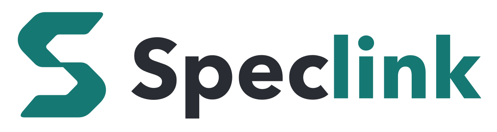
  </picture>
</p>

<p align="center">
  <b>Every AI-built change, checked against its spec</b>
</p>

<p align="center">
  <a href="https://github.com/MomoChenisMe/speclink/actions/workflows/ci.yml"></a>
  <a href="https://github.com/MomoChenisMe/speclink/releases/latest"></a>
  <a href="https://www.npmjs.com/package/@speclink/cli"></a>
  <a href="LICENSE"></a>
</p>

<p align="center">
  <a href="README.zh-TW.md">繁體中文</a> · <b>English</b>
</p>

Speclink is a Spec-Driven Development (SDD) engine written in Rust. It makes AI-built changes checkable. Each change starts with a small spec that says what the change must do. Then an AI agent builds it. Before archive, two quality stations, review and verify, check the work and record the evidence. The specs are plain text in your repo.

Speclink has two paths. One person needs only a local project. A team that wants shared specs uses a remote project.

- **Local project**: Specs live in the `speclink/` folder of your repo. Git handles collaboration. No Server is necessary.
- **Remote project**: One Server holds the specs, and the checkout has no spec files. The Server can be [a system that embeds the engine](#embedding) (your own backend) or [the official demonstration server](#official-server). The CLI and the desktop app work the same way with both. At this team layer, PMs and POs take part in discussions and proposals, and they share one set of terms with engineers and AI agents: change, artifact, task, verify, and archive.

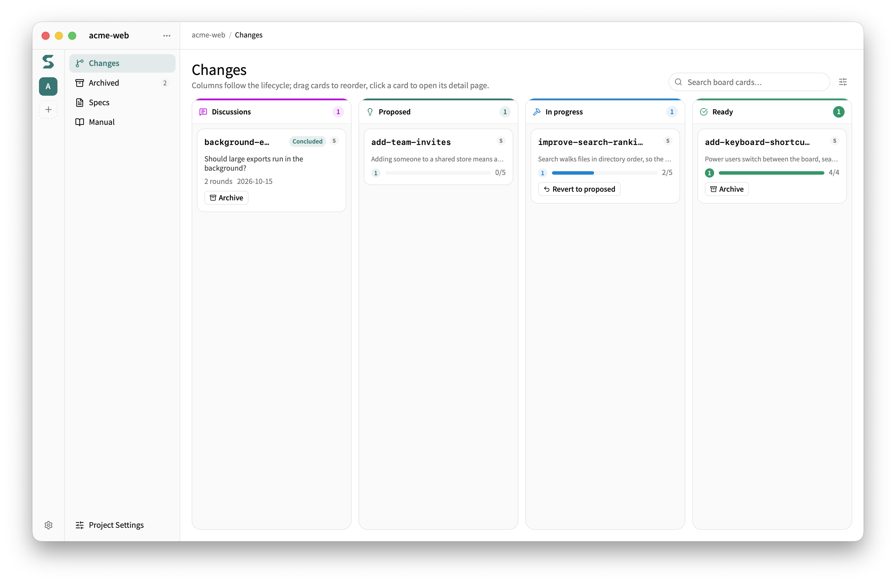

## <a id="why"></a>Why Speclink

- **The specs live next to your code.** They are plain Markdown and YAML files in your repo. You can read them without Speclink, and every edit shows in the Git diff.
- **Your AI agent knows each step.** Speclink writes skills for Claude Code, Codex, GitHub Copilot, pi, and Cursor. Each skill tells the agent what to read, what to write, and when to stop and ask you.
- **You check the work before it lands.** Two optional quality stations run before archive: `review` checks the code craft, and `verify` checks the delivery against the specs.
- **One workflow from one person to a team.** Start in one repo with a local project. When the team wants shared specs, change to a remote project. The workflow and the terms stay the same.

## <a id="quick-start"></a>Quick start

1. Install the CLI:

   ```bash
   npm i -g @speclink/cli
   ```

   For Homebrew, the install script, and the desktop app, see [Install](#install).

2. Initialize the repo where you want to use Speclink:

   ```bash
   speclink init --tools claude,codex
   ```

   `--tools` lists the agent tools that you use: `claude`, `codex`, `copilot`, `pi`, and `cursor`, in any comma-separated combination.

3. Ask your agent to start a change. In Claude Code, GitHub Copilot, or Cursor, enter `/speclink-propose <change-name>`. In Codex, enter `$speclink-propose <change-name>`. In pi, enter `/skill:speclink-propose <change-name>`. The agent writes the proposal, the specs, and the task list.

For the full first round (propose, apply, check, archive), see [Getting started](docs/getting-started.md). To use a remote project, see [Remote getting started](docs/remote-getting-started.md).

## <a id="screenshots"></a>Screenshots

<table>
  <tr>
    <td width="50%">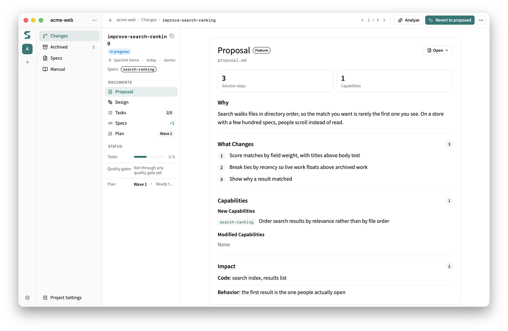<br /><sub>A change: its documents, tasks, and quality stations</sub></td>
    <td width="50%">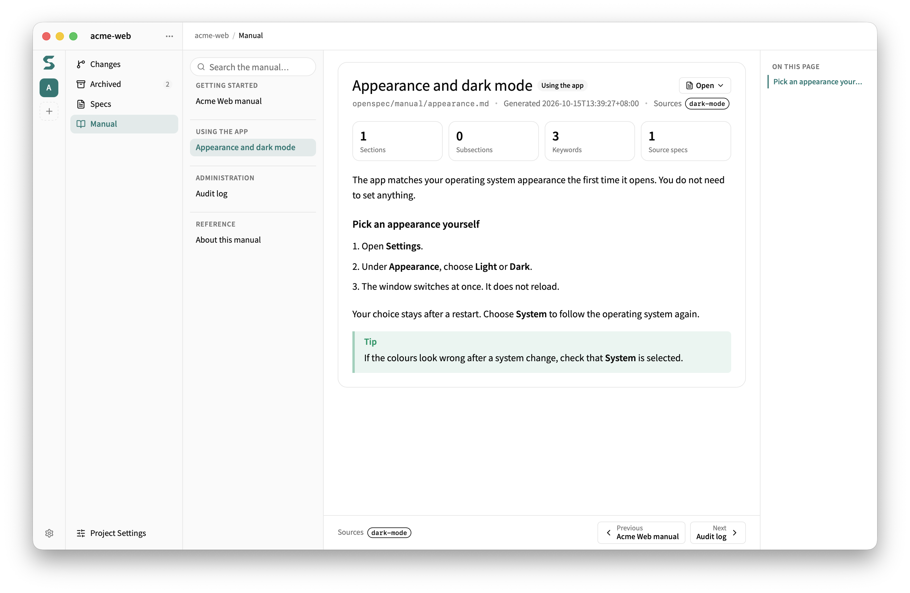<br /><sub>A manual that Speclink generates from the specs</sub></td>
  </tr>
  <tr>
    <td width="50%">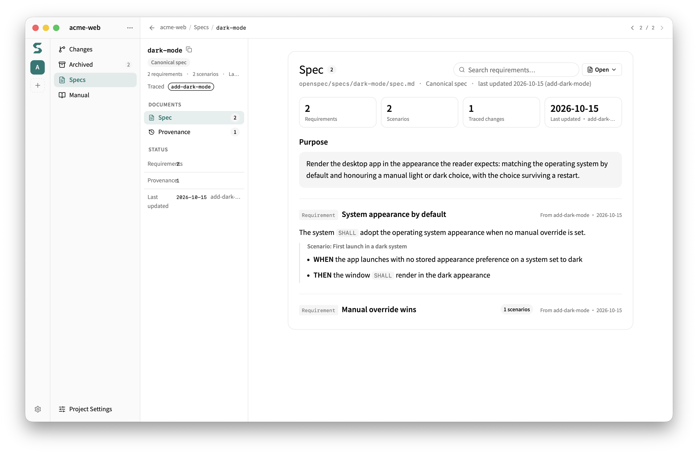<br /><sub>A spec with its requirements and scenarios</sub></td>
    <td width="50%">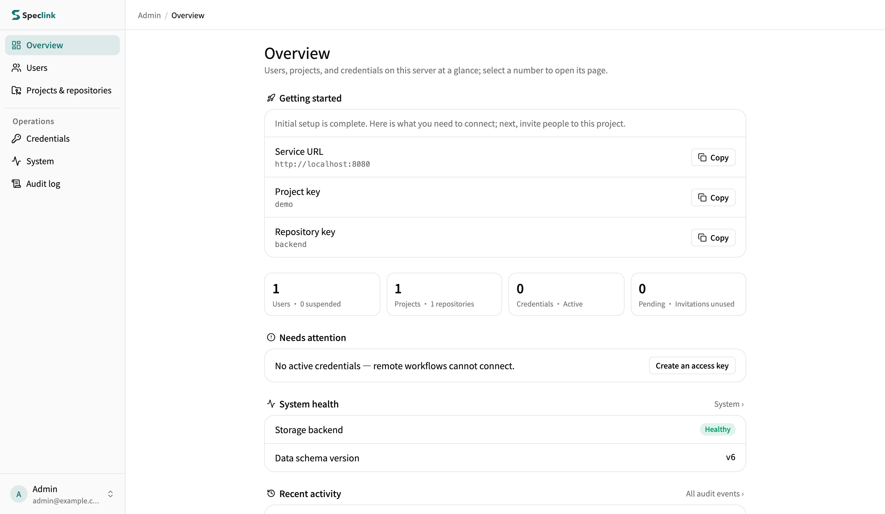<br /><sub>The console of the demonstration server</sub></td>
  </tr>
  <tr>
    <td width="50%" align="center">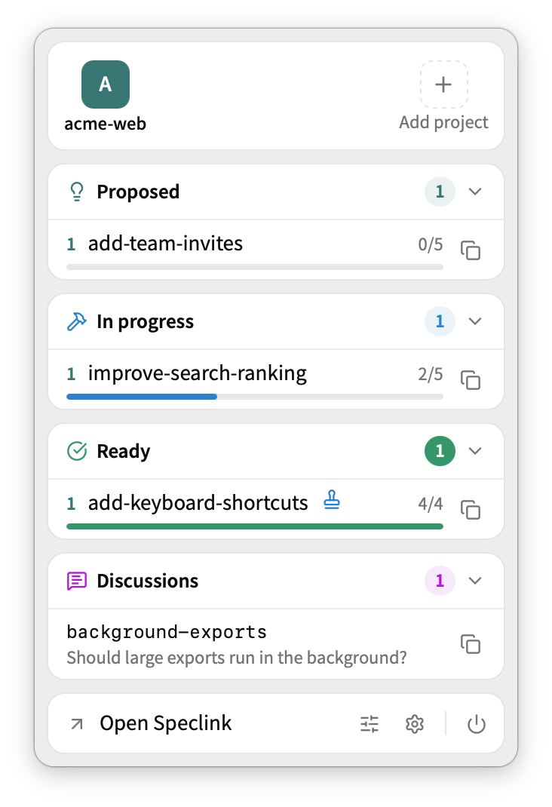<br /><sub>The tray panel in the macOS menu bar</sub></td>
    <td width="50%">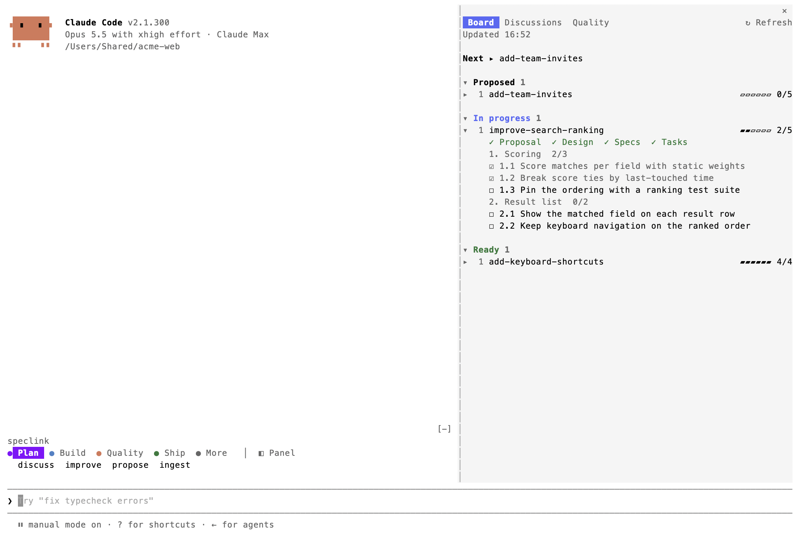<br /><sub>The Claude Code plugin: skill bar and side panel</sub></td>
  </tr>
</table>

## <a id="features"></a>Features

- **Plain text**: In Local mode, the files live under `speclink/` in your repo: `specs/<capability>/spec.md`, `changes/<name>/`, `changes/archive/`, and `config.yaml`. All content is Markdown and YAML. You can read and edit it without Speclink, and each change shows in the Git diff. Speclink adds only two items: `discussions/` (discussion records) and a `.meta.yaml` file in each change (lifecycle metadata). This applies to Local mode only, not to remote mode: the Server holds the specs of a remote project, and the checkout has no spec files. To import a project that uses OpenSpec, run `speclink init` in the project root. Speclink moves `openspec/` to `speclink/`, and after that the OpenSpec CLI cannot read the project. The import is one-way: you cannot convert the project back.
- **Skills for AI agents**: `speclink init` writes skill files for Claude Code, Codex, GitHub Copilot, pi, and Cursor. Each stage, from discussion to archive, has a `/speclink-*` command (`$speclink-*` in Codex, `/skill:speclink-*` in pi).
- **Desktop board**: Each change is a card. You can see its stage, its task progress, and the spec changes it makes.
- **Quality stations**: `review` checks code craft. `verify` checks that the delivery matches the specs. Both stations are optional.
- **Execution order**: `speclink plan` puts changes into waves from their declared dependencies and shows the next change that is ready to start.
- **Manual and trace**: Speclink generates a readable manual from the specs, and `trace` shows how a capability came to be.
- **Team sharing**: In a remote project, the CLI, the desktop app, and AI agents read and write the same specs on the Server.

## <a id="workflow"></a>How it works

```text
baseline? → discuss?/improve? → propose → apply ⇄ ingest → (quality? | review? ∥ verify?) → archive
                                            ↑
                                    resume after a pause: drift first

worktree: apply-with-worktree ⇄ ingest → (quality? | review? ∥ verify?) → worktree-merge → archive

tools: validate / analyze / audit / commit / config / manual / trace / plan
```

A stage with `?` is optional. Your situation tells you where to start:

| Situation | Entry |
| --- | --- |
| The requirement is clear | `propose` |
| The requirement needs decisions | `discuss` (you bring the topic) or `improve` (the model finds topics) |
| The code has no specs yet | `baseline` |
| The requirement changes during the work | `ingest` |
| You resume a change after a pause | `drift` first |
| You want to move several independent changes at the same time | the worktree flow |

Before archive, two optional quality stations are available: `review` checks craft, and `verify` checks the specs. Choose the stations from the risk. For a low-risk change, you can skip both.

For the purpose, skill, done criteria, and next step of each stage, see the [SDD workflow](docs/workflow.md).

## <a id="install"></a>Install

The desktop app and the CLI are two ways to use the same engine. Pick one:

- To see the board, specs, and discussions, install the desktop app. The installer includes the CLI of the same version.
- To work without a GUI, or in scripts and CI, install only the CLI. It has all the features.

### Desktop app

Download the installer for your platform from [Releases](https://github.com/MomoChenisMe/speclink/releases/latest):

| Platform | Installer |
| --- | --- |
| macOS | `Speclink_<version>_universal.dmg` (one file for Apple Silicon and Intel) |
| Windows | `Speclink_<version>_x64-setup.exe` |
| Linux desktop | `Speclink_<version>_amd64.AppImage` (x86_64) or `Speclink_<version>_aarch64.AppImage` (arm64), no install step |

- The Windows installer has no code signature. On the first run, SmartScreen shows a warning. Click "More info", then "Run anyway".
- On Linux without a GUI (servers, WSL, CI), use the CLI below, not the desktop app.

### CLI

All three methods install the same binary (the source is `@speclink/cli` on npm). Pick one:

```bash
# With Node.js (any platform)
npm i -g @speclink/cli

# macOS or Linux without Node.js (servers, WSL, CI)
curl -fsSL https://raw.githubusercontent.com/MomoChenisMe/speclink/main/scripts/install.sh | sh

# Homebrew (macOS or Linux)
brew install MomoChenisMe/tap/speclink
```

Windows has no install script. With Node.js, use npm. Without Node.js, install the desktop app. Its installer also puts the CLI on your PATH.

Do you want both the CLI and the desktop app? The desktop app can replace your CLI. Read [Install in Getting started](docs/getting-started.md#install) first. That section also lists the install script options and the move to the AppImage for older Linux installs.

### Claude Code plugin (optional)

`speclink-skills` adds a row of speclink skill buttons above the Claude Code input box. It also adds a side panel that lists changes, discussions, and open quality tickets. In Claude Code, enter:

```text
/plugin install speclink-skills --marketplace MomoChenisMe/speclink
```

<table>
  <tr>
    <td width="50%">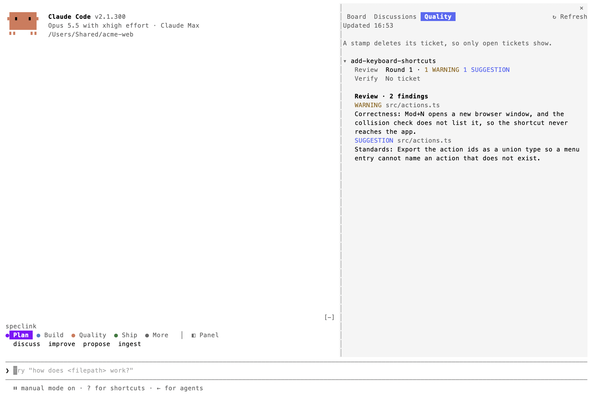<br /><sub>The Quality tab lists the open review and verify tickets</sub></td>
    <td width="50%">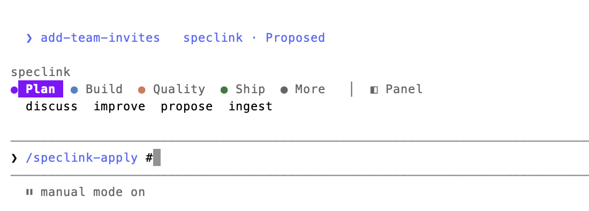<br /><sub>Type <code>#</code> to pick a change name</sub></td>
  </tr>
</table>

For requirements, settings, and known limits, see [speclink-skills](integrations/claude-code/speclink-skills/README.en.md).

### Herdr mod (optional)

`speclink` adds a panel to [Herdr](https://herdr.dev), next to your terminals. The panel lists the changes and discussions of the current project and shows the review and verify stamps. It suggests the next skill, sends the skill to the right agent, and starts new agents. The sidebar shows how many changes each project has in each stage, and it groups the agents by space. The text follows your system language, also on Herdr's own screens such as the settings page and the menus.

Keep Herdr open and run these lines in a clone of this repo:

```bash
cp -R integrations/herdr/mods/speclink integrations/herdr/mods/speclink-new ~/.config/herdr-app/mods/
node scripts/herdr/dock-panel.mjs
```

<table>
  <tr>
    <td width="50%">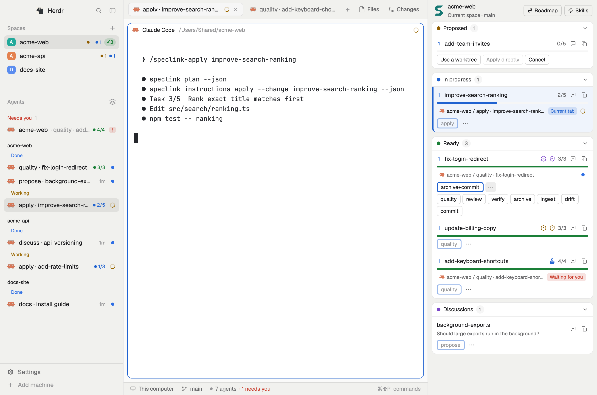<br /><sub>The sidebar and the panel in Herdr</sub></td>
    <td width="50%">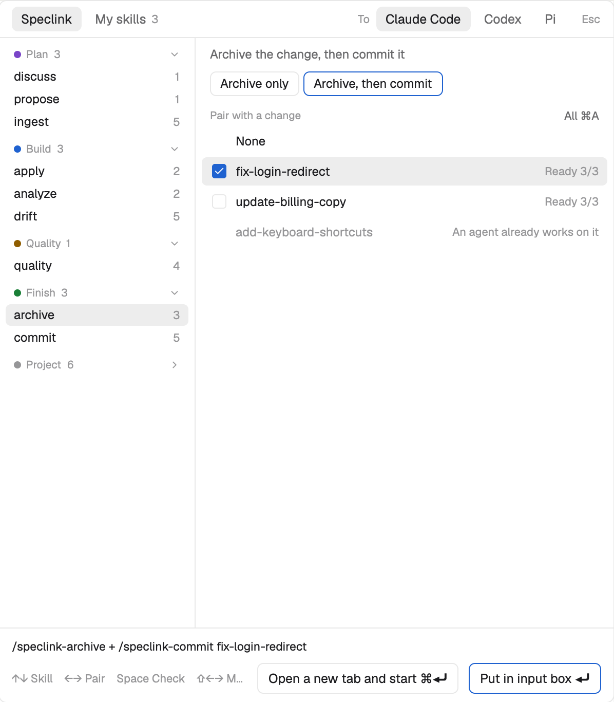<br /><sub>Pick a skill and a change, then put the command in the input box or open a new tab</sub></td>
  </tr>
</table>

For keyboard shortcuts, requirements, and known limits, see [speclink for Herdr](integrations/herdr/README.en.md).

## <a id="embedding"></a>Embed Speclink in your system

Use this path when a team shares specs and you already have a backend with its own accounts, login, permissions, and database. You put the engine in your backend process, and the specs go into your own database. Your system is then the Server of the remote project. The original CLI and desktop app connect to it, and your own AI agent uses the same engine. This section calls your system the host.


Requests come from two places. The CLI and the desktop app of an engineer use HTTP to reach one route of the host. The Agent tool of the host calls directly. Both reach the entry point of the host kit, and then the engine runs the request. The engine reads and writes specs through three functions only (list, read, and commit). The host implements these three functions, and the data stays in the database of the host. Speclink supplies the host kit and the engine. All other parts belong to the host.

The host does four things:

1. **Implement the three store functions and pass the conformance tests.** The functions `list`, `read`, and `commit` do their work in your database. One commit applies all of its writes or none. The conformance tests in the package check your implementation. See [Implement the three store functions](docs/sdk-node.md#store-port) and [Check your implementation with the conformance tests](docs/sdk-node.md#conformance) in the Node SDK.
2. **Mount one route that gives each request to the entry point.** Give all requests below `/api/speclink/v1/` to `host.handleRequest`. Then the CLI and the desktop app can connect. See [Serve the CLI and Speclink Desktop](docs/sdk-node.md#http-entry).
3. **Pass null when you cannot verify an identity.** Your route verifies the token. When it finds an identity, it gives the identity to the entry point. When it does not, it passes `null`. The entry point decides which paths need no login.
4. **For browser login, make your login service publish the standard metadata document and accept a loopback callback.** The login service must publish an RFC 8414 metadata document, accept a callback to `http://127.0.0.1` on any port, and register the Speclink client as a public client with no secret. This item is optional: without it, the client logs in with an access token.

A Node.js backend builds the host kit with `createHost`. For the full description and examples, see the [Node SDK](docs/sdk-node.md). SQLite, PostgreSQL, and the file system each have an implementation that passes the conformance tests. See the [store port examples](docs/server-store-drivers.md).

Speclink does not supply accounts, login, permissions, or database connections: these belong to the host. For the parts that are not done, see the [known gaps](docs/product-status.md#known-gaps) in the product status.

## <a id="official-server"></a>Try the official server

The official server is for demonstration and trial. It lets you try remote projects without writing code. For production use, embed the engine in your own system. See [Embed Speclink in your system](#embedding).

`speclink-server` and an embedded host use the same host kit and the same store contract, so the CLI and the desktop app work with both. Pick one way to run it:

| Method | Command |
| --- | --- |
| npx (needs only Node.js) | `npx @speclink/server` |
| Docker | `docker run -d -p 8080:8080 -v speclink-data:/data ghcr.io/momochenisme/speclink-server:latest` |
| Docker Compose | `cd deploy && docker compose up -d` |

On the first start, the server prints a one-time `/setup` link. A normal restart does not print it again. The default storage is SQLite, and the data goes to `./speclink-data` (`/data` in the container). For environment variables, PostgreSQL, upgrades, and rollbacks, see [Server deployment](docs/server-deployment.md). To connect the desktop app and the CLI, see [Remote getting started](docs/remote-getting-started.md).

## <a id="docs"></a>Documentation

**For one person, start with these three**

| Document | Content |
| --- | --- |
| [Getting started](docs/getting-started.md) | From install to your first archive |
| [SDD workflow](docs/workflow.md) | The purpose, skill, done criteria, and next step of each stage |
| [Configuration](docs/configuration.md) | `.speclink.yaml`, `speclink/config.yaml`, and remote settings |

**Remote projects**

| Document | Content |
| --- | --- |
| [Remote getting started](docs/remote-getting-started.md) | From the start of the demonstration server to a connected desktop app and CLI |
| [Server deployment](docs/server-deployment.md) | npx, Docker, Compose, upgrades, and rollbacks of the demonstration server |
| [Server backup and restore](docs/server-backup.md) | `backup`, `verify-backup`, and `restore` of the demonstration server |

**Embed Speclink in your system**

| Document | Content |
| --- | --- |
| [Node SDK](docs/sdk-node.md) | `@speclink/engine`: `createHost`, the three store functions, the conformance tests, the hooks, and the two entry points |
| [Store port examples](docs/server-store-drivers.md) | The SQLite, PostgreSQL, and file system examples, and how to choose one for the demonstration server |
| [Verb and flag contract](docs/verb-contract.md) | Local and remote verbs, output shapes, and HTTP endpoints |

**Project status and direction**

| Document | Content |
| --- | --- |
| [Product status](docs/product-status.md) | What is available and what is partial, with evidence and limits |
| [Roadmap](docs/roadmap.md) | The work that comes next |
| [Changelog](CHANGELOG.md) | The changes in each version |
| [Brand assets](docs/assets/brand/README.en.md) | Logo, colors, and usage |

`speclink/` holds the specs of Speclink itself. `speclink/changes/archive/` and `speclink/discussions/archive/` are history records, not user guides.

## <a id="status"></a>Project status

- **Available**: the CLI and the desktop app for local projects, agent skills (Claude, Codex, GitHub Copilot, pi, and Cursor), quality stations, execution order, manual and trace, the Node SDK and the host kit (`@speclink/engine`), three store port examples (SQLite, PostgreSQL, file system), the demonstration server and its admin console, the CLI for remote projects, install channels, operations of the demonstration server (deployment, backup, and restore).
- **Partial**: Remote projects in the desktop app, the Claude Code plugin, the Herdr mod.
- **Planned**: MCP, SSO, runtime plugins, multi-node deployment.

For the evidence, limits, and check date of each item, see [Product status](docs/product-status.md). Its [known gaps](docs/product-status.md#known-gaps) list the items that this version delays or does not do. For the work that is not done yet, see the [Roadmap](docs/roadmap.md).

## <a id="contributing"></a>Contributing

Issues and pull requests are welcome, in English or Traditional Chinese.

- Read [CONTRIBUTING.md](CONTRIBUTING.md) for the dev setup, the tests to run, the commit style, and how changes go through Speclink itself.
- Do not report a security problem in a public issue. Follow [SECURITY.md](SECURITY.md) to report it privately.
- For the one-command dev environment (`npm run dev` and four more entry points), the full test commands, and the repo layout, see [Development](docs/development.md).

To build the CLI from source (you need a stable Rust toolchain):

```bash
cargo install --path crates/adapters/speclink-cli
speclink --version
```

## <a id="acknowledgments"></a>Acknowledgments

- [Spectra App 2.3.1](https://github.com/kaochenlong/spectra-app): the Local CLI started with its CLI as the behavior reference. Golden tests and CLI integration tests protect the human output, the `--json` shape, and the core workflow. On top of that base, Speclink adds discussions, a desktop app, a Node SDK, a host kit, and remote projects.
- [OpenSpec](https://github.com/Fission-AI/OpenSpec): Local mode uses the OpenSpec folder layout for specs and changes.

## <a id="license"></a>License

[MIT](LICENSE)
