<p align="center">
  <picture>
    <source media="(prefers-color-scheme: dark)" srcset="docs/assets/brand/transparent/speclink-logo-horizontal-dark.png" />
    
  </picture>
</p>

<p align="center">
  <b>讓 AI 寫的每個變更，都對得上規格、查得到證據</b>
</p>

<p align="center">
  <a href="https://github.com/MomoChenisMe/speclink/actions/workflows/ci.yml"></a>
  <a href="https://github.com/MomoChenisMe/speclink/releases/latest"></a>
  <a href="https://www.npmjs.com/package/@speclink/cli"></a>
  <a href="https://www.npmjs.com/package/@speclink/engine"></a>
  <a href="LICENSE"></a>
</p>

<p align="center">
  <b>繁體中文</b> · <a href="README.md">English</a>
</p>

Speclink 是用 Rust 寫的 Spec-Driven Development（SDD，規格驅動開發）引擎，讓 AI 做的變更可以驗收。每個變更先寫一小份規格，講清楚它要做到什麼；接著交給 AI agent 實作；封存前由審查與驗證兩道品質關卡檢查並留下證據。規格是 repo 裡的純文字。

Speclink 有兩條路徑：一個人用本機專案就夠；團隊要共用規格時用遠端專案。

- **本機專案**：規格放在 repo 的 `speclink/`，用 Git 協作，不需要 Server。
- **遠端專案**：規格由一台 Server 持有，checkout 裡沒有規格檔。Server 可以是[內嵌了引擎的系統](#embedding)（你自己的後端），也可以是[官方的示範用 server](#official-server)；CLI 與桌面 app 對兩者的用法相同。PM、PO 在團隊這一層參與討論與提案，和 RD、AI Agent 用同一套語意協作：change（變更）、artifact（產物）、task（任務）、verify（驗證）與 archive（封存）。

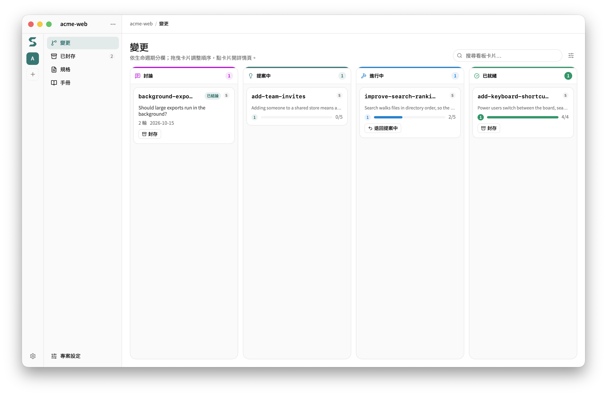

## <a id="why"></a>為什麼用 Speclink

- **規格就放在程式碼旁邊。** 規格是 repo 裡的 Markdown 與 YAML 純文字檔。不裝 Speclink 也讀得懂，每次修改都看得到 Git diff。
- **AI Agent 知道每一步該做什麼。** Speclink 為 Claude Code、Codex、GitHub Copilot、pi 與 Cursor 產生技能。每個技能告訴 Agent 要讀什麼、要寫什麼、什麼時候停下來問你。
- **封存前先檢查。** 封存前有兩道選用的品質關卡：`review` 看程式碼寫得好不好，`verify` 看交付是否符合規格。
- **一個人到整個團隊，同一套流程。** 先在自己的 repo 用本機專案開始。團隊要共用規格時改用遠端專案，流程與用語都不變。

## <a id="quick-start"></a>快速開始

1. 安裝 CLI：

   ```bash
   npm i -g @speclink/cli
   ```

   Homebrew、安裝腳本與桌面 app 見[安裝](#install)。

2. 在要導入 Speclink 的 repo 裡初始化：

   ```bash
   speclink init --tools claude,codex
   ```

   `--tools` 列出你用的 Agent 工具：`claude`、`codex`、`copilot`、`pi`、`cursor`，用逗號任意組合。

3. 請 Agent 開一個變更：在 Claude Code、GitHub Copilot 或 Cursor 輸入 `/speclink-propose <變更名稱>`，在 Codex 輸入 `$speclink-propose <變更名稱>`，在 pi 輸入 `/skill:speclink-propose <變更名稱>`。Agent 會寫出提案、規格與任務清單。

完整的第一輪（提案、實作、檢查、封存）見 [Local Repo 入門](docs/getting-started.zh-TW.md)。要用遠端專案，見 [Remote 入門](docs/remote-getting-started.zh-TW.md)。

## <a id="screenshots"></a>畫面一覽

<table>
  <tr>
    <td width="50%">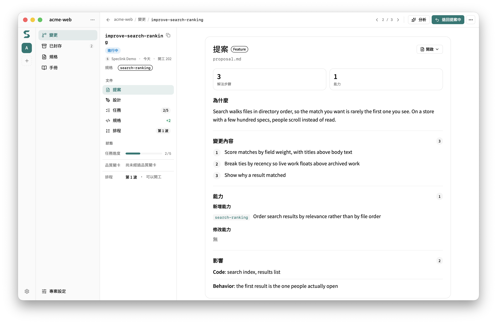<br /><sub>一個變更的文件、任務與品質關卡</sub></td>
    <td width="50%">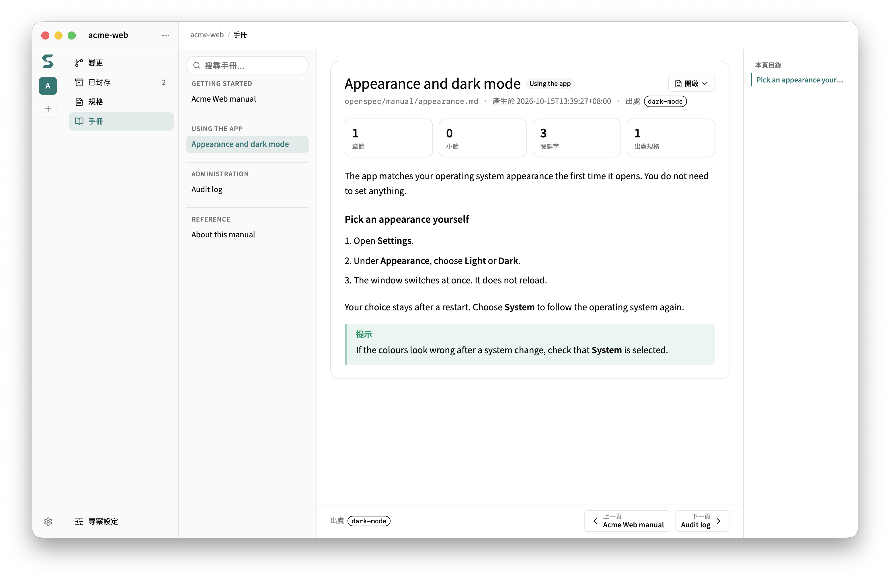<br /><sub>由正式規格產生的手冊</sub></td>
  </tr>
  <tr>
    <td width="50%">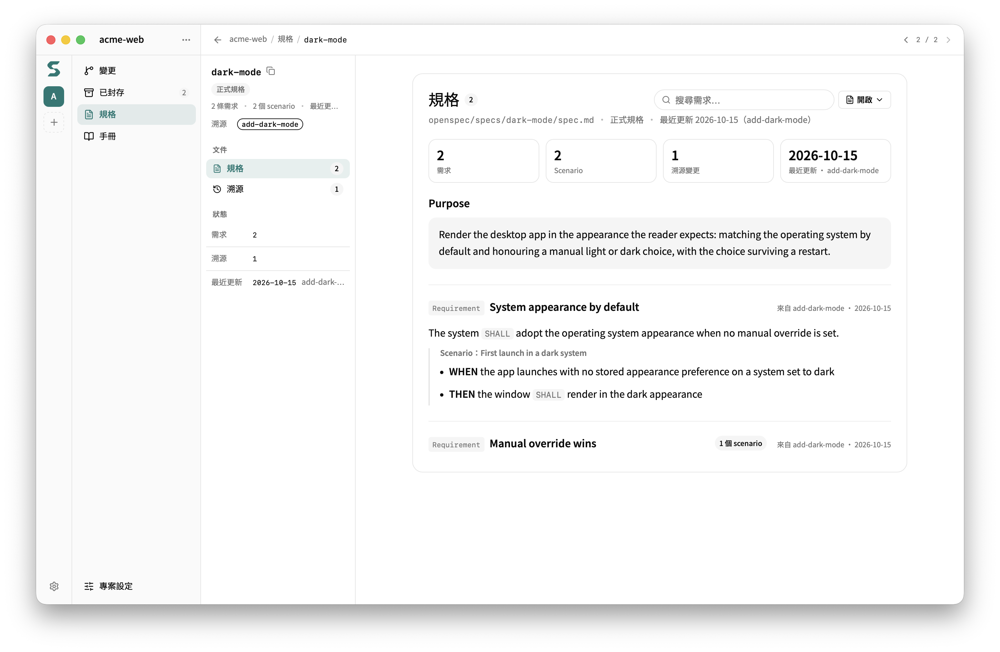<br /><sub>一份正式規格的需求與情境</sub></td>
    <td width="50%">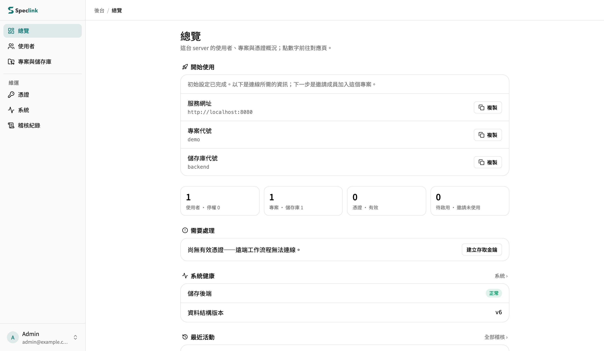<br /><sub>示範用 server 的後台</sub></td>
  </tr>
  <tr>
    <td width="50%" align="center">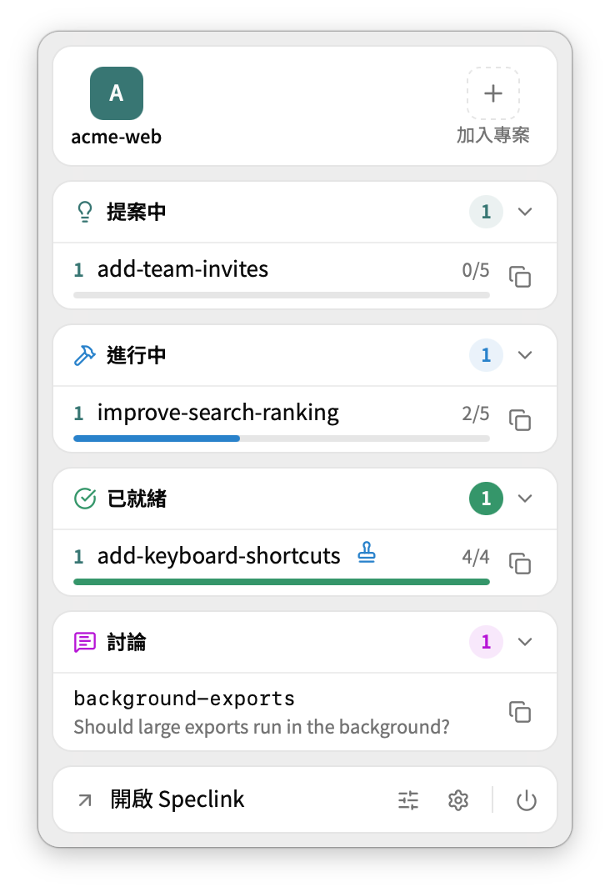<br /><sub>macOS 選單列的系統匣面板</sub></td>
    <td width="50%">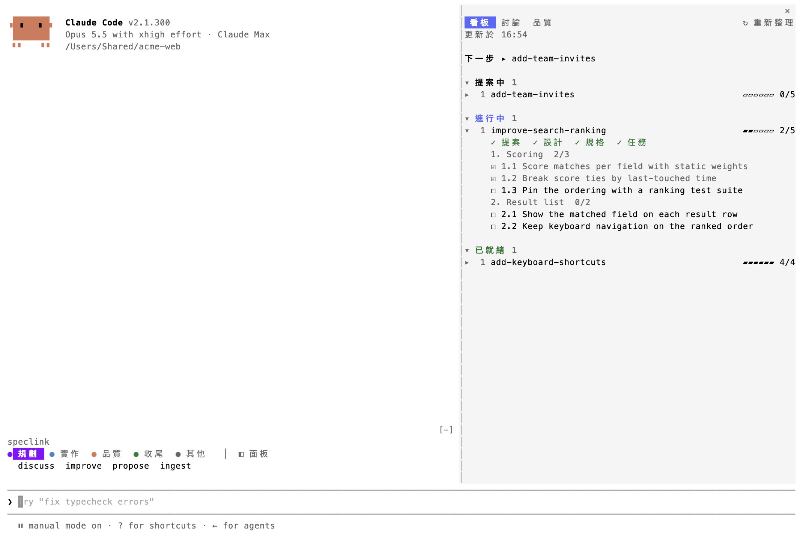<br /><sub>Claude Code 外掛的技能列與側邊面板</sub></td>
  </tr>
</table>

## <a id="features"></a>特色

- **純文字**：Local 模式的產物放在 repo 的 `speclink/` 底下：`specs/<capability>/spec.md`、`changes/<名稱>/`、`changes/archive/` 與 `config.yaml`。內容全是 Markdown 與 YAML，不裝 Speclink 也讀得懂、改得動，每次變動都看得到 Git diff。Speclink 只多放兩樣東西：`discussions/`（討論記錄）與每個變更的 `.meta.yaml`（生命週期資料）。這一點只適用本機專案（Local 模式），不適用遠端專案：遠端專案的正式規格由 Server 持有，checkout 裡沒有規格檔。已經在用 OpenSpec 的專案，在專案根執行 `speclink init` 就能匯入：`openspec/` 會搬到 `speclink/`，之後 OpenSpec CLI 就讀不到這個專案，所以這是單向的匯入，不能再轉回去。
- **給 AI Agent 的技能**：`speclink init` 為 Claude Code、Codex、GitHub Copilot、pi 與 Cursor 產生技能檔。從討論、提案、實作、品質關卡到封存，每一站都有對應的 `/speclink-*` 指令（Codex 寫成 `$speclink-*`，pi 寫成 `/skill:speclink-*`）。
- **桌面看板**：每個變更是一張卡片。你看得到它在哪一站、任務做到哪裡、規格改了什麼。
- **品質關卡**：`review` 看程式碼寫得好不好，`verify` 看交付是否符合規格。兩道都是選用的。
- **執行順序**：`speclink plan` 依宣告的依賴把變更分成一波一波，並指出下一個可以開工的變更。
- **手冊與溯源**：Speclink 能從正式規格產生好讀的手冊，`trace` 指令列出一項能力是怎麼一步步形成的。
- **團隊共用**：用遠端專案時，CLI、桌面 app 與 Agent 讀寫 Server 上的同一份正式規格。

## <a id="workflow"></a>工作流程

```text
baseline? → discuss?/improve? → propose → apply ⇄ ingest → (quality? | review? ∥ verify?) → archive
                                            ↑
                                    閒置後續作：先 drift

worktree：apply-with-worktree ⇄ ingest → (quality? | review? ∥ verify?) → worktree-merge → archive

工具：validate / analyze / audit / commit / config / manual / trace / plan
```

帶 `?` 的站是選用的。從哪一站開始，看你手上的情況：

| 情況 | 入口 |
| --- | --- |
| 需求已經清楚 | `propose` |
| 需求還要收斂 | `discuss`（你帶題目）或 `improve`（請模型幫你找題目） |
| 既有程式還沒有規格 | `baseline` |
| 實作途中需求改變 | `ingest` |
| 變更閒置一陣子才繼續 | 先 `drift` |
| 想同時推多個互不衝突的變更 | worktree 流程 |

封存前有兩道選用的品質關卡：`review` 看工藝，`verify` 看是否符合規格。依風險決定要跑哪幾道；低風險的變更兩道都跳過也可以。

每一站的用途、技能、完成判準與下一站見[完整 SDD 工作流](docs/workflow.zh-TW.md)。

## <a id="install"></a>安裝

桌面 app 與 CLI 是同一套引擎的兩種用法，擇一即可：

- 想看看板、規格與討論：裝桌面 app。安裝檔內含同版 CLI。
- 不需要圖形介面，或要用在腳本與 CI：只裝 CLI。功能一樣完整。

### 桌面 app

到 [Releases](https://github.com/MomoChenisMe/speclink/releases/latest) 下載你的平台的安裝檔：

| 平台 | 安裝檔 |
| --- | --- |
| macOS | `Speclink_<版本>_universal.dmg`（Apple Silicon 與 Intel 同一檔） |
| Windows | `Speclink_<版本>_x64-setup.exe` |
| Linux 桌面 | `Speclink_<版本>_amd64.AppImage`（x86_64）或 `Speclink_<版本>_aarch64.AppImage`（arm64），免安裝 |

- Windows 安裝檔沒有程式碼簽章。第一次執行時 SmartScreen 會跳出警告，點「其他資訊」→「仍要執行」。
- 沒有圖形介面的 Linux（伺服器、WSL、CI）不裝桌面 app，改用下面的 CLI。

### CLI

三種方式裝到的是同一份執行檔（來源是 npm 上的 `@speclink/cli`），擇一即可：

```bash
# 有 Node.js（任何平台）
npm i -g @speclink/cli

# 沒有 Node.js 的 macOS／Linux（伺服器、WSL、CI）
curl -fsSL https://raw.githubusercontent.com/MomoChenisMe/speclink/main/scripts/install.sh | sh

# Homebrew（macOS／Linux）
brew install MomoChenisMe/tap/speclink
```

Windows 沒有安裝腳本：有 Node.js 就用 npm，沒有就裝桌面 app（安裝器會一併設好 CLI 的 PATH）。

CLI 與桌面 app 都想裝？桌面 app 可能換掉你的 CLI，先看 [Local Repo 入門的安裝一節](docs/getting-started.zh-TW.md#install)。那一節也列出安裝腳本的選項，以及舊版 Linux 套件換成 AppImage 的方式。

### Claude Code 外掛（選用）

`speclink-skills` 在 Claude Code 的輸入框上方加一排可以點的 speclink 技能按鈕，另有一個側邊面板列出變更、討論與未結的品質工單。在 Claude Code 裡輸入：

```text
/plugin install speclink-skills --marketplace MomoChenisMe/speclink
```

<table>
  <tr>
    <td width="50%">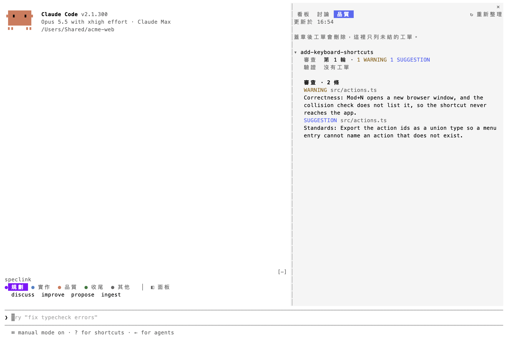<br /><sub>品質分頁列出未結的審查與驗證工單</sub></td>
    <td width="50%">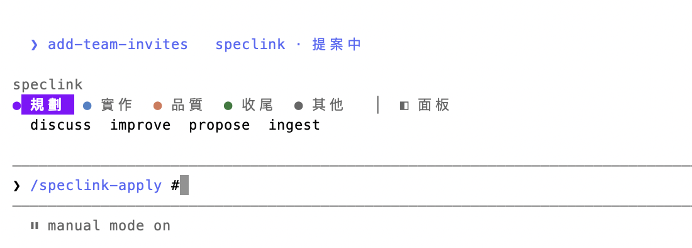<br /><sub>打 <code>#</code> 選變更名稱</sub></td>
  </tr>
</table>

需求、設定與已知限制見 [speclink-skills](integrations/claude-code/speclink-skills/README.md)。

### Herdr mod（選用）

`speclink` 在 [Herdr](https://herdr.dev) 的終端機旁邊加一個面板，列出目前專案的變更與討論，並顯示 review 和 verify 的章。它會建議下一步，把技能交給對的 agent，也可以開新的 agent。左邊側欄會顯示每個專案在各階段有幾個變更，並依 space 整理 agent。介面文字跟隨系統語言，Herdr 內建的設定頁和選單也一樣。

讓 Herdr 開著，在這個 repo 的 clone 裡執行：

```bash
cp -R integrations/herdr/mods/speclink integrations/herdr/mods/speclink-new ~/.config/herdr-app/mods/
node scripts/herdr/dock-panel.mjs
```

<table>
  <tr>
    <td width="50%">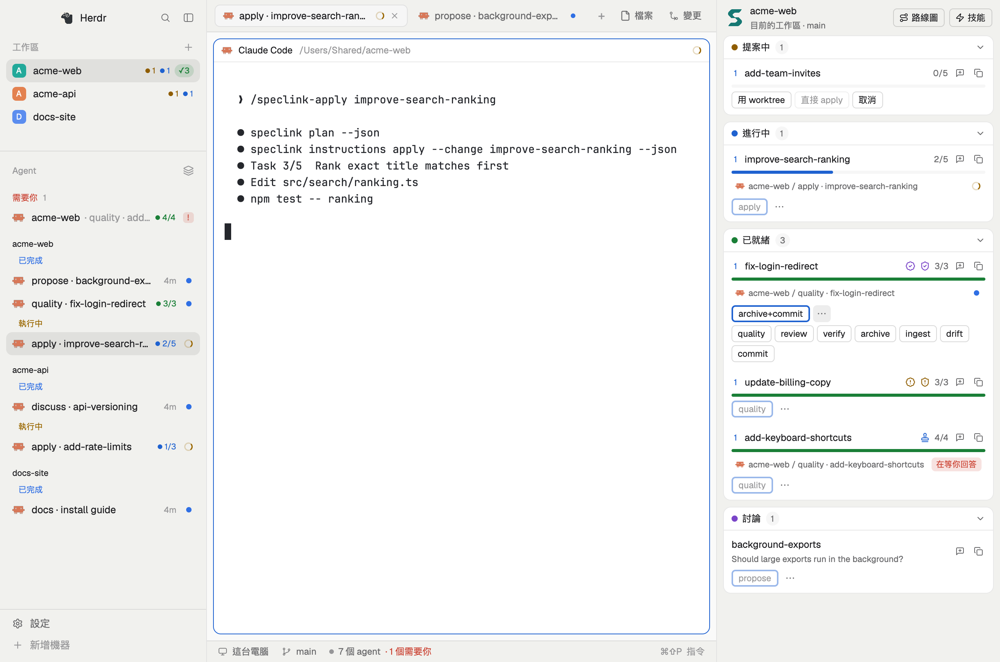<br /><sub>Herdr 裡的側欄與面板</sub></td>
    <td width="50%">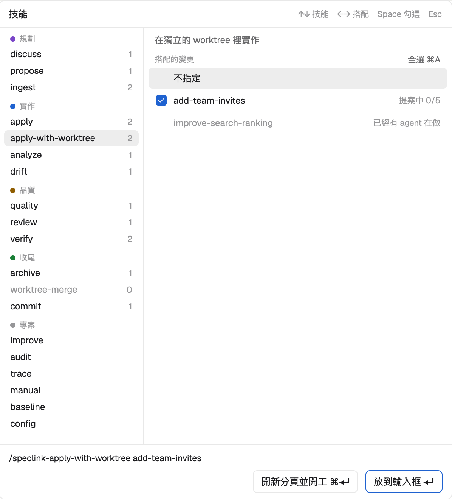<br /><sub>選技能和變更，放到輸入框或開新分頁</sub></td>
  </tr>
</table>

快捷鍵、需求與已知限制見 [Speclink 的 Herdr mod](integrations/herdr/README.md)。

## <a id="embedding"></a>把 Speclink 內嵌進你的系統

團隊要共用規格，而且你已經有自己的後端（帳號、登入、權限與資料庫）時，走這條路：把引擎放進你的後端程序，規格存進你自己的資料庫。你的系統就是遠端專案的 Server。原版的 CLI 與桌面 app 直接連上它，你自己的 AI Agent 也用同一個引擎。這裡把你的系統叫做「宿主」。

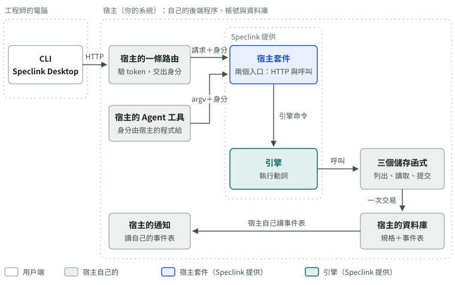

請求從兩個地方來：工程師的 CLI 與桌面 app 經 HTTP 到宿主的一條路由，宿主的 Agent 工具直接呼叫。兩者都進到宿主套件的入口，再由引擎執行。引擎只經三個函式（列出、讀取、提交）讀寫規格；這三個函式由宿主實作，資料放在宿主的資料庫。宿主套件與引擎由 Speclink 提供，其餘都是宿主自己的。

宿主要做四件事：

1. **實作三個儲存函式，並通過合格測試。** `list`、`read`、`commit` 三個函式在你的資料庫裡完成；一次提交要全部成功或全部不做。套件附的合格測試會檢查你的實作。見 Node SDK 的[實作三個儲存函式](docs/sdk-node.zh-TW.md#store-port)與[用合格測試檢查你的實作](docs/sdk-node.zh-TW.md#conformance)。
2. **掛一條路由，把請求交給入口。** `/api/speclink/v1/` 底下的請求全部交給 `host.handleRequest`，CLI 與桌面 app 就能連上。見[服務 CLI 與 Speclink Desktop](docs/sdk-node.zh-TW.md#http-entry)。
3. **驗不出身分時傳空值。** 你的路由自己驗 token：驗得出就把身分交給入口，驗不出就傳 `null`。哪些路徑不用登入，由入口決定。見[服務 CLI 與 Speclink Desktop](docs/sdk-node.zh-TW.md#http-entry)的說明。
4. **要支援瀏覽器登入時，讓你的登入服務提供標準的說明文件並接受本機回呼。** 登入服務要提供 RFC 8414 的說明文件、接受 `http://127.0.0.1` 任意埠的回呼，並把 Speclink 的用戶端登記成不帶密鑰的公開用戶端。不做這一項也可以：用戶端改用存取金鑰登入。登入方式怎麼宣告，見同一節的[登入方式的宣告](docs/sdk-node.zh-TW.md#http-entry)。

用 Node.js 的後端以 `createHost` 建立宿主套件，完整的說明與範例見 [Node SDK](docs/sdk-node.zh-TW.md)。SQLite、PostgreSQL 與檔案系統各有一個通過合格測試的實作可以參考，見[儲存接口的範例](docs/server-store-drivers.zh-TW.md)。

Speclink 不做帳號、登入、權限與資料庫連線：這些都是宿主的。還沒做的部分列在專案能力狀態的[已知缺口](docs/product-status.zh-TW.md#known-gaps)。

## <a id="official-server"></a>試用官方 server

官方 server 是示範與試用用的。它讓你不寫程式就能試遠端專案。正式使用請把引擎內嵌進自己的系統。見[把 Speclink 內嵌進你的系統](#embedding)。

`speclink-server` 和內嵌的宿主用同一套宿主套件與同一份儲存契約組成，所以 CLI 與桌面 app 對兩者同樣可用。三種跑法擇一：

| 跑法 | 指令 |
| --- | --- |
| npx（有 Node.js 就能跑） | `npx @speclink/server` |
| Docker | `docker run -d -p 8080:8080 -v speclink-data:/data ghcr.io/momochenisme/speclink-server:latest` |
| Docker Compose | `cd deploy && docker compose up -d` |

第一次啟動時，server 會印出一次性的 `/setup` 連結；之後重啟不會再印。預設用 SQLite，資料放在 `./speclink-data`（容器內是 `/data`）。環境變數、PostgreSQL 與升級回退見 [Server 部署](docs/server-deployment.zh-TW.md)。桌面 app 與 CLI 怎麼連上，見 [Remote 入門](docs/remote-getting-started.zh-TW.md)。

## <a id="docs"></a>文件

**一個人用，先讀這三份**

| 文件 | 內容 |
| --- | --- |
| [Local Repo 入門](docs/getting-started.zh-TW.md) | 從安裝到第一次封存 |
| [完整 SDD 工作流](docs/workflow.zh-TW.md) | 每一站的用途、技能、完成判準與下一站 |
| [設定說明](docs/configuration.zh-TW.md) | `.speclink.yaml`、`speclink/config.yaml` 與遠端設定 |

**遠端專案**

| 文件 | 內容 |
| --- | --- |
| [Remote 入門](docs/remote-getting-started.zh-TW.md) | 從啟動示範用 server 到桌面 app 與 CLI 連上 |
| [Server 部署](docs/server-deployment.zh-TW.md) | 示範用 server 的 npx、Docker、Compose、升級與回退 |
| [Server 備份與還原](docs/server-backup.zh-TW.md) | 示範用 server 的 `backup`、`verify-backup`、`restore` |

**把 Speclink 內嵌進你的系統**

| 文件 | 內容 |
| --- | --- |
| [Node SDK](docs/sdk-node.zh-TW.md) | `@speclink/engine`：`createHost`、三個儲存函式、合格測試、掛鉤與兩個入口 |
| [儲存接口的範例](docs/server-store-drivers.zh-TW.md) | SQLite、PostgreSQL 與檔案系統三個範例，以及示範用 server 怎麼選 |
| [動詞與旗標契約](docs/verb-contract.zh-TW.md) | 動詞在本地與遠端的歸屬、輸出格式與 HTTP 端點 |

**專案現況與方向**

| 文件 | 內容 |
| --- | --- |
| [專案能力狀態](docs/product-status.zh-TW.md) | 哪些能用、哪些部分可用，附證據與限制 |
| [專案路線圖](docs/roadmap.zh-TW.md) | 之後要做的方向 |
| [更新日誌](CHANGELOG.zh-TW.md) | 每個版本改了什麼 |
| [品牌資產](docs/assets/brand/README.md) | Logo、配色與使用方式 |

`speclink/` 是 Speclink 自己的規格。`speclink/changes/archive/` 與 `speclink/discussions/archive/` 是歷史記錄，不是操作文件。

## <a id="status"></a>目前狀態

- **可用**：本機專案的 CLI 與桌面 app、Agent 技能（Claude、Codex、GitHub Copilot、pi 與 Cursor）、品質關卡、執行順序、手冊與溯源、Node SDK 與宿主套件（`@speclink/engine`）、三個儲存接口的範例（SQLite、PostgreSQL、檔案系統）、示範用 server 與後台、遠端專案的 CLI、安裝通路、示範用 server 的營運（部署、備份還原）。
- **部分可用**：桌面 app 的遠端專案、Claude Code 外掛、Herdr mod。
- **規劃中**：MCP、SSO、runtime plugin、多節點部署。

每一項的證據、限制與查核日期見[專案能力狀態](docs/product-status.zh-TW.md)。這一版刻意延後或不做的項目列在它的[已知缺口](docs/product-status.zh-TW.md#known-gaps)。還沒做的方向見[專案路線圖](docs/roadmap.zh-TW.md)。

## <a id="contributing"></a>參與貢獻

歡迎用英文或繁體中文開 issue 與送 pull request。

- 開發環境、要跑的測試、commit 寫法，以及變更如何走 Speclink 自己的流程，見 [CONTRIBUTING.md](CONTRIBUTING.md)（英文）。
- 安全性問題不要開公開 issue，依 [SECURITY.md](SECURITY.md)（英文）私下回報。
- 一鍵開發環境（`npm run dev` 等五個入口）、完整的測試指令與 repo 結構，見[開發環境](docs/development.zh-TW.md)。

從原始碼建置 CLI（需要 stable Rust toolchain）：

```bash
cargo install --path crates/adapters/speclink-cli
speclink --version
```

## <a id="acknowledgments"></a>致謝

- [Spectra App 2.3.1](https://github.com/kaochenlong/spectra-app)：Local CLI 設計之初以它附的 CLI 為行為參考。golden 與 CLI 整合測試守住人眼輸出、`--json` 格式與核心工作流。Speclink 在這個基礎上加入討論、桌面 app、Node SDK、宿主套件與遠端專案。
- [OpenSpec](https://github.com/Fission-AI/OpenSpec)：Local 模式的規格與變更沿用 OpenSpec 的目錄結構。

## <a id="license"></a>授權

[MIT](LICENSE)
