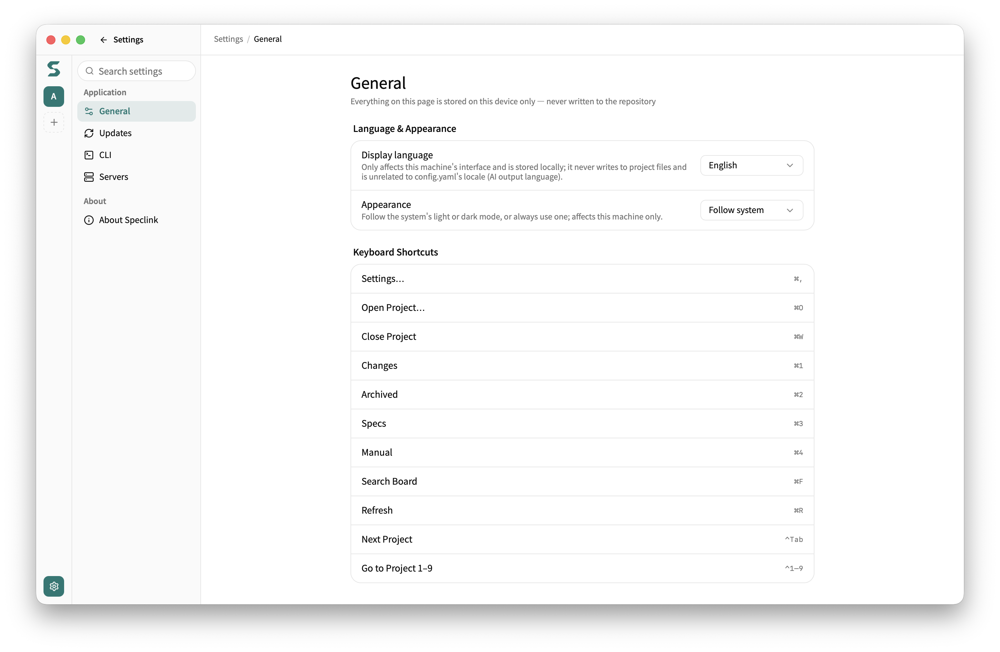

# Configuration

[繁體中文](configuration.zh-TW.md) · **English**

Speclink keeps settings in three layers. Workflow policy lives in `openspec/config.yaml` and travels with the specs. The AI tools and the remote connection of this checkout live in `.speclink.yaml`. Sign-in credentials live at the user level and never enter the project. Environment variables can override policy for one run.

## <a id="layers"></a>Where settings live

| Location | Contents | Read by | In version control |
| --- | --- | --- | --- |
| `openspec/config.yaml` | Workflow policy: `schema`, `locale`, `spec_locale`, `tdd`, `audit`, `worktree`, `context`, `rules`, `review` | The CLI and the desktop app; skills get the effective values through `speclink instructions` | Yes |
| `.speclink.yaml` | The binding of this checkout: `tools`, `spec_dir`, `remote` | The CLI and the desktop app | Yes (it holds no credentials) |
| `.speclink/` | Local work data: snapshots for archive and the quality stations, records of generated tool files, the read-only content snapshot of remote mode | The CLI and the desktop app | No (`speclink init` adds it to `.gitignore`) |
| User config directory | `credentials.yaml` (the credential that the CLI stores for an access-token login), `schemas/` (user-level custom schemas), `config.yaml` (the key-value store of `speclink config`) | The CLI and the desktop app | No |
| System keychain | Device-login credentials, and access tokens (PATs) that the desktop app stores | Shared by the CLI and the desktop app | No |
| `SPECLINK_*` environment variables | Overrides for one run | The CLI and the Node SDK | No |

The user config directory is here:

- macOS: `~/Library/Application Support/speclink/`
- Linux: `$XDG_CONFIG_HOME/speclink/`, or `~/.config/speclink/` when `XDG_CONFIG_HOME` is not set
- Windows: `%USERPROFILE%\AppData\Roaming\speclink\`

The desktop app keeps its UI language and its server list in its own app folder. It keeps credentials in the system keychain. None of these go into the project.

In the desktop app, Settings opens in settings mode. The left column lists the categories: General, Updates, CLI, and Servers under Application, and About Speclink under About. The General and CLI pages keep their values on this computer. The Servers page manages the list of server connections.



Use these three rules to place a new setting:

- A setting that changes what the workflow produces (language, TDD, audit, the worktree flow) is **policy**. Put it in `openspec/config.yaml`, so the whole team reads the same values.
- A setting that concerns only this checkout (AI tools, remote connection) goes in `.speclink.yaml`.
- A personal or CI difference uses an environment variable and changes no file.

`speclink config` and `speclink workflow-config` are different commands. `speclink config` manages generic keys in the user-level `config.yaml`, and no other Speclink command reads that file. Always use `speclink workflow-config` to change workflow policy.

## <a id="resolution"></a>Resolution order

Speclink checks the layers from top to bottom. The first layer with a value wins:

| Order | Source | Notes |
| --- | --- | --- |
| 1 | `SPECLINK_LOCALE`, `SPECLINK_SPEC_LOCALE`, `SPECLINK_TDD`, `SPECLINK_AUDIT`, `SPECLINK_WORKTREE` | Boolean variables accept only `true` / `false` (any case). Speclink treats `1`, `yes`, and an empty value as unset and checks the next layer |
| 2 | `openspec/config.yaml` | The project values |
| 3 | Built-in defaults | `locale` and `spec_locale` independently use the system language. `tdd`, `audit`, and `worktree` are off. `schema` is `spec-driven` |

Three more points:

- Policy keys in `.speclink.yaml` (`locale`, `tdd`, and so on) have no effect and show no warning. Move them to `openspec/config.yaml` with the same values.
- Environment variables affect only the CLI and the Node SDK on your machine. In remote mode, the server makes the instructions from the team policy, so a local variable cannot override team policy.
- Only the `worktree` key in `openspec/config.yaml` decides whether the two worktree skills exist. `SPECLINK_WORKTREE` does not change skill files.

The remote connection has two more orders:

- **Connection URL**: `SPECLINK_STORE_URL` comes first, then `remote.url` in `.speclink.yaml`. Only a `remote:` section in `.speclink.yaml` turns on remote mode. `SPECLINK_STORE_URL` never turns a local project into a remote one. If the `remote:` section exists but neither source gives a URL, the command fails. It does not fall back to local mode.
- **Credentials**: Speclink checks `SPECLINK_TOKEN`, then the device login in the keychain, then an access token in the keychain, then the user-level `credentials.yaml`. Credentials are keyed by the server origin (`scheme://host:port`), so all projects on one server share one login. `speclink auth status` shows which layer it uses.

## <a id="workflow-config"></a>Change workflow policy

Use `speclink workflow-config`. In local mode it changes `openspec/config.yaml`. In remote mode it changes the copy on the server.

| Subcommand | What it does |
| --- | --- |
| `show [--json]` | Shows the values in the file. It does not apply environment variables |
| `set <key> <value>` | Sets one of `locale`, `spec_locale`, `tdd`, `audit`, `worktree` |
| `context --stdin` | Replaces `context` with the stdin text. Whitespace-only input removes the key |
| `rules <artifact> --stdin` | Replaces the rules of one artifact with stdin, one rule per line. Blank lines are skipped. Empty input removes the section. `<artifact>` must be an artifact id of the current schema |
| `review <list> --stdin` | Replaces one list of project review rules with stdin, one rule per line. Blank lines are skipped. Empty input removes the list. `<list>` is `critical`, `warning`, or `suggestion` |
| `review baseline <mode>` | Sets whether the review station also checks its 12 built-in code smells. `<mode>` is `extend` (the default, which removes the key) or `replace` |

Write rules:

- `locale` accepts only `tw`, `ja`, `en`. `spec_locale` also accepts `auto` (follow `locale`). Case must match. A display name such as 「繁體中文」 is rejected, and the error lists the valid codes.
- `tdd`, `audit`, and `worktree` accept only `true` / `false`. A `false` value (or an empty `locale`) removes the line, so the default applies again.
- All write subcommands accept `--dry-run`. It prints the diff and writes nothing. The diff compares the old and new text line by line. Only the lines that are removed, added, or moved get `-` or `+`. The other lines in the changed range show as context, also when they are between two changes. Up to three unchanged lines before and after that range are also shown.
- A `review` write replaces the whole `review` block. `extend` writes no `baseline` key, an empty list removes its key, and a block with nothing left is removed. Comments inside the `review` block are not kept.
- After a `review` write, the command checks the skill files in your local project. If they are older than the engine, the write still succeeds, but stderr shows a warning that tells you to run `speclink update`. An older review skill may not apply the review rules.
- The `review` block is strict. An unknown key (a typo such as `critcal`), a `baseline` other than `extend` or `replace`, or a list entry that is not a string makes the file unparseable. Every command that reads the file then fails and names the key, until you correct it.
- A write changes only the target lines. All other content and comments stay as they are. If the file cannot be parsed, reads and writes both fail, so your content stays safe.
- In local mode, a `worktree` change also adds or removes the two worktree skills. You cannot change `worktree` from `true` to `false` while a worktree is still open. The command lists those worktrees. Close them with `speclink-worktree-merge` first.
- In remote mode, a write fails if another person writes at the same time. Run the command again; it never overwrites the other write. The command also fails when you are offline or your credential is not valid. Nothing is queued.

```bash
speclink workflow-config set tdd true --dry-run   # look at the diff first
speclink workflow-config set tdd true             # then write
cat CONTEXT.md | speclink workflow-config context --stdin
```

Run the first line in a project right after `speclink init`. **Expected output**:

```text
--- a/openspec/config.yaml
+++ b/openspec/config.yaml
@@ -1,5 +1,7 @@
 schema: spec-driven

+tdd: true
+
 # Workflow policy (optional)
 # Personal/CI overrides: SPECLINK_LOCALE, SPECLINK_SPEC_LOCALE, SPECLINK_TDD, SPECLINK_AUDIT, SPECLINK_WORKTREE
 #
```

`workflow-config set` does not accept `schema`. To change the schema, use one of these:

- Edit the `schema:` line in `openspec/config.yaml`.
- Run `speclink schema init <name> --default`. It makes a new custom schema and sets it as the project default.
- Use the Workflow page in **Project Settings** of the desktop app.

**Project Settings** in the desktop app changes the same file with the same rules. The built-in `speclink-config` skill collects `context` and `rules` from your code. It shows you the diff and writes only after you approve. It shows all policy fields, `worktree` included, in one table with their current values, and asks only whether you want to change any of them. Review rules are optional: you can leave them not set, add them to the built-in checks (`extend`), or use them in place of the built-in checks (`replace`). You can give the skill a list of reminders, pasted or as a file path. For each reminder, it decides whether it goes into a review rule, a rule for one artifact (`rules`), or neither, and tells you why. It takes review rules only from you, never from your code.

The review station applies the `review` block only with a CLI and skill files of this version or later. Run `speclink update` after you upgrade. An older CLI skips the block.

## <a id="tools"></a>AI tools and custom tools

The `tools` list in `.speclink.yaml` decides which AI tools get skill files:

| Value | Skill file location |
| --- | --- |
| `claude` | `.claude/skills/` |
| `codex` (`agents` is an alias) | `.agents/skills/` |
| `copilot` | `.github/skills/` |
| A custom tool descriptor | The `skills_dir` of the descriptor |

GitHub Copilot also reads `.claude/skills/` and `.agents/skills/`, but it reads `.github/skills/` first. Thus, when you select `copilot`, Copilot uses the skills that Speclink writes for it.

After you change `tools`, run `speclink update`. A new tool gets its skill files. For a tool that you remove, Speclink deletes its `speclink-*` skill directories and any directory that becomes empty. When you select built-in tools on the `.speclink.yaml` page of **Project Settings** in the desktop app, the app does the same sync.

Use a descriptor to connect any other AI tool:

```yaml
tools:
  - claude
  - name: my-harness
    skills_dir: .my-harness/skills
    invocation: tool-call
```

| Field | Required | Rules |
| --- | --- | --- |
| `name` | Yes | kebab-case, 2–50 characters of `a-z`, `0-9`, `-`. It cannot be `claude`, `codex`, `agents`, or `copilot` |
| `skills_dir` | Yes | A relative path inside the project root. It cannot leave the project, cannot be the project root itself, and cannot be `.claude/skills`, `.agents/skills`, or `.github/skills` (in any letter case) |
| `invocation` | No | `cli` (default): skills say "run `speclink <verb>`". `tool-call`: skills say "call the speclink tool with an argv array" |
| `instructions_file` | No, deprecated | Speclink writes nothing to it. `speclink update` uses it only to remove an old `SPECLINK` block. If you keep it, stderr shows a one-line deprecation notice |

If a field is not valid, the command prints one error line that names the field and exits non-zero. Skills for a descriptor have no `/speclink-` slash commands and do not mention plan mode. The built-in claude, codex, and copilot output does not change.

Old versions accepted a descriptor named `copilot`, or a descriptor with `skills_dir` set to `.github/skills`. After you upgrade, `speclink update` rejects such a descriptor and exits non-zero. Remove the descriptor and add `copilot` to `tools`.

## <a id="remote"></a>Remote mode

When you connect to a remote, each setting keeps its layer. Only the location of the specs moves to the server:

- `speclink link <url> --repo <name>` writes a `remote:` section (`url` and `repo`) into `.speclink.yaml`. `speclink unlink` removes it. The section turns on remote mode.
- Workflow policy lives on the server. `speclink workflow-config` reads and writes the server copy, and the local `openspec/config.yaml` has no effect.
- `.speclink/context/` is a read-only snapshot of the remote content. Do not edit it. The next command finds the edit and refuses to run. Run `speclink instructions` again to refresh it.
- No credential goes into a project file, so you can safely commit `.speclink.yaml`.

[Remote Getting Started](remote-getting-started.md) shows how to start a server, sign in, and recover from a lost connection. It also lists the environment variables for the server, such as `SPECLINK_PORT`.

## <a id="reference"></a>Key reference

### `openspec/config.yaml`

| Key | Values | Default | Use |
| --- | --- | --- | --- |
| `schema` | A schema name | `spec-driven` | The workflow schema for new changes (which documents, in which order) |
| `locale` | `tw`, `ja`, `en` | System language | The language of AI-generated documents and reports; review and verify also present their results in it. Otherwise the agent talks to you in your own language |
| `spec_locale` | `tw`, `ja`, `en`, `auto` | System language | The language of spec files. `auto` follows `locale` |
| `tdd` | `true` / `false` | `false` | Write a failing test first, then the code (red to green) |
| `audit` | `true` / `false` | `false` | Run a sharp-edges security check on new APIs and parameter handling |
| `worktree` | `true` / `false` | `false` | Turn on the parallel worktree flow and make the two worktree skills |
| `context` | Multi-line text | None | Project background that the AI gets when it writes artifacts |
| `rules` | Artifact id → list of rules | None | Writing rules for each artifact |
| `review.baseline` | `extend`, `replace` | `extend` | Whether the review station checks its 12 built-in code smells plus the project rules (`extend`), or the project rules only (`replace`) |
| `review.critical`, `review.warning`, `review.suggestion` | Lists of rules | None | Project review rules for the Standards axis of the review station. The list a rule is in sets the severity of a violation |

Speclink ignores other keys.

### `.speclink.yaml`

| Key | Values | Default | Use |
| --- | --- | --- | --- |
| `spec_dir` | A relative path | `openspec` | The spec directory, relative to the project root |
| `tools` | A list | None | AI tools that get skill files: `claude`, `codex`, `copilot`, or custom tool descriptors |
| `remote.url` | A URL | None | The connection URL of the remote project (project-scoped URL) |
| `remote.repo` | A name | None | The registered name of this repo in the remote project. A project with one repo can leave it out |

### Environment variables

| Variable | Values | Effect |
| --- | --- | --- |
| `SPECLINK_LOCALE` | A language code | Overrides `locale` |
| `SPECLINK_SPEC_LOCALE` | A language code or `auto` | Overrides `spec_locale` |
| `SPECLINK_TDD` | `true` / `false` | Overrides `tdd` |
| `SPECLINK_AUDIT` | `true` / `false` | Overrides `audit` |
| `SPECLINK_WORKTREE` | `true` / `false` | Overrides `worktree`. It does not change which skill files exist |
| `SPECLINK_STORE_URL` | A URL | Replaces `remote.url`. It never turns a local project into a remote one |
| `SPECLINK_TOKEN` | An access token | The remote credential. It comes before the keychain and `credentials.yaml`, so it suits CI |


## <a id="fork-language-defaults"></a>Fork language defaults

Unset locale and spec_locale independently use the language of the machine running Speclink: Chinese maps to tw, Japanese to ja, all other or unavailable values to en. Explicit settings and environment overrides take precedence; only legacy spec_locale:auto follows locale. Remote mode uses the Server OS, independently of Client or UI language. Detection never writes configuration.

`speclink workflow-config languages --json` reads canonical settings and host defaults without environment overrides and returns concrete locale and specLocale values. Older Servers without language metadata produce an upgrade error for this query; show remains compatible.

## <a id="security-review"></a>OWASP / CWE Preliminary Security Review

The optional `security_verification` block lives in the existing openspec/config.yaml policy document. Absence means disabled; audit, TDD and worktree remain independent. Desktop exposes it beneath audit in Output Policy. Use `speclink workflow-config security --stdin [--dry-run]` for a partial patch that preserves unknown fields. Each standard is independent; Top 10 2025 works on its own. Users explicitly install standards in application settings; review never downloads data. See the [operation, licensing and maintenance guide](security-review.md).

## <a id="project-icon-color"></a>Project icon color

Choose Default, Teal, Blue, Purple, Pink, Orange or Green in project settings. Changes save immediately on this device and appear in both the main window and tray: selected custom icons use deep backgrounds with white text; unselected backgrounds mix in 50% white and use dark text of the same hue. Preferences survive closing/restarting; Default restores the original appearance. Local and Remote identities are kept separate. This never writes openspec/config.yaml or Remote policy, so readers can change their own appearance. Storage errors keep the last adopted color and display the failure.
