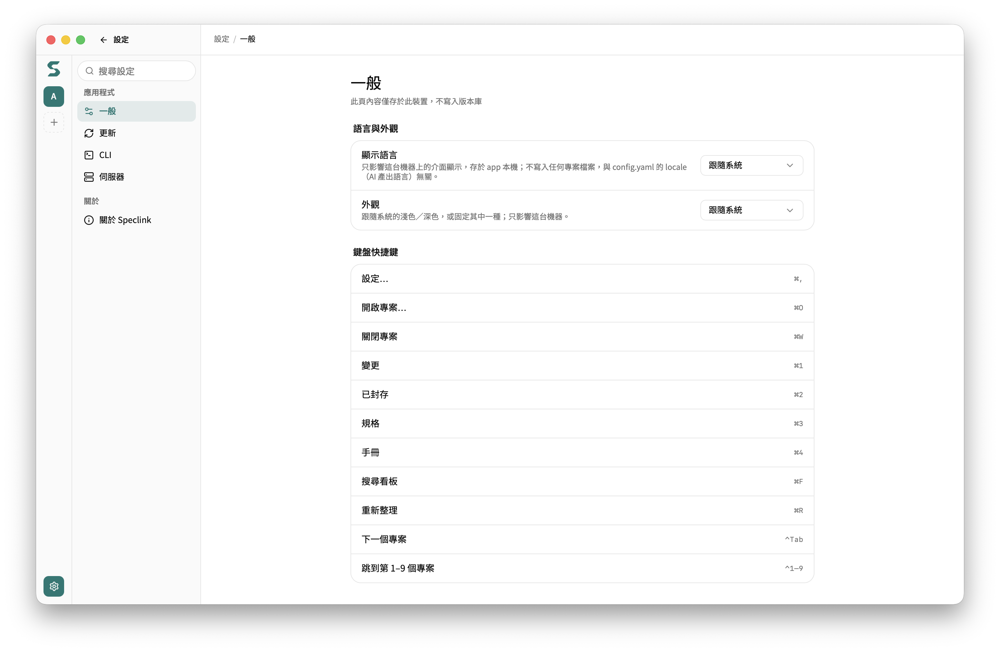

# 設定說明

**繁體中文** · [English](configuration.md)

Speclink 的設定分三層：工作流政策寫在 `openspec/config.yaml`，跟著規格走；這個 checkout 接哪些 AI 工具、連哪個遠端，寫在 `.speclink.yaml`；登入憑證放在使用者層，不進專案。環境變數可以在單次執行時蓋過政策。

## <a id="layers"></a>設定放在哪裡

| 位置 | 放什麼 | 誰會讀 | 進版本控制 |
| --- | --- | --- | --- |
| `openspec/config.yaml` | 工作流政策：`schema`、`locale`、`spec_locale`、`tdd`、`audit`、`worktree`、`context`、`rules`、`review` | CLI、桌面 app；技能透過 `speclink instructions` 取得生效值 | 是 |
| `.speclink.yaml` | 這個 checkout 的綁定：`tools`、`spec_dir`、`remote` | CLI、桌面 app | 是（裡面沒有憑證） |
| `.speclink/` | 本機工作資料：封存與品質關卡用的快照、生成工具的記錄、遠端模式的唯讀內容快照 | CLI、桌面 app | 否（`speclink init` 會把它加進 `.gitignore`） |
| 使用者層設定目錄 | `credentials.yaml`（CLI 用存取金鑰登入時存的憑證）、`schemas/`（使用者層自訂 schema）、`config.yaml`（`speclink config` 的鍵值） | CLI、桌面 app | 否 |
| 系統鑰匙圈 | 裝置登入的憑證、桌面 app 存的存取金鑰（PAT） | CLI 與桌面 app 共用 | 否 |
| `SPECLINK_*` 環境變數 | 單次執行的覆寫 | CLI、Node SDK | 否 |

使用者層設定目錄的位置：

- macOS：`~/Library/Application Support/speclink/`
- Linux：`$XDG_CONFIG_HOME/speclink/`；沒設 `XDG_CONFIG_HOME` 時是 `~/.config/speclink/`
- Windows：`%USERPROFILE%\AppData\Roaming\speclink\`

桌面 app 自己的介面語言與伺服器連線清單存在 app 的資料夾，憑證存在系統鑰匙圈，都不寫進專案。

桌面 app 的「設定」以設定模式開啟：左欄列出分類，「應用程式」下有一般、更新、CLI、伺服器、網路與診斷、安全標準資料，「關於」下有「關於 Speclink」。一般與 CLI 頁的內容只存在這台機器，「伺服器」頁管理伺服器連線清單。



## <a id="desktop-project-icons"></a>專案圖示與設定導覽

專案圖示色票預覽固定深底白字，只以外框標示目前選擇。專案列選取時深底白字、未選取時淺底黑字；紫色為 #9400D3／#DA70D6，預設為 #374151／#E5E7EB。主視窗與系統匣使用相同色票。從兩種設定頁點左側專案，成功後會回到該專案看板；有未儲存的專案設定時沿用捨棄確認。

## <a id="desktop-network-diagnostics"></a>桌面網路與診斷

開啟應用程式「設定 → 網路與診斷」。這裡的設定只屬於這台裝置，沒有專案、Remote 離線或登入過期時也能使用。`runtime-preferences.json` 與桌面的 `connections.json` 同層；portable 版放在可攜資料目錄的 `desktop/`。不會寫入專案政策，也不會改變獨立 CLI、Remote 登入或即時連線的路由。

缺少偏好檔時使用預設值，不會立即建立檔案：

```json
{"formatVersion":1,"debugEnabled":false,"proxy":{"mode":"system","url":null}}
```

修改後按「儲存」。寫入失敗保留舊設定；偏好檔損壞或版本不支援時，頁面提供「重設網路與診斷設定」，在重設前停止新的受管網路工作。下載中修改設定，只影響下一個工作；已檢查的候選更新沿用檢查時的設定。

| Proxy 模式 | 行為 |
| --- | --- |
| 沿用系統 | 先讀程序的 `HTTPS_PROXY`／`HTTP_PROXY`／`ALL_PROXY` 與 `NO_PROXY`，再讀 Windows 單一固定 Proxy 或 macOS 固定 HTTP／HTTPS Proxy。Linux 只讀程序環境。未取得固定路由時直接連線，診斷會記錄 `system-no-static-route`。 |
| 手動設定 | 輸入 `http://host:port`，連接埠為 1–65535；可用公司內網位址。HTTPS 目的地透過 HTTP CONNECT 連線。網址不能帶帳密、非根路徑、query 或 fragment。 |
| 直接連線 | 明確略過環境與系統 Proxy。 |

這三種模式涵蓋更新檢查、更新下載、安全標準清單更新與下載。選定 Proxy 後失敗，不會偷偷改走直連。第一版不支援 PAC／WPAD、Windows 分協定設定、企業帳密驗證（含 NTLM／Kerberos）、SOCKS、HTTPS Proxy 端點或自訂公司 CA；TLS 與更新簽章檢查仍會執行。

要收集失敗證據，開啟 Debug mode 並儲存，再重現問題。頁面會持續顯示記錄狀態；畫面出錯時可重試，或直接開啟獨立的網路與診斷頁。「匯出診斷紀錄」會讓你選擇 ZIP 的儲存位置；關閉 Debug 後仍可匯出既有紀錄。每個記錄檔最多 2 MiB、保留四檔，佇列與單筆大小也有限制；匯出前再次過濾，不包含原始錯誤文字、帳密、查詢參數、完整本機路徑或專案內容。既有目的檔不會被覆寫。

Debug 開啟並儲存後才出現「測試更新連線」。它只在按下時對內建更新端點送出獨立請求，限制 20 秒、實際回應 2 MiB、最多三次 HTTPS 重新導向，不下載或安裝更新。顯示的狀態碼屬於這次測試；更新元件沒有公開的資訊會保留為未知，不從錯誤文字猜測原因。

## <a id="offline-standard-bundles"></a>安全標準離線資料包

「設定 → 安全標準資料」可匯出一個已安裝版本，或按「全部匯出」保存所有有效安裝版本；無效版本會列為跳過。沒有有效資料時不建立空包。匯出不需要網路，也不更動已安裝資料。專案圖示色票預覽固定深底白字；專案列選取時深底白字、未選取時淺底黑字。從兩種設定頁點左側專案，成功後會回到該專案看板；有未儲存的專案設定時沿用捨棄確認。

CLI 使用相同資料交換流程：

```sh
speclink security data export cwe --version 4.20 --output cwe-4.20.zip --json
speclink security data export --all --output standards.zip --json
speclink security data import standards.zip --json
```

單包維持 formatVersion 1，保留原始檔、來源資訊、授權與 SHA-256；不包含解析快取或專案文件。全部匯出為 formatVersion 2 集合 ZIP，內含可單獨匯入的 v1 包。最多 32 包，外包與內包總大小上限 512 MiB，全部原始資料展開後最多 1 GiB；單包原有限制不變。目的檔已存在會回報 `file_exists`，取消或失敗不會留下看似完成的包。

同一個匯入入口接受 v1 與 v2。集合包會先驗證所有內容，再依清單逐版本提交；預檢失敗時完全不提交。提交途中失敗或取消就停止，已完成版本仍保留，失敗版本保留舊資料，其餘列為尚未處理。桌面顯示逐項結果；CLI 的 v2 JSON 使用 `installed`／`partial`／`failed`／`cancelled` 狀態與 `results` 清單。成功 exit 0、操作失敗 1、取消 130、參數錯誤 2；進度與錯誤寫 stderr，結果寫 stdout，支援 `--no-color`。匯入內容一律標示 imported，指紋相同不代表官方背書。

新設定該放哪裡，照這三條判斷：

- 會改變產出內容的設定（語言、TDD、audit、worktree 流程）是**政策**，放 `openspec/config.yaml`，全隊讀到同一份。
- 只跟這個 checkout 有關的設定（接哪些 AI 工具、連哪個遠端）放 `.speclink.yaml`。
- 個人或 CI 的臨時差異用環境變數，不改任何檔案。

`speclink config` 與 `speclink workflow-config` 是兩回事。`speclink config` 管使用者層 `config.yaml` 的通用鍵值，Speclink 的其他指令都不讀它。工作流政策一律用 `speclink workflow-config` 改。

## <a id="resolution"></a>解析順序

政策值由上往下找，先找到的生效：

| 順序 | 來源 | 說明 |
| --- | --- | --- |
| 1 | `SPECLINK_LOCALE`、`SPECLINK_SPEC_LOCALE`、`SPECLINK_TDD`、`SPECLINK_AUDIT`、`SPECLINK_WORKTREE` | 布林變數只認 `true`／`false`（不分大小寫）。`1`、`yes`、空字串都當成沒設，往下一層找 |
| 2 | `openspec/config.yaml` | 專案的正式值 |
| 3 | 內建預設 | `locale` 與 `spec_locale` 各自採系統語言；`tdd`、`audit`、`worktree` 為關閉；`schema` 為 `spec-driven` |

另外三件事：

- `.speclink.yaml` 裡的政策鍵（`locale`、`tdd` 等）不會生效，也不會警告。請照原值搬到 `openspec/config.yaml`。
- 環境變數只影響你這台機器上執行的 CLI 與 Node SDK。遠端模式的指引由 server 依團隊設定產生，本機環境變數蓋不過團隊政策。
- 要不要產生兩個 worktree 技能，只看 `openspec/config.yaml` 的 `worktree`。`SPECLINK_WORKTREE` 不影響技能檔。

遠端連線另有兩條順序：

- **連線網址**：`SPECLINK_STORE_URL` 優先，其次是 `.speclink.yaml` 的 `remote.url`。是不是遠端模式只看 `.speclink.yaml` 有沒有 `remote:` 區段，`SPECLINK_STORE_URL` 不會把本機專案切成遠端模式。有 `remote:` 區段、兩邊卻都沒有網址時，指令直接報錯，不會退回本機模式。
- **憑證**：依序找 `SPECLINK_TOKEN` → 鑰匙圈裡的裝置登入 → 鑰匙圈裡的存取金鑰 → 使用者層的 `credentials.yaml`。憑證以伺服器的 origin（`scheme://host:port`）區分，同一台 server 上的專案共用一份登入。`speclink auth status` 會告訴你目前用的是哪一層。

## <a id="workflow-config"></a>修改工作流政策

用 `speclink workflow-config`。本機模式改 `openspec/config.yaml`，遠端模式改 server 上的那一份。

| 子指令 | 作用 |
| --- | --- |
| `show [--json]` | 顯示檔案裡的值。不套用環境變數 |
| `set <key> <value>` | 改 `locale`、`spec_locale`、`tdd`、`audit`、`worktree` 其中一個 |
| `context --stdin` | 用 stdin 的內容整段取代 `context`。內容只有空白時移除這個鍵 |
| `rules <artifact> --stdin` | 用 stdin 整段取代一個 artifact 的規則，一行一條，空行略過。stdin 為空時移除這一節。`<artifact>` 必須是目前 schema 的 artifact id |
| `review <list> --stdin` | 用 stdin 整段取代一個審查規則清單，一行一條，空行略過。stdin 為空時移除這個清單。`<list>` 是 `critical`、`warning` 或 `suggestion` |
| `review baseline <mode>` | 設定審查關卡要不要檢查內建的 12 條 code smell。`<mode>` 是 `extend`（預設，寫入時移除這個鍵）或 `replace` |

寫入規則：

- `locale` 只收 `tw`、`ja`、`en`；`spec_locale` 另外收 `auto`（跟著 `locale`）。大小寫要相同。寫「繁體中文」這類名稱會被拒絕，錯誤訊息會列出可用的代碼。
- `tdd`、`audit`、`worktree` 只收 `true`／`false`。設成 `false`（或把 `locale` 設成空字串）會刪掉那一行，回到預設值。
- 所有寫入子指令都有 `--dry-run`：只印出差異，不寫檔。差異逐行比對新舊內容：只有被刪除、新增或移動位置的行會標 `-`／`+`；改動範圍內其餘沒改的行以前後文呈現，夾在兩處改動之間的也一樣。範圍前後另外最多各帶三行沒改的內容。
- `review` 的寫入會整塊取代 `review` 區塊：`extend` 不寫 `baseline` 鍵、清單清空就移除該鍵、整塊沒有內容時移除 `review` 鍵。`review` 區塊內的註解不會保留。
- `review` 寫入後，指令會檢查本機專案的技能檔。技能檔比引擎舊時，寫入照樣成功，但 stderr 會多一行警告，提示執行 `speclink update`——舊版審查技能可能不套用審查規則。
- `review` 區塊採嚴格解析：出現不認得的鍵（例如打錯成 `critcal`）、`baseline` 不是 `extend` 或 `replace`、或清單裡有不是字串的條目時，整份檔案視為無法解析。讀這份檔案的指令都會失敗並點名出錯的鍵，直到你改正。
- 只改目標那幾行，其他內容與註解原樣保留。檔案無法解析時讀寫都會拒絕，不會蓋掉你的內容。
- 本機模式下改 `worktree` 會同時產生或移除兩個 worktree 技能。還有 worktree 沒收尾時，不能從 `true` 改成 `false`；指令會列出那些 worktree，請先用 `speclink-worktree-merge` 收掉。
- 遠端模式下，如果別人剛好同時寫入，指令會失敗並請你重跑，不會蓋掉別人的修改。離線或憑證失效也會直接失敗，不會排隊。

```bash
speclink workflow-config set tdd true --dry-run   # 先看差異
speclink workflow-config set tdd true             # 再寫入
cat CONTEXT.md | speclink workflow-config context --stdin
```

在剛 `speclink init` 完的專案跑第一行，**預期輸出**：

```text
--- a/openspec/config.yaml
+++ b/openspec/config.yaml
@@ -1,5 +1,7 @@
 schema: spec-driven

+tdd: true
+
 # Workflow policy (optional)
 # Personal/CI overrides: SPECLINK_LOCALE, SPECLINK_SPEC_LOCALE, SPECLINK_TDD, SPECLINK_AUDIT, SPECLINK_WORKTREE
 #
```

`workflow-config set` 不收 `schema`。要換 schema，用下列任一種方式：

- 直接編輯 `openspec/config.yaml` 的 `schema:` 那一行。
- `speclink schema init <name> --default`：建立一個新的自訂 schema，並設成專案預設。
- 桌面 app「專案設定」的「產出流程」頁。

桌面 app 的「專案設定」改的是同一份檔案，規則也相同。內建技能 `speclink-config` 會從程式碼整理出 `context` 與 `rules`，先給你看差異，你同意後才寫入。政策欄位（含 `worktree`）它會用一張表列出現值，只問你要不要改。審查規則是選用的：可以不設定、附加在內建檢查之後（`extend`），或取代內建檢查（`replace`）。你可以交給它一份提醒清單（貼上或給檔案路徑），它會逐條判斷要放進審查規則、某個 artifact 的產出規則（`rules`），還是不收，並說明理由。審查規則只收你給的，不從程式碼推導。

審查關卡要套用 `review` 區塊，需要這個版本以後的 CLI 與技能檔；升級後請執行 `speclink update`。舊版 CLI 會略過這個區塊。

## <a id="tools"></a>AI 工具與自訂工具

`.speclink.yaml` 的 `tools` 決定要為哪些 AI 工具產生技能檔：

| 值 | 技能檔位置 |
| --- | --- |
| `claude` | `.claude/skills/` |
| `codex`（`agents` 是它的別名） | `.agents/skills/` |
| `copilot` | `.github/skills/` |
| 自訂工具描述子 | 描述子的 `skills_dir` |

GitHub Copilot 也會讀 `.claude/skills/` 與 `.agents/skills/`，但它先讀 `.github/skills/`。所以選了 `copilot`，Copilot 用的就是寫給它的那一份。

改完 `tools` 後執行 `speclink update`。新加的工具會產生技能檔；從清單拿掉的工具，它的 `speclink-*` 技能目錄會被刪除，因此變空的目錄也一併移除。在桌面 app「專案設定」的 `.speclink.yaml` 頁勾選內建工具時，會自動做同樣的同步。

其他 AI 工具用描述子接上：

```yaml
tools:
  - claude
  - name: my-harness
    skills_dir: .my-harness/skills
    invocation: tool-call
```

| 欄位 | 必填 | 規則 |
| --- | --- | --- |
| `name` | 是 | kebab-case，2–50 個字元，只能用 `a-z`、`0-9`、`-`。不能是 `claude`、`codex`、`agents`、`copilot` |
| `skills_dir` | 是 | 專案根目錄下的相對路徑。不能跑出專案、不能是專案根目錄本身，也不能是 `.claude/skills`、`.agents/skills` 或 `.github/skills`（不分大小寫） |
| `invocation` | 否 | `cli`（預設）：技能寫「執行 `speclink <動詞>`」。`tool-call`：技能寫「呼叫 speclink 工具，參數是 argv 陣列」 |
| `instructions_file` | 否，已棄用 | 不再產生任何內容，只用來讓 `speclink update` 清掉舊版留下的 `SPECLINK` 區塊。留著會在 stderr 印一行棄用提示 |

欄位不合法時，指令印出一行指出欄位的錯誤，並以非零結束。描述子產生的技能沒有 `/speclink-` 斜線指令，也不提 plan mode；內建的 claude、codex、copilot 不受影響。

舊版允許名為 `copilot`、或 `skills_dir` 是 `.github/skills` 的描述子。升級後 `speclink update` 會拒絕它並以非零結束。刪掉這個描述子，改在 `tools` 寫 `copilot` 即可。

## <a id="remote"></a>遠端模式

接上遠端後，設定的歸屬不變，只是「規格放在哪裡」換成 server：

- `speclink link <url> --repo <name>` 在 `.speclink.yaml` 寫入 `remote:` 區段（`url` 與 `repo`），`speclink unlink` 移除它。有這個區段就是遠端模式。
- 工作流政策改存在 server 上。`speclink workflow-config` 讀寫 server 那一份，本機的 `openspec/config.yaml` 不再生效。
- `.speclink/context/` 是遠端內容的唯讀快照。不要手改，下一個指令會發現它被改過而拒絕執行；要刷新就重新執行 `speclink instructions`。
- 憑證不寫進任何專案檔案，所以 `.speclink.yaml` 可以放心 commit。

怎麼啟動 server、登入、斷線後怎麼恢復，見 [Remote 入門](remote-getting-started.zh-TW.md)。啟動 server 用的環境變數（例如 `SPECLINK_PORT`）也在那裡。

## <a id="reference"></a>完整鍵值參考

### `openspec/config.yaml`

| 鍵 | 值 | 預設 | 用途 |
| --- | --- | --- | --- |
| `schema` | schema 名稱 | `spec-driven` | 新變更使用的產出流程（產出哪些文件、什麼順序） |
| `locale` | `tw`、`ja`、`en` | 系統語言 | AI 產出文件與報告的語言；review、verify 也用它呈現結果。其餘時候 Agent 用你的語言跟你對話 |
| `spec_locale` | `tw`、`ja`、`en`、`auto` | 系統語言 | 規格檔的語言；`auto` 跟著 `locale` |
| `tdd` | `true`／`false` | `false` | 實作時先寫會失敗的測試，再寫程式（紅→綠） |
| `audit` | `true`／`false` | `false` | 實作時對新 API 與參數處理做 sharp-edges 安全檢查 |
| `worktree` | `true`／`false` | `false` | 開啟 worktree 平行實作流程，並產生兩個 worktree 技能 |
| `context` | 多行文字 | 無 | 產生 artifact 時提供給 AI 的專案背景 |
| `rules` | artifact id → 規則清單 | 無 | 各 artifact 的撰寫規則 |
| `review.baseline` | `extend`、`replace` | `extend` | 審查關卡檢查內建 12 條 code smell 再加上專案規則（`extend`），或只用專案規則（`replace`） |
| `review.critical`、`review.warning`、`review.suggestion` | 規則清單 | 無 | 審查關卡 Standards 軸的專案審查規則。規則放在哪個清單，違反時就記成那個嚴重度 |

其他鍵會被忽略。

### `.speclink.yaml`

| 鍵 | 值 | 預設 | 用途 |
| --- | --- | --- | --- |
| `spec_dir` | 相對路徑 | `openspec` | 規格目錄的位置，相對於專案根目錄 |
| `tools` | 清單 | 無 | 要產生技能檔的 AI 工具：`claude`、`codex`、`copilot` 或自訂工具描述子 |
| `remote.url` | 網址 | 無 | 遠端專案的連線網址（project-scoped URL） |
| `remote.repo` | 名稱 | 無 | 這個 repo 在遠端專案裡的註冊名稱；只有一個 repo 的專案可以省略 |

### 環境變數

| 變數 | 值 | 作用 |
| --- | --- | --- |
| `SPECLINK_LOCALE` | 語言代碼 | 覆寫 `locale` |
| `SPECLINK_SPEC_LOCALE` | 語言代碼或 `auto` | 覆寫 `spec_locale` |
| `SPECLINK_TDD` | `true`／`false` | 覆寫 `tdd` |
| `SPECLINK_AUDIT` | `true`／`false` | 覆寫 `audit` |
| `SPECLINK_WORKTREE` | `true`／`false` | 覆寫 `worktree`；不影響技能檔要不要產生 |
| `SPECLINK_STORE_URL` | 網址 | 取代 `remote.url`；不會把本機專案切成遠端模式 |
| `SPECLINK_TOKEN` | 存取金鑰 | 遠端憑證，優先於鑰匙圈與 `credentials.yaml`，適合 CI |


## <a id="fork-language-defaults"></a>Fork 的語言預設

未設定 locale 與 spec_locale 時，分別使用執行 Speclink 的主機語言：中文對應 tw、日文對應 ja，其餘或無法偵測時為 en。明示設定及環境覆寫優先；舊 spec_locale:auto 才跟隨 locale。Remote 使用 Server 的作業系統，不採 Client 或 UI 語言。偵測不回寫設定。

`speclink workflow-config languages --json` 只讀查詢正典設定與主機預設，不套用環境覆寫，回傳具體 locale 及 specLocale；舊 Server 未提供語言資料時會明示要求升級，show 仍可使用。

## <a id="security-review"></a>OWASP / CWE 初步安全審查

安全政策使用同一份 openspec/config.yaml 的 security_verification，缺席預設停用，與 audit／tdd／worktree 獨立。Desktop 位於既有「產出政策」的 audit 下方；CLI 用 `speclink workflow-config security --stdin [--dry-run]` 部分更新，保留未知欄位。四個標準可各自關閉；Top 10 2025 可單獨使用。標準資料由使用者在應用程式設定下載到裝置資料目錄，審查不自動連網。詳見[操作、授權與維護說明](security-review.zh-TW.md)。

## <a id="project-icon-color"></a>專案圖示底色

在專案設定的「專案圖示底色」選擇預設、青綠、藍、紫、粉紅、橘或綠色。選取後立即儲存在本裝置，主視窗與系統匣同步：自訂色票選取時為深底白字，未選取時底色混入50%白色並搭配同色系深色字。關閉或重新啟動仍保留；「預設」恢復原樣式。Local／Remote 依既有專案識別分開保存，不寫入 openspec/config.yaml 或 Remote政策，檢視者也能設定自己的顏色。無法寫入本機儲存時顯示錯誤，保留上次顏色。
