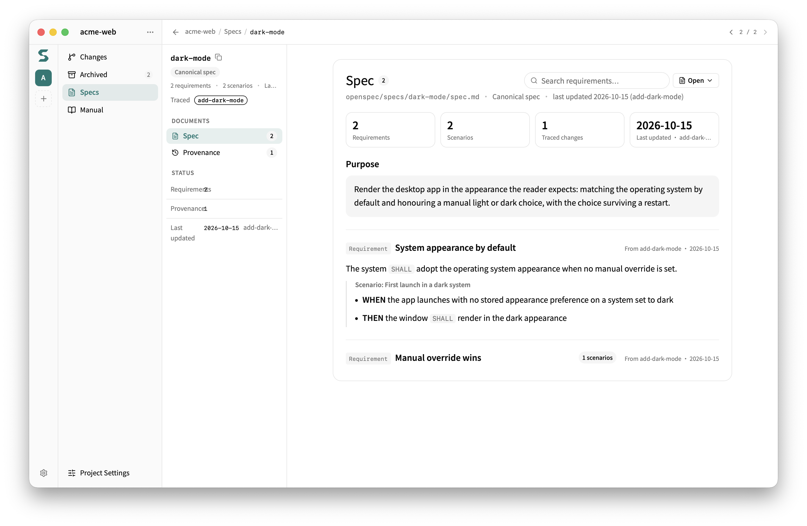

# Getting started with a Local Repo

[繁體中文](getting-started.zh-TW.md) · **English**

Follow this guide to complete one full round: **install → init → propose → apply → check → archive**. The specs live in your repo, and Git handles collaboration. No server is necessary.

Each step shows the expected output. If your output is different, stop and find the difference first. This guide covers only the main path. For the other branches, see the [SDD workflow](workflow.md).

## <a id="before"></a>Before you start

The example requirement is "add CSV export", and the requirement is clear. If you still compare approaches or need a decision, run `discuss` first (see the [workflow](workflow.md#discuss)).

You can work in four ways. All four give the same result:

| Way | Syntax | Note |
| --- | --- | --- |
| Claude Code | `/speclink-propose add-csv-export` | A slash command |
| Codex | `$speclink-propose add-csv-export` | `$` and the skill name; you can also enter `/skills` and pick from the list |
| GitHub Copilot | `/speclink-propose add-csv-export` | A slash command, the same as in Claude Code |
| CLI only | `speclink new change add-csv-export` | No agent; you write each document yourself |

A skill is a workflow guide for the agent: what to read, how to write the documents, and when to stop and ask you. The `speclink` CLI does the actual work. Most users only need the skills.

## <a id="install"></a>1. Install

Install the CLI. Pick one method:

```bash
# With Node.js (any platform)
npm i -g @speclink/cli

# macOS or Linux without Node.js (servers, WSL, CI)
curl -fsSL https://raw.githubusercontent.com/MomoChenisMe/speclink/main/scripts/install.sh | sh

# Homebrew (macOS or Linux)
brew install MomoChenisMe/tap/speclink
```

For a GUI, download a desktop installer from [Releases](https://github.com/MomoChenisMe/speclink/releases/latest) (macOS universal dmg, Windows installer, Linux AppImage). Each installer includes the CLI of the same version. Windows has no install script: use npm or the desktop app.

If you have the CLI and want the desktop app too, read [Install both the CLI and the desktop app](#cli-and-desktop) below first. The desktop app can replace your CLI.

Check the install:

```bash
speclink --version
```

**Expected output**: one version line, for example `speclink 0.8.0 (arm64, engine v1.48.0)`.

### <a id="install-script"></a>Install script options

The install script finds your platform, checks the sha512 of the npm package, and puts `speclink` in `~/.local/bin`. Three environment variables change its behavior:

| Variable | Use |
| --- | --- |
| `SPECLINK_INSTALL_DIR` | Change the install folder |
| `SPECLINK_INSTALL_VERSION` | Pin a version (`0.5.0` or `v0.5.0`; versions before 0.5.0 are not on npm) |
| `SPECLINK_INSTALL_REGISTRY` | Use a different npm registry |

### <a id="cli-and-desktop"></a>Install both the CLI and the desktop app

The desktop app and the install script both use `~/.local/bin/speclink`. Thus the desktop app can replace your CLI:

| Platform | What the desktop app does to `~/.local/bin/speclink` |
| --- | --- |
| macOS | It checks on each start. If the CLI is missing or its version is different from the app, it deletes the file and puts a symlink to the bundled CLI in its place |
| Linux AppImage | It writes over the file only when the versions are different |
| Windows | It does not touch this location; the installer manages PATH |

Thus a version that you pin with `SPECLINK_INSTALL_VERSION` does not stay: if it is different from the app version, the app replaces it. To keep your own CLI, set `SPECLINK_INSTALL_DIR` to a different folder when you install. Then put that folder before `~/.local/bin` in your PATH.

### <a id="from-deb"></a>Move from the .deb package to the AppImage

Releases do not include a `.deb` package after 0.5.0. If you installed the `.deb`, run `sudo apt remove speclink`, then use the AppImage.

## <a id="init"></a>2. Initialize

Go to your repo and run:

```bash
speclink init --tools claude,codex
```

**Expected output**:

```text
✓ Initialized at /path/to/your-repo/speclink
Generated files for: claude, codex
```

`--tools` selects the agent tools that get skills: `claude`, `codex`, and `copilot`, in any comma-separated combination. If you use only GitHub Copilot, write `--tools copilot`.

This step does three things:

- It creates `speclink/` and `.speclink.yaml`.
- It writes skill files for the tools that you select: `.claude/skills/` for Claude, `.agents/skills/` for Codex, and `.github/skills/` for GitHub Copilot.
- It adds `.speclink/` (local work data) to `.gitignore`.

It does not change your `CLAUDE.md`, `AGENTS.md`, or `.github/copilot-instructions.md`. The agent reads the description in each skill file to choose the right skill.

`speclink/` has this folder layout:

```text
speclink/
├── config.yaml                  workflow settings
├── specs/<capability>/spec.md   specs, one file for each capability
├── changes/<name>/              active changes
├── changes/archive/             archived changes
└── discussions/                 discussion records (added by Speclink)
```

All files are plain Markdown and YAML. You can read and edit them without Speclink, and each change shows in the Git diff. Speclink adds only two items: `discussions/`, and a `.meta.yaml` file in each change folder. That file keeps lifecycle data, such as the start time and the source discussion.

This applies to Local mode only. After you connect a remote server, the specs live in the Store. Your machine keeps only a read-only projection (`.speclink/context/`).

Make sure that you start from an empty state:

```bash
speclink list
speclink validate --specs --all --strict
```

**Expected output**: `list` prints `No active changes.`. When no specs exist yet, `validate` prints nothing and exits with 0. No output means a pass.

If your repo has a lot of code but no specs, run `/speclink-baseline` first (`$speclink-baseline` in Codex). It writes specs from the current behavior. Then start a new change.

## <a id="propose"></a>3. Propose

Ask the agent to create the change. In Claude Code or GitHub Copilot:

```text
/speclink-propose add-csv-export
```

In Codex:

```text
$speclink-propose add-csv-export
```

The agent creates the change and writes the documents that the work needs:

- `proposal.md`: why and what.
- The delta specs: the specs that this change adds or changes.
- `tasks.md`: the task list.

`design.md` (technical design) is optional. The agent writes it only for work across modules or for important technical decisions. Thus a change does not always have four documents.

You can check the progress at any time:

```bash
speclink status --change add-csv-export
```

**Expected output** (after the documents are complete):

```text
Change: add-csv-export
Schema: spec-driven

  ✓ proposal (proposal.md)
  ○ design (design.md)
  ✓ specs (specs/**/*.md)
  ✓ tasks (tasks.md)
```

`✓` means done. `○` means ready but not written. `✗` means blocked by an earlier document. It is normal for `design` to stay at `○`: the work can start when `tasks` is done.

When the proposal is complete, the agent runs `analyze` and `validate` to check the documents.

If the requirement comes from a concluded discussion, use `/speclink-propose --from-discussion <slug>`. For the other outcomes of a discussion, see [Discussion outcomes](workflow.md#discussion-outcomes).

<details>
<summary>Write the documents with the CLI, without an agent</summary>

This way is for people who know the document format. The flow is: create the change, read the writing instructions for a document, then write it from stdin.

```bash
speclink new change add-csv-export
speclink instructions proposal --change add-csv-export
speclink new artifact proposal --change add-csv-export --stdin < proposal.md
speclink new artifact spec csv-export --change add-csv-export --new --stdin < spec.md
speclink new artifact tasks --change add-csv-export --stdin < tasks.md
```

- `instructions` shows the sections and the template for a document.
- For a new capability, add `--new`. The delta spec must start with a `## Purpose` section (one or two sentences, 50 characters or more).
- The expected output of `new change`:

```text
✓ Created change: add-csv-export
  Path: /path/to/your-repo/speclink/changes/add-csv-export
  Schema: spec-driven
```

</details>

## <a id="apply"></a>4. Apply

When the documents are complete, ask the agent to start the work. In Claude Code or GitHub Copilot:

```text
/speclink-apply add-csv-export
```

In Codex:

```text
$speclink-apply add-csv-export
```

First, the agent runs `speclink plan` to make sure that no other change blocks this one. Then it reads the proposal, the specs, the design (if one exists), and the tasks, and it does the tasks one by one. After each task, it runs `speclink task done`:

```text
✓ Task 1 marked as done: 1.1 Serialize report rows to CSV
```

Check a task only when its behavior and its tests pass. To clear a wrong check, run `speclink task undone --change add-csv-export <number>`. Do not edit the checkboxes in `tasks.md` directly.

A task with `[M]` is a manual task. You check it yourself. The agent does not check it for you.

When all tasks are done, `speclink list` shows full progress:

```text
Changes:
  • add-csv-export [2/2] — Reports can only be read insid…
```

## <a id="check"></a>5. Check

**Usually you do not need to do this step yourself.** The `propose`, `ingest`, and `apply` skills run `analyze` for you. To look for yourself, or to add a gate in CI, run:

```bash
speclink analyze add-csv-export
speclink validate add-csv-export
```

- `analyze` compares the proposal, specs, design, and tasks. It looks for four types of problems: Coverage, Consistency, Ambiguity, and Gaps.
- `validate` checks the format and the required sections of each document.

**Expected output**:

```text
Change: add-csv-export

  ● Coverage       1 issue(s) found (1 findings)
  ✓ Consistency    Skipped (insufficient artifacts) (0 findings)
  ✓ Ambiguity      Clean (0 findings)
  ✓ Gaps           Clean (0 findings)
  ...
  [WARNING] Requirement 'Export report as CSV' has no matching task

✓ add-csv-export — valid
```

This WARNING means that the specs have a requirement, but no task clearly matches it. Consistency shows `Skipped` because no `design.md` exists.

- CRITICAL: fix the documents before you start the work.
- WARNING and SUGGESTION: they do not block you, but read them before you continue.

`analyze` and `validate` check only the documents. **They do not replace code tests.** Run the tests, lint, and build of your project as usual.

Two optional quality stations check the code. `/speclink-review` checks code craft. `/speclink-verify` checks that the delivery matches the specs. To run both, use `/speclink-quality`. For a small first change, you can skip them. For the rules, see the [workflow](workflow.md#quality).

## <a id="archive"></a>6. Archive

When all tasks are done, the checks pass, and the quality stations that you chose are complete, ask the agent to archive. In Claude Code or GitHub Copilot:

```text
/speclink-archive add-csv-export
```

In Codex:

```text
$speclink-archive add-csv-export
```

Or run the CLI:

```bash
speclink archive add-csv-export -y
```

**Expected output**:

```text
✓ Archived: add-csv-export → <date>-add-csv-export
Specs applied: csv-export (added: 1, modified: 0, removed: 0, renamed: 0)
Snapshot created for unarchive support.
```

The archive step merges the delta specs into the specs and moves the change to `speclink/changes/archive/`. After that, `speclink list` shows `No active changes.` again, and `speclink/specs/csv-export/` exists. This folder is the result of the round.

In the desktop app, the Specs page lists the merged specs, one row for each capability. Click a row to open the detail page of that spec, with its requirements and scenarios.



Do not use `--mark-tasks-complete` or `--no-validate` to skip work that is not done.

## <a id="created"></a>Where the files are

| Path | Content |
| --- | --- |
| `speclink/specs/<capability>/spec.md` | The specs: the current behavior of the system |
| `speclink/changes/<name>/` | An active change and its documents |
| `speclink/changes/archive/` | Archived changes |
| `speclink/discussions/` | Discussion records (only when a decision is necessary) |
| `speclink/config.yaml` | Workflow settings: language, project context, rules, TDD, audit, worktree |
| `.speclink.yaml` | The tools and the remote binding of this checkout |
| `.speclink/` | Local work data (not in Git) |

For the settings, see [Configuration](configuration.md).

## <a id="upgrade"></a>Upgrade an older project or import an OpenSpec project

**A project that an older Speclink created** keeps its specs in `openspec/`. After you upgrade Speclink, run this in the project root:

```bash
speclink update
```

`update` moves `openspec/` to `speclink/`. Then it renames the `.openspec.yaml` file of each change (active and archived) to `.meta.yaml`. The file contents do not change. `update` does not commit for you: after the move, commit it yourself. `speclink/` is an addition and `openspec/` is a deletion. Teammates must upgrade Speclink before they pull that commit, because an older version cannot see the new folder and shows an empty project. Your own scripts, CI settings, and `.gitignore` entries that name `openspec/` also need your changes.

In these two cases, `update` waits with the move and tells you why. It still updates the skill files:

- Other worktrees exist: each worktree has its own copy of `openspec/`. Merge or remove them first. Inside a linked worktree, run `update` in the main checkout instead.
- `openspec/` has uncommitted changes (new untracked files too): commit them first.

The project works without the move: Speclink keeps reading `openspec/` and prints one reminder line on stderr at each run. A project whose `.speclink.yaml` sets `spec_dir` is never moved automatically.

**An OpenSpec project**: run `speclink init` (with the `--tools` you need) in the project root. Speclink moves `openspec/` to `speclink/` and keeps your `config.yaml`, `schemas/`, specs, and changes. Then it adds `.speclink.yaml`, the `.gitignore` entry, and the skill files. When other worktrees exist or `openspec/` has uncommitted changes, `init` refuses and writes nothing. The import is one-way: after it, the OpenSpec CLI cannot read the project. Speclink does not move or delete the skills and command files that OpenSpec installed. Remove them yourself if you no longer use OpenSpec.

## <a id="next"></a>What to do next

- The requirement needs decisions: `/speclink-discuss`. You cannot name the area to improve: `/speclink-improve`.
- The requirement changes during the work: `/speclink-ingest`.
- You resume a change after a pause: run `/speclink-drift <change-name>` first.
- You want to move several independent changes at the same time: use the worktree flow. See the [workflow](workflow.md#worktree).
- You want to know which change comes first: `speclink plan`.
- You want to share specs with a team: see [Remote getting started](remote-getting-started.md).
- You want to know if a capability is available now: see [Product status](product-status.md).
