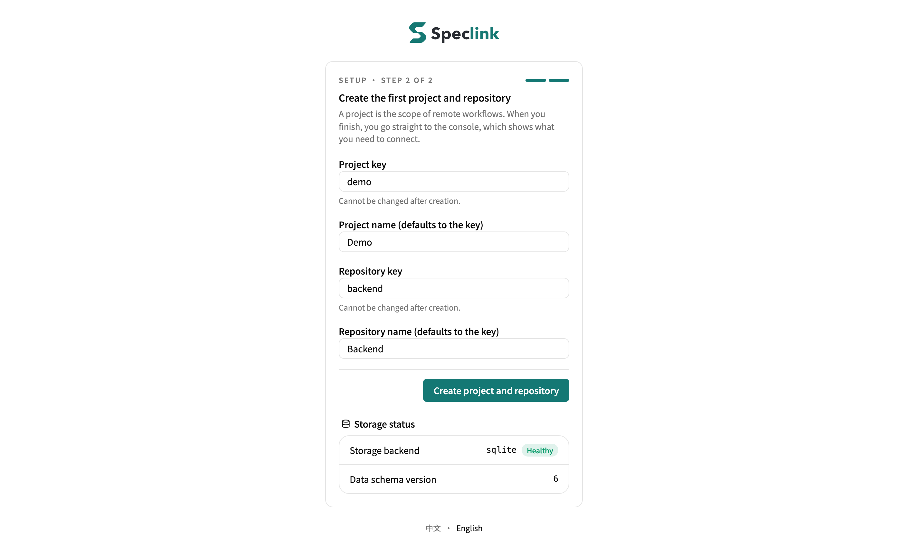
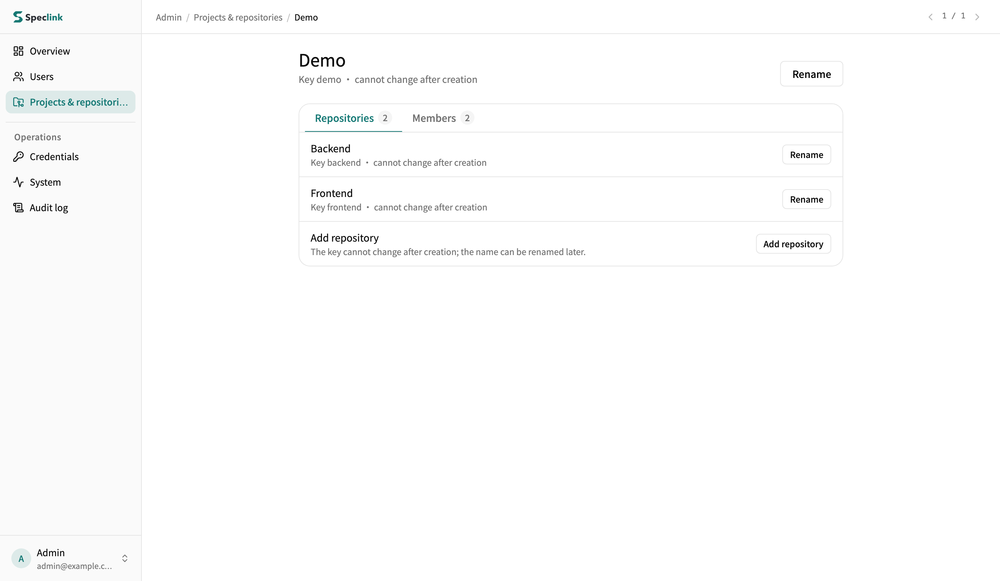

# Remote Getting Started: Server, Desktop, and CLI

[繁體中文](remote-getting-started.zh-TW.md) · **English**

Follow this guide once. You start a demonstration server on your own computer, and then you connect Speclink Desktop (the Desktop app) and the CLI to the same remote project. Each step shows the result that you must see. For a local project, which needs no Server, see [Getting started](getting-started.md). [Product status](product-status.md) is the reference for what works today.

The official server is for demonstration and trial. It lets you try remote projects without writing code. For production use, embed the engine in your own system. See [Embed Speclink in your system](../README.md#embedding).

The steps of this guide use the demonstration server (`speclink-server`). The demonstration server and a host that embeds the engine use the same host kit and the same store contract. Thus, the CLI and Speclink Desktop work the same way with such a host. The first-run setup, the admin console, and the account page (sections 1 to 4) belong to the demonstration server. A host supplies its own accounts, login, and permissions.

## <a id="before-you-begin"></a>Before you begin

You need:

- Node.js 18 or later, to run `npx @speclink/server`. You do not need to clone this repo.
- The `speclink` CLI. The [README](../README.md#install) shows how to install it.
- The Desktop app (optional).

After you connect to a remote, the server keeps the specs and the changes. Your computer does not keep a writable copy. All writes go through the server.

This guide uses three types of URL. Each type has a different use. Do not mix them:

| Name | Example | Where you use it |
| --- | --- | --- |
| Server base URL | `http://localhost:8080` | New Desktop connection, `curl` health check |
| Browser page URL | `http://localhost:8080/account`, `http://localhost:8080/admin/users` | Open in a browser and sign in |
| project-scoped URL | `http://localhost:8080/api/speclink/v1/projects/demo` | CLI `speclink link` |

A project-scoped URL is the Server base URL plus `/api/speclink/v1/projects/<project key>`.

## <a id="start-server"></a>1. Start the server

Go to an empty folder and run:

```bash
npx @speclink/server
```

**Expected output**: one first-run line with a one-time setup link.

```text
Speclink 首次啟動：開啟 http://localhost:8080/setup?token=spk_setup_… 完成初始設定（此連結 24 小時內有效，且僅顯示這一次）。
```

The server prints this link only once. The link is valid for 24 hours. Copy it now.

The current folder now also contains `speclink-data/`. All data is in this folder:

- `config.yaml`: the configuration file that the launcher makes from environment variables. The launcher writes it again at each start without arguments, so manual edits do not stay.
- `store.db`: the project data (specs, changes, and more). The `store.db-wal` and `store.db-shm` files next to it are SQLite work files.
- `identity.db`: accounts, memberships, and credentials.

By default, the server listens only on `127.0.0.1:8080`. Only this computer can connect. To use a different port, run `SPECLINK_PORT=8090 npx @speclink/server`, and change the port in all later URLs. For other settings and the other run modes, see [Server Deployment](server-deployment.md).

Keep this terminal open. Press `Ctrl+C` to stop the server cleanly.

Open a second terminal and make sure that the server is alive:

```bash
curl -o /dev/null -w "%{http_code}\n" http://localhost:8080/healthz
```

**Expected output**: `200`.

## <a id="first-run-setup"></a>2. Complete the first-run setup

Open the setup link in a browser. Keep `localhost` as the host in the address bar. Do not change it to `127.0.0.1`. If the host is different, the server rejects the form as a cross-origin request.

The setup has two steps:

1. Create the admin account: enter an email, a display name, and a password.
2. Create the first project and repository: this guide uses the project key `demo` and the repository key `backend`. You cannot change a key later. An empty name uses the key.



(The screenshots show the interface in Traditional Chinese. You can change the interface language.)

When the setup finishes, the browser opens the admin console overview as the admin. The "Getting started" block at the top shows the service URL, the project key, and the repository key. This block appears only once, right after the setup. Write the values down.

With the example values, the project-scoped URL for the CLI is `http://localhost:8080/api/speclink/v1/projects/demo`.

## <a id="grant-membership"></a>3. Add yourself to the project (required)

The setup creates your admin account and the `demo` project. It does **not** make you a member of `demo`. Project membership is a separate permission layer, and the admin flag does not skip it.

Without membership, you see these results:

- A read of a project resource returns `403` (`permission_denied`), not 404. A 404 means only that the project key does not exist.
- The Desktop Project and Repo list is empty.
- The CLI `speclink auth status` and the verbs that read or write the project show `access denied`. `speclink auth login` itself succeeds: a login checks only your identity, not your membership.

So you must do this step:

1. Open `http://localhost:8080/admin/users` in the browser.
2. Click your own account. The user detail page opens. Open the "Memberships" tab.
3. In the last row, "Add to project", select `demo` in the project list. Keep the role `editor`, and then click "Add".

There are only two roles:

- `editor`: can read and write.
- `reader`: can only read.

A membership applies to a full project, so it covers every repository in that project. The project detail page on `/admin/registry` lists the repositories and the members of the project:



To add a teammate, click "Invite user" on the same page. In the dialog, enter the email and the display name. Select each project in the "Add to projects" list, and then click "Send invitation". The dialog shows a one-time invitation link. Copy it before you close the dialog, and give it to the teammate to finish the sign-up. After the teammate accepts, the teammate is an `editor` in those projects. For the command-line method, see [Server Deployment](server-deployment.md#manage).

## <a id="access-key"></a>4. Create an access key (for CI)

You do not need an access key (PAT, Personal Access Token) for daily sign-in. The demonstration server supports two login methods: device login and access keys. The Desktop app and the CLI use device login first: you click "Approve" once in a browser. Access keys are for CI and for environments without a browser. If you do not need one now, go to the next step. For the three login methods and the order of selection, see [section 6](#cli).

To create an access key:

1. Open `http://localhost:8080/account` in the browser.
2. Click "Create access key" at the top of the page. In the dialog, enter a name. You can leave the expiry date empty, and then the key never expires.
3. Click "Create", and copy the key immediately. The dialog shows it only once. After you close the dialog, you cannot get it back.

When you click the button, the page sends POST `/api/speclink/v1/web/account/tokens` in the background. This URL accepts only POST. It is not a page that you can open. If you open it directly in a browser, you get `405 Method Not Allowed`.

Keep these three rules in mind:

- A key has no permission scope of its own. When you connect with it, you get the memberships of your account.
- Paste the key only into an app input field, or give it to the CLI through standard input (stdin). Do not put it in a URL, `.speclink.yaml`, a repo, or a documentation example. Do not type it as the value of a shell argument.
- If you lose a key, revoke it on `/account` and create a new one.

## <a id="desktop"></a>5. Connect the Desktop app

1. In the icon rail on the left of the Desktop app, click "+" (New project). Select the "Server" source card, and then click "Next".
2. Under "Choose a Server", enter the server URL `http://localhost:8080` (the Server base URL), and then click "Add and sign in".
3. The Desktop app opens the device login page `/activate` in a browser. Sign in if necessary. The page fills in the code. Click "Next", make sure that the code is the same as the code in the Desktop app, and then click "Approve".
4. Go back to the Desktop app. Under "Choose a Project and Repo", select `demo` and `backend`.
5. Under "Connect a local checkout?", select one of the two modes below.
6. Click "Open Project".

An empty list means that you did not do section 3. Add the membership, and then reload the list in the Desktop app.

The two modes:

- **"Skip (spec mode)"**: spec-only. You read and write the remote specs and changes, with no local folder. Use it if you only work with specs.
- **"Choose local folder"**: checkout. You bind the remote project to a local Git folder. The folder must already point to the same remote, or it must be a Git repo with no binding. Select at least one AI tool. Before the workspace opens, the Desktop app writes the Speclink skill files into the folder. If a step fails, the screen stays on that step so you can try again.

The Desktop app keeps your credentials in the system keychain, not in project files. On one computer, the Desktop app and the CLI share the same login in the keychain.

The Desktop app selects a login method in the same order as the CLI (see section 6). The "Sign-in methods" card in Settings → Servers lists the three methods: Browser login, Device login, and Access key.

- When the Server declares browser login, the Desktop app opens the login service of that Server in a browser. The screen shows "Waiting for browser sign-in" and a URL that you can copy.
- The Desktop app shows an access key field only when the Server accepts only access keys, or when the Server declares no login methods and has no device login. In that case, paste the key that you got from that Server. The demonstration server supports device login, so you do not see this field.

For a remote project that you open with "Choose local folder", the Server supplies the skill files (see "Get the skills" in section 6). The Desktop app compares the skill files in the checkout with the skill files from the Server. When you must do something, it shows a notice card:

- The skill files are different from those of the Server: click "Update skill files".
- The checkout has no skill files: click "Install skill files".
- The Desktop app is older than the Server: the dialog also shows "Update Speclink". You can still install the skills from the Server first.

A project that you open with "Skip (spec mode)" has no checkout, so the Desktop app does not do this check.

For the differences between the remote board and the local board, see [Project Capability Status](product-status.md).

## <a id="cli"></a>6. Connect the CLI

**Do this step in a separate test folder.** `speclink link` writes the connection into the `.speclink.yaml` file of the current project. If you run it in the root of a product repo, that repo connects to this test server.

```bash
mkdir speclink-remote-test
cd speclink-remote-test
speclink link http://localhost:8080/api/speclink/v1/projects/demo --repo backend
```

**Expected output** (when this computer is not signed in to this server):

```text
✓ Linked to http://localhost:8080/api/speclink/v1/projects/demo
  No credentials yet — run `speclink auth login` to connect
```

Use the repository key for `--repo`. If the key does not match, `link` shows the available keys and stops. It writes nothing. When the project has one repository, you can omit `--repo`. When the project has two or more repositories and you are signed in, `--repo` is necessary: without it, `link` tells you to add `--repo`, shows the available keys, and stops. It writes nothing then too.

The Desktop app and the CLI share the login in the keychain. If you signed in with the Desktop app in section 5, the output has one more line, `✓ Repo 'backend' is registered in this project`, and you can skip `auth login` below. If not, sign in and check the result:

```bash
speclink auth login
speclink auth status
```

With the demonstration server, `auth login` uses device login. It shows a URL and a code, and it opens `/activate` in a browser. The page fills in the code. Click "Next", and then click "Approve" to finish the sign-in. `auth status` shows your identity and the source of the credential (the `Credential from:` line). Its last line is `Repo 'backend' is registered in this project`, which means that the repository key matches.

Do one read and write test:

```bash
speclink new change smoke-test
speclink list
```

**Expected output** (from `list`):

```text
Changes:
  • smoke-test
```

The Desktop board also shows `smoke-test`. When you finish the test, run `speclink discard smoke-test` to remove it.

### Three login methods and the order of selection

The CLI and Speclink Desktop have three login methods. The Server decides which methods are possible:

| Login method | How it works | Flag that selects it |
| --- | --- | --- |
| Browser login | The CLI shows a login URL and opens the login service of the Server in a browser. You sign in there. The browser then sends the result to a temporary port that the CLI opens on `127.0.0.1`. The CLI waits for a maximum of 5 minutes | `--browser` |
| Device login | The CLI shows a URL and a code. You approve this device on a page of the Server | `--device` |
| Access key | You give the CLI a key that you got from the Server | `--pat` (paste by hand), `--token-stdin` (read from standard input) |

Without a flag, `speclink auth login` first asks the Server which login methods it supports. Then it uses the first method that the Server declares, in this fixed order: **browser login → device login → access key**. The client sets this order. The order in the list from the Server has no effect.

- The Server declares browser login: the CLI uses browser login first. To use one of the other two methods, add `--device`, `--pat`, or `--token-stdin`.
- The demonstration server declares device login and access keys: the CLI uses device login.
- The Server declares only access keys: `auth login` exits non-zero. The message tells you to use `--pat` or `--token-stdin`.
- You select a method with `--browser` or `--device`, and the Server does not declare it: `auth login` exits non-zero. The message lists the methods that the Server supports. The CLI does not change to a different method by itself.
- You can use only one of the four flags at a time.

When the Server declares no login methods (an old Server, or a host that sets no login methods), the CLI keeps the old behavior:

- No flag, or `--device`: the CLI tries device login first. If the Server has no device login either, the CLI exits non-zero. The message tells you to use `speclink auth login --pat`.
- `--browser`: the CLI refuses, because the Server publishes no login service.
- `--pat` and `--token-stdin`: these work as usual.

If the query for the login methods fails (for example, the Server has an error or you cannot connect), the login stops. The CLI does not try a different method.

### Where credentials are stored

- **Browser login and device login**: the CLI keeps the credential only in the system keychain. If this computer has no usable keychain, these two logins do not start. The message tells you to use `--pat` or `SPECLINK_TOKEN`.
- **Access key**: the CLI first asks the Server whether the key is valid. Then it stores the key in the system keychain. If no keychain is usable (for example, CI without a desktop environment), the CLI stores the key in `credentials.yaml` in the user config directory. On macOS and Linux, only your account can read that file. For the location of the directory, see [Configuration](configuration.md#layers).
- A key that an older CLI stored in `credentials.yaml` still works.
- No credential is in the repo. The CLI and the Desktop app share the logins in the keychain.

`speclink auth logout` removes all credentials for this Server from this computer (the keychain and `credentials.yaml`). It also revokes a device login credential on the Server. It revokes a browser login credential when the login service supports revocation. An access key stays valid on the Server. With the demonstration server, revoke it on `/account`.

### In CI or without a terminal

`speclink auth login` without a flag needs an interactive terminal. Outside a terminal, it stops with an error. In that case, use an access key in one of these ways:

- Set the environment variable `SPECLINK_TOKEN` from the secret store of your CI. The CLI uses it first and writes it to no file.
- Run `speclink auth login --token-stdin` to read the key from standard input. To paste the key by hand, use `speclink auth login --pat`.

### Get the skills

Skill files are the step-by-step instructions in the checkout that AI tools read. After you connect to a remote project and sign in, run this command once:

```bash
speclink update
```

`speclink update` gets skills only for the AI tools in the `tools` list of `.speclink.yaml`. A folder that you connected only with `speclink link` does not have this list yet. Add it first (see [Configuration](configuration.md#tools)):

```yaml
tools:
  - claude
```

**Expected output** (when the tool is `claude`; the value in parentheses is the skill version of the Server):

```text
✓ Updated skill files for: claude
  Skills source: server (v1.58.0)
```

Keep these points in mind about the skills of a remote project:

- **The skills come from the Server.** The engine on the Server runs the verbs of a remote project, so the Server also supplies the skills. Their text comes from the templates of the engine version on the Server. The Server decides which skills it supplies. For example, the two worktree skills exist only when the workflow config on the Server turns on worktree.
- **The version follows the Server.** If the version from the Server is older than the version in the checkout, the CLI installs it anyway. The output has one more line, `! Skills replaced with the server's version …`. You do not need `--allow-downgrade` here.
- **When you connect to a Server, you trust the skills that it supplies.** Skill files are instructions that AI tools follow. Speclink does not sign the skills and does not check their content. Connect only to a Server that you trust.
- After the Server is upgraded, or after the workflow config on the Server changes, run `speclink update` again.
- If the Server supplies no skills for an AI tool, the skill files of that tool stay as they are. The output has one more line, `! The server gives no skills for: …`.
- If the Server declares skills but the CLI cannot get them, the command exits non-zero and writes no file.

With an old Server that declares no skills, `speclink update` makes the skills from the templates in this CLI. stderr shows one more line, `speclink: skills generated from this CLI's templates — this server does not provide skills`, and the output shows `local` as the source. In this case, the two worktree skills are not made. See the [known gaps](product-status.md#known-gaps). The CLI also uses its own templates when you are not signed in or cannot connect to the Server. The stderr line then gives the cause.

A checkout that you make with `speclink init --store remote` also starts with skills from the templates in the CLI. After you sign in, run `speclink update` in the same way. When the skill templates of the CLI are older than those of the Server, the CLI reminds you to update Speclink. See [Configuration](configuration.md#remote).

### Verb differences in remote projects

Most verbs work as usual in a remote project, and they write to the Server. The CLI limits only two verbs to one side. If you run one on the other side, the CLI refuses it:

- Local projects only: `demo`. It writes a demo change into the local spec folder.
- Remote projects only: `claim`. A local project has no claim state. To release a claim, run `speclink claim <change> --release`. Each person with write access can release it, not only the claimant. A Server that embeds the engine can set a stricter rule.

`trace`, `change rank`, and `plan --strict-overlap` work in remote projects. The Server calculates the result.

There are two more differences:

- In a remote project, `speclink archive` archives one change at a time. The CLI refuses `--all` and more than one name.
- In a remote project, the CLI refuses `--schema` on `speclink status` and `speclink instructions`. The workflow config on the Server decides the schema.

For skills: remote projects do not support the baseline and manual skills yet. Each skill gives the cause and stops, and it writes no file. The tour mode of the manual skill is not affected. See the [known gaps](product-status.md#known-gaps).

For the full list, see the [Verb and Flag Contract](verb-contract.md#mode-assignment). In checkout mode, `speclink instructions` puts the remote content into the read-only `.speclink/context/` folder. Do not edit it. To update it, run `speclink instructions` again.

## <a id="restart"></a>7. Data stays after a restart

Press `Ctrl+C` in the server terminal. Then run `npx @speclink/server` again in the same folder.

This time the server does **not** print a setup link. This is correct: the setup is complete, and the data is in `speclink-data/`. Then check these results:

- `speclink list` still shows `smoke-test`.
- The remote tab in the Desktop app is still there. It connects again when the server comes back.
- If you open the setup link again, the page shows "Setup link is not valid", because the setup is closed.

If you restart before the setup is complete, the server does not print a new link either. The first link stays valid for 24 hours. If you cannot find it, wait until it expires and restart, and the server prints a new one. Or reset as in section 9.

## <a id="offline"></a>8. When the server is offline

Try this once on purpose: keep a remote tab open in the Desktop app, and press `Ctrl+C` in the server terminal. The tab goes offline:

- The Desktop app shows "Connection interrupted". The screen keeps the last content that loaded successfully, and you can still read it.
- The Desktop app disables all write actions (check a task, save a document, change settings). It does not queue them for later.
- CLI commands fail with `Error: server unreachable — …`.

A TLS certificate that this computer does not trust also stops the connection. The Desktop app shows the same "Connection interrupted", and the CLI message names the certificate:

```text
Error: server unreachable — the server's TLS certificate was rejected (UnknownIssuer); if your organisation's own CA issued it, add that CA to the operating system's trust store
```

See [Troubleshooting](#troubleshooting) for the fix.

Start the server again. The Desktop app connects again by itself, queries the server again, and updates the screen. You do not need to reload. Changes that other people made during the outage also appear.

When the Server answers but cannot serve for a time (for example, during maintenance), the Desktop app also goes offline. If the Server gives a reason, the Desktop app shows that reason next to "Connection interrupted", and the CLI message is `Error: server unavailable — <the reason from the Server>`.

In a different condition, the Server operates correctly, but your account is suspended or removed from the project. The open tab shows a red "Access denied" above the board with the reason from the Server. The project square in the left rail gets a red dot, and the system tray shows the condition too. The screen keeps the last content that loaded successfully, and all write actions are disabled. After an admin gives your access back, the tab recovers by itself and queries the Server again.

## <a id="reset"></a>9. Full reset

With npx, all data is in `speclink-data/`. To start from zero:

1. In the test folder, run `speclink auth logout` to remove the sign-in for this server from this computer.
2. Stop the server and remove the data folder:

   ```bash
   rm -rf ./speclink-data
   ```

3. Remove the test folder `speclink-remote-test`. In the Desktop app, remove this connection in Settings → Servers.

The next `npx @speclink/server` prints a new setup link, and everything starts again.

To move data or to make regular backups, see [Server Backup and Restore](server-backup.md). To develop inside a Speclink source checkout, use `npm run dev`, and use `npm run dev:reset` to reset. See [Development](development.md).

## <a id="troubleshooting"></a>Troubleshooting

| Symptom | Cause and fix |
| --- | --- |
| You cannot find the setup link, and a restart does not print it | The server prints the link only once. Before the setup is complete, the first link is valid for 24 hours. After it expires, a restart prints a new one. If you do not need the data, reset as in section 9. |
| After the setup, the setup link shows "Setup link is not valid" | This is correct: the setup closes permanently when it is complete. Sign in at `/admin`. |
| A form shows a cross-origin rejection | The scheme, host, and port in the address bar must be the same as the server `public_url`. For example, use `localhost`, not `127.0.0.1`. |
| The Desktop Project and Repo list is empty, the CLI shows `access denied`, or the API returns `403` (`permission_denied`) | The account is signed in but has no membership. This applies to admins too. Give the account `reader` or `editor` on `/admin/users`, and then reload the list in the Desktop app. |
| You open `/api/speclink/v1/web/account/tokens` in a browser and get `405` | This URL accepts only POST. On the `/account` page, click "Create access key". |
| You lost an access key | You cannot get it back. Revoke it on `/account` and create a new one. |
| `speclink auth login` says that it needs a terminal | You are not in an interactive terminal. Use `--token-stdin` or `SPECLINK_TOKEN`. See section 6. |
| `speclink auth login --browser` says `this server does not support browser login` | This Server does not declare browser login. The demonstration server is an example. Remove `--browser` and let the CLI select the method. See section 6. |
| `speclink update` says `No AI tool configurations found` | `.speclink.yaml` has no `tools` list. Add the AI tools that you use and run the command again. See "Get the skills" in section 6. |
| stderr shows `this CLI's skill templates (…) are older than this server's (…)` | The skill templates of the CLI are older than those of the Server. This is only a reminder, and the command completes as usual. Update Speclink. See [Configuration](configuration.md#remote). |
| `link` or `auth status` says `repo '…' is not registered in this project` | The `--repo` value does not match the repository key. The message shows the available keys. Run `speclink link` again with the correct key. |
| `link`, `init --store remote`, or `auth status` says `this project registers multiple repos` | The project has two or more repositories, and this folder does not name one. Run `speclink link <url> --repo <key>` as the message tells you, with a key from the list in the message. `init --store remote` completed the initialization before this message, so this one step is sufficient. |
| A CLI command fails, and the message contains `registers multiple repos — specify one with X-Speclink-Repo` | This Server is an old version (0.14.0 or earlier). Upgrade the Server (or the `@speclink/engine` of the host). Before the upgrade, write `repo: <key>` below `remote` in `.speclink.yaml` yourself. |
| The Desktop app shows a red "Access denied" above the board | The account is suspended, or it is not a member of this project now. The text is the reason from the Server. Ask an admin to give the access back. The tab then recovers by itself, and you do not need to open it again. |
| A CLI command fails with `Error: server unreachable — the server's TLS certificate was rejected (…)`. Or the Desktop app shows "Connection interrupted" for an `https://` Server that is in operation | This computer does not trust the TLS certificate of the Server. The text in the parentheses is the reason name from the operating system, for example `UnknownIssuer`. Another operating system can give a different name, and the name can be `Other`. If a CA of your organisation issued the certificate, install that CA into the trust store of the operating system, and then run the command again. Speclink has no setting that skips this check. During login, the message starts with `the login service's TLS certificate was rejected`, and the fix is the same. See [Configuration](configuration.md#remote). |
| The server URL changed | In the test folder, run `speclink unlink`, and then run `link` with the new URL. In the Desktop app, add a new connection. |
| The server does not start, or `/healthz` does not return `200` | Read the error in the server terminal. If the configuration has an error, the server stops. It never starts with a bad configuration. |
| You run `speclink-server` directly and see `missing required argument --config` | The binary always needs `--config`. Use `npx @speclink/server`, or give your own configuration file. See [Server Deployment](server-deployment.md). |
| The CLI behavior does not match this guide | Usually, an old `speclink` is on your PATH. Run `speclink --version` to check the version. Inside a Speclink source checkout, use `npm run cli -- <args>`. It always runs the CLI built from that checkout. |
