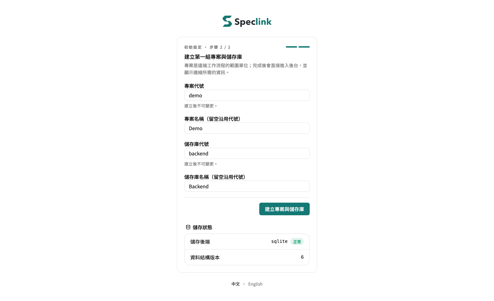
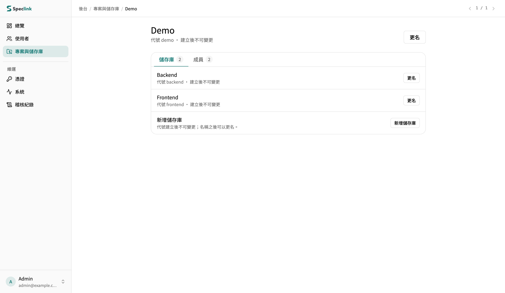

# Remote 入門：Server、Desktop 與 CLI

**繁體中文** · [English](remote-getting-started.md)

照這份文件做一次，你會在自己的電腦上起一台示範用 server，再用 Speclink Desktop 和 CLI 連上同一個遠端專案。每一步都附上你該看到的結果。不需要 Server 的本機專案見[本機專案的入門](getting-started.zh-TW.md)；哪些能力現在能用，以[專案能力狀態](product-status.zh-TW.md)為準。

官方 server 是示範與試用用的。它讓你不寫程式就能試遠端專案。正式使用請把引擎內嵌進自己的系統。見[把 Speclink 內嵌進你的系統](../README.zh-TW.md#embedding)。

這份文件的步驟用的是示範用 server（`speclink-server`）。它和內嵌了引擎的宿主用同一套宿主套件與同一份儲存契約組成，所以 CLI 與 Speclink Desktop 連到宿主時，用法和這裡一樣。初始設定、後台與帳號頁（第 1 到第 4 節）是示範用 server 自己的畫面；宿主的帳號、登入與權限由宿主負責。

## <a id="before-you-begin"></a>開始前

你需要：

- Node.js 18 以上，用來執行 `npx @speclink/server`。不需要 clone 這個 repo。
- `speclink` CLI，安裝方式見 [README](../README.zh-TW.md#install)。
- Desktop app（選用）。

接上遠端之後，規格與變更都存在 server 上。本機不會留一份可寫的副本，所有寫入都經過 server。

全文會用到三種網址。它們的用途不同，不要混用：

| 名稱 | 範例 | 用在哪裡 |
| --- | --- | --- |
| Server base URL | `http://localhost:8080` | Desktop 新增連線、`curl` 健康檢查 |
| 瀏覽器頁面網址 | `http://localhost:8080/account`、`http://localhost:8080/admin/users` | 用瀏覽器開，登入後操作 |
| project-scoped URL | `http://localhost:8080/api/speclink/v1/projects/demo` | CLI 的 `speclink link` |

project-scoped URL 等於 Server base URL 加上 `/api/speclink/v1/projects/<專案代號>`。

## <a id="start-server"></a>1. 啟動 server

找一個空資料夾，執行：

```bash
npx @speclink/server
```

**預期輸出**：一行首次啟動訊息，裡面有一次性的設定連結。

```text
Speclink 首次啟動：開啟 http://localhost:8080/setup?token=spk_setup_… 完成初始設定（此連結 24 小時內有效，且僅顯示這一次）。
```

這個連結只印這一次，24 小時內有效。先把它複製下來。

目前資料夾同時多了 `speclink-data/`，所有資料都在裡面：

- `config.yaml`：啟動器依環境變數產生的組態檔。每次不帶參數啟動都會重新產生，手改的內容會被蓋掉。
- `store.db`：專案資料（規格、變更等）。旁邊的 `store.db-wal` 與 `store.db-shm` 是 SQLite 的工作檔。
- `identity.db`：帳號、成員資格與憑證。

server 預設只聽 `127.0.0.1:8080`，只有這台電腦連得到。要換埠就用 `SPECLINK_PORT=8090 npx @speclink/server`，後面所有網址的埠也跟著換。其他設定與其他跑法，見 [Server 部署](server-deployment.zh-TW.md)。

讓這個終端機保持執行。按 `Ctrl+C` 會正常停止 server。

開另一個終端機，確認 server 活著：

```bash
curl -o /dev/null -w "%{http_code}\n" http://localhost:8080/healthz
```

**預期輸出**：`200`。

## <a id="first-run-setup"></a>2. 完成初始設定

用瀏覽器開剛才的設定連結。網址列的主機要和連結一樣是 `localhost`，不要改成 `127.0.0.1`；不一樣的話，送出表單會被當成跨來源請求拒絕。

畫面分兩步：

1. 建立管理員帳號：填 email、顯示名稱與密碼。
2. 建立第一組專案與儲存庫：本文的專案代號用 `demo`，儲存庫代號用 `backend`。代號建立後不能改；名稱留空會沿用代號。



完成後，瀏覽器會以管理員身分進入管理主控台的總覽。最上面的「開始使用」區塊列出服務網址、專案代號與儲存庫代號。這個區塊只在剛完成設定時出現這一次，可以順手記下來。

依本文的範例，CLI 要用的 project-scoped URL 是 `http://localhost:8080/api/speclink/v1/projects/demo`。

## <a id="grant-membership"></a>3. 把自己加進專案（必做）

初始設定建立了你的管理員帳號和 `demo` 專案，但**沒有**讓你成為 `demo` 的成員。成員資格（membership）是另一層權限，管理員身分也不會略過它。

沒有成員資格時，你會看到：

- 讀取專案資源得到 `403`（`permission_denied`），不是 404。404 只代表專案代號不存在。
- Desktop 的 Project／Repo 清單是空的。
- CLI 的 `speclink auth status` 與讀寫專案的動詞回 `access denied`。`speclink auth login` 本身會成功：登入只確認你的身分，不看成員資格。

所以這一步一定要做：

1. 用瀏覽器開 `http://localhost:8080/admin/users`。
2. 點你自己的帳號，進入使用者詳情頁，切到「成員資格」分頁。
3. 在最後一列「加入專案」的下拉選單選 `demo`，角色維持 `editor`，按「加入」。

角色只有兩種：

- `editor`：可以讀，也可以寫。
- `reader`：只能讀。

成員資格以專案為單位，專案裡的每個儲存庫都適用。`/admin/registry` 的專案詳情頁列出這個專案的儲存庫與成員：



要讓同事加入，在同一頁按「邀請使用者」，在對話框填電子郵件與顯示名稱，從「加入專案」下拉選單逐一選要加入的專案，再按「送出邀請」。對話框會顯示一次性的邀請連結，關掉前先複製，交給對方完成註冊；對方接受後就是那些專案的 `editor`。命令列的做法見 [Server 部署](server-deployment.zh-TW.md#manage)。

## <a id="access-key"></a>4. 建立存取金鑰（給 CI 用）

日常登入用不到存取金鑰（PAT，Personal Access Token）。示範用 server 支援裝置登入與存取金鑰兩種登入方式，Desktop 與 CLI 會先用裝置登入：在瀏覽器按一次「核准」就好。存取金鑰是給 CI 或沒有瀏覽器的環境用的；現在用不到的話，可以直接跳到下一步。三種登入方式與選擇的順序見[第 6 節](#cli)。

建立方式：

1. 用瀏覽器開 `http://localhost:8080/account`。
2. 按頁面上方的「建立存取金鑰」，在對話框填名稱。到期日可以留空，代表永久有效。
3. 按「建立」，立刻複製對話框裡的金鑰。它只顯示這一次，關掉對話框就拿不回來。

按下建立時，頁面在背景送出 POST `/api/speclink/v1/web/account/tokens`。這個網址只接受 POST，不是可以直接開的頁面；用瀏覽器直接開它，會得到 `405 Method Not Allowed`。

使用時記住三件事：

- 金鑰沒有自己的權限範圍。用它連線時，權限等於你的帳號在各專案的成員資格。
- 只把金鑰貼進 app 的輸入框，或從標準輸入（stdin）交給 CLI。不要放進網址、`.speclink.yaml`、repo 或文件範例，也不要寫成帶值的 shell 參數。
- 弄丟了就到 `/account` 撤銷，再建一把新的。

## <a id="desktop"></a>5. 用 Desktop 連上

1. 在 Desktop 左側圖示列按「＋」（新增專案），選「Server」來源卡，再按「下一步」。
2. 在「選擇 Server」下方填伺服器位址 `http://localhost:8080`（Server base URL），按「新增並登入」。
3. Desktop 會開瀏覽器到裝置登入頁 `/activate`。還沒登入就先登入。頁面已帶入代碼，按「下一步」，確認代碼和 Desktop 上的一樣，再按「核准」。
4. 回到 Desktop，在「選擇 Project 與 Repo」選 `demo` 與 `backend`。
5. 在「連接本機 checkout？」選一種開法，見下方說明。
6. 按「開啟專案」。

清單是空的，代表第 3 節還沒做。補上成員資格後，回 Desktop 重新載入清單。

兩種開法：

- **「略過（規格模式）」**：spec-only。只讀寫遠端的規格與變更，不連本機資料夾。適合只看規格的人。
- **「選擇本機資料夾」**：checkout。把遠端專案綁到一個本機 Git 資料夾。這個資料夾必須已經綁同一個遠端，或是還沒綁定的 Git repo。你至少要勾一個 AI 工具；開啟前，Desktop 會把 Speclink 技能檔寫進這個資料夾。任何一步失敗，畫面會停在那一步讓你重試。

登入憑證存在系統鑰匙圈，不會寫進專案檔案。在同一台電腦上，Desktop 與 CLI 共用鑰匙圈裡的同一份登入。

Desktop 選登入方式的順序和 CLI 相同（見第 6 節），「設定 → 伺服器」的「登入方式」卡列出三種：瀏覽器登入、裝置登入、存取金鑰。

- 連到宣告了瀏覽器登入的 Server 時，Desktop 開瀏覽器到那台 Server 的登入服務，畫面停在「等待瀏覽器登入」，並顯示可以複製的網址。
- Server 只收存取金鑰，或是沒有宣告登入方式又不支援裝置登入時，Desktop 才會改顯示存取金鑰的輸入框。這時貼上你在那台 Server 取得的金鑰。示範用 server 支援裝置登入，所以你不會看到這個輸入框。

用「選擇本機資料夾」開的遠端專案，技能檔由 Server 提供（見第 6 節的「取得技能」）。Desktop 會拿 checkout 裡的技能檔和 Server 提供的比對，需要處理時顯示提示卡：

- 技能檔和 Server 提供的不同：按「更新技能檔」。
- checkout 裡還沒有技能檔：按「安裝技能檔」。
- Desktop 自己的版本比 Server 舊：確認框多一個「更新 Speclink」。你仍然可以先安裝 Server 提供的技能。

用「略過（規格模式）」開的專案沒有 checkout，不做這項檢查。

遠端看板和本地看板還有哪些差異，逐項見[專案能力狀態](product-status.zh-TW.md)。

## <a id="cli"></a>6. 用 CLI 連上

**請在一個獨立的測試資料夾裡做這一步。** `speclink link` 會把連線寫進目前專案的 `.speclink.yaml`。在產品 repo 的根目錄執行，會把那個 repo 改成連到這台測試 server。

```bash
mkdir speclink-remote-test
cd speclink-remote-test
speclink link http://localhost:8080/api/speclink/v1/projects/demo --repo backend
```

**預期輸出**（這台電腦還沒登入過這台 server 時）：

```text
✓ Linked to http://localhost:8080/api/speclink/v1/projects/demo
  No credentials yet — run `speclink auth login` to connect
```

`--repo` 填儲存庫代號。代號對不上時，`link` 會列出可用的代號並結束，不寫入任何東西。

Desktop 與 CLI 共用鑰匙圈裡的登入。如果第 5 節已經用 Desktop 登入，輸出會多一行 `✓ Repo 'backend' is registered in this project`，下面的 `auth login` 可以略過。否則，登入並確認：

```bash
speclink auth login
speclink auth status
```

連到示範用 server 時，`auth login` 走裝置登入：它會印出一個網址和代碼，並開瀏覽器到 `/activate`。頁面已帶入代碼，按「下一步」再按「核准」就完成登入。`auth status` 會印出你的身分與憑證的來源（`Credential from:` 那一行）；最後一行是 `Repo 'backend' is registered in this project`，代表儲存庫代號對得上。

做一次讀寫測試：

```bash
speclink new change smoke-test
speclink list
```

**預期輸出**（`list` 的部分）：

```text
Changes:
  • smoke-test
```

Desktop 的看板也會出現 `smoke-test`。測完用 `speclink discard smoke-test` 刪掉它。

### 三種登入方式與選擇的順序

CLI 與 Speclink Desktop 有三種登入方式。用哪一種，看 Server 支援什麼：

| 登入方式 | 怎麼進行 | 指定用它的旗標 |
| --- | --- | --- |
| 瀏覽器登入 | CLI 印出登入網址，並開瀏覽器到 Server 的登入服務。你在那裡登入後，瀏覽器把結果送回 CLI 在本機 `127.0.0.1` 臨時開的埠。CLI 最多等 5 分鐘 | `--browser` |
| 裝置登入 | CLI 印出網址與代碼，你在 Server 的頁面核准這台裝置 | `--device` |
| 存取金鑰 | 你把在 Server 取得的金鑰交給 CLI | `--pat`（手動貼上）、`--token-stdin`（從標準輸入讀） |

`speclink auth login` 不帶旗標時，CLI 先問 Server 支援哪些登入方式，再依固定的順序用第一個 Server 有宣告的：**瀏覽器登入 → 裝置登入 → 存取金鑰**。這個順序由用戶端決定，和 Server 列出的順序無關。

- Server 宣告了瀏覽器登入：CLI 先用瀏覽器登入。要改用另外兩種，加上 `--device`、`--pat` 或 `--token-stdin`。
- 示範用 server 宣告裝置登入與存取金鑰：CLI 用裝置登入。
- Server 只宣告存取金鑰：`auth login` 以非零結束，訊息請你改用 `--pat` 或 `--token-stdin`。
- 你用 `--browser` 或 `--device` 指定的方式 Server 沒有宣告：`auth login` 以非零結束，訊息列出 Server 支援的方式。CLI 不會自己改用別種。
- 四個旗標一次只能用一個。

Server 沒有宣告登入方式時（舊版的 Server，或沒有設定登入方式的宿主），CLI 維持舊的行為：

- 不帶旗標或帶 `--device`：先試裝置登入。Server 也沒有裝置登入時，以非零結束，訊息請你改用 `speclink auth login --pat`。
- `--browser`：被拒絕，因為 Server 沒有公布登入服務。
- `--pat` 與 `--token-stdin`：照常可用。

查詢登入方式本身失敗時（例如 Server 出錯或連不上），登入直接停止，不會改用別種方式。

### 憑證存放的位置

- **瀏覽器登入與裝置登入**：憑證只存在系統鑰匙圈。這台機器沒有可用的鑰匙圈時，這兩種登入不會開始；訊息會請你改用 `--pat` 或 `SPECLINK_TOKEN`。
- **存取金鑰**：CLI 先向 Server 確認金鑰有效，再存進系統鑰匙圈。沒有可用的鑰匙圈時（例如沒有桌面環境的 CI），改存到使用者設定目錄的 `credentials.yaml`；在 macOS 與 Linux，這個檔案只有你的帳號讀得到。目錄的位置見[設定說明](configuration.zh-TW.md#layers)。
- 舊版 CLI 存在 `credentials.yaml` 的金鑰照常可用。
- 憑證都不在 repo 裡。存在鑰匙圈的登入，CLI 與 Desktop 共用。

`speclink auth logout` 清掉這台電腦上這台 Server 的全部憑證（鑰匙圈與 `credentials.yaml`）。裝置登入的憑證會一併向 Server 撤銷；瀏覽器登入的憑證在登入服務提供撤銷時也會撤銷。存取金鑰在 Server 上仍然有效，示範用 server 要到 `/account` 撤銷。

### 在 CI 或沒有終端機的環境

不帶旗標的 `speclink auth login` 需要互動終端機；不在終端機裡執行時，它會直接拒絕。這時改用存取金鑰，擇一：

- 設環境變數 `SPECLINK_TOKEN`，由 CI 的祕密管理功能注入。CLI 會優先使用它，不寫進任何檔案。
- 執行 `speclink auth login --token-stdin`，從標準輸入讀金鑰。要手動貼上，則用 `speclink auth login --pat`。

### 取得技能

技能檔是放在 checkout 裡、給 AI 工具讀的步驟說明。連上遠端專案並登入之後，執行一次：

```bash
speclink update
```

`speclink update` 只替 `.speclink.yaml` 的 `tools` 列出的 AI 工具取得技能。只用 `speclink link` 接上的資料夾還沒有這份清單，請先加上（寫法見[設定說明](configuration.zh-TW.md#tools)）：

```yaml
tools:
  - claude
```

**預期輸出**（工具是 `claude` 時；括號裡是 Server 的技能版本）：

```text
✓ Updated skill files for: claude
  Skills source: server (v1.58.0)
```

關於遠端專案的技能，要知道這幾件事：

- **技能來自 Server。** 遠端專案的動詞由 Server 上的引擎執行，所以技能也由 Server 提供，內容是 Server 那一版引擎的範本。提供哪些技能由 Server 決定：例如 Server 上的流程設定開了 worktree，才會有兩個 worktree 技能。
- **版本跟著 Server。** Server 提供的版本比 checkout 裡的舊時也照裝，輸出多一行 `! Skills replaced with the server's version …`。這裡不需要 `--allow-downgrade`。
- **連到一台 Server，等於信任它提供的技能。** 技能檔是 AI 工具會照著做的指示。Speclink 不替技能簽章，也不檢查內容。只連你信任的 Server。
- Server 升級之後，或 Server 上的流程設定改了之後，再執行一次 `speclink update`。
- Server 對某個 AI 工具一支技能都不提供時，那個工具既有的技能檔維持原狀，輸出多一行 `! The server gives no skills for: …`。
- Server 有宣告技能、取得卻失敗時，指令以非零結束，不寫入任何檔案。

連到沒有宣告技能的舊版 Server 時，`speclink update` 改用這份 CLI 內建的範本產生技能。stderr 會多一行 `speclink: skills generated from this CLI's templates — this server does not provide skills`，輸出的來源顯示 `local`。這時不會有兩個 worktree 技能，見[已知缺口](product-status.zh-TW.md#known-gaps)。還沒登入或連不上 Server 時也一樣用內建的範本，stderr 那一行會寫出原因。

用 `speclink init --store remote` 建立的 checkout，一開始的技能也來自 CLI 內建的範本；登入後同樣執行 `speclink update`。CLI 的技能範本比 Server 舊時，CLI 會提醒你更新 Speclink，見[設定說明](configuration.zh-TW.md#remote)。

### 動詞在遠端的差異

大多數動詞在遠端專案照常可用，結果寫到 Server。CLI 只把兩個動詞限定在一邊；在另一邊執行，CLI 會直接拒絕：

- 只限本機專案：`demo`。它把示範用的變更寫進本機的規格資料夾。
- 只限遠端專案：`claim`。本機專案沒有認領的狀態。

`trace`、`change rank` 與 `plan --strict-overlap` 在遠端專案可用，由 Server 算出結果。

另外有兩處差異：

- `speclink archive` 在遠端專案一次只封存一個變更；`--all` 或一次給多個名稱會被拒絕。
- `speclink status` 與 `speclink instructions` 的 `--schema` 在遠端專案會被拒絕：schema 由 Server 上的流程設定決定。

技能方面，baseline 與 manual 兩支技能在遠端專案還不支援：技能會說明原因後結束，不寫任何檔案。manual 的導覽模式不受影響。見[已知缺口](product-status.zh-TW.md#known-gaps)。

完整清單見[動詞與旗標契約](verb-contract.zh-TW.md#mode-assignment)。用 checkout 開法時，`speclink instructions` 會把遠端的內容放進唯讀的 `.speclink/context/`。不要手改它；要更新，就重新執行 `speclink instructions`。

## <a id="restart"></a>7. 重啟後資料還在

在 server 的終端機按 `Ctrl+C`，然後在同一個資料夾再執行一次 `npx @speclink/server`。

這次**不會**印出設定連結。這是正常的：設定已經完成，資料都在 `speclink-data/`。接著確認：

- `speclink list` 仍然列出 `smoke-test`。
- Desktop 的遠端分頁還在，server 回來後會自動接上。
- 再開一次設定連結，畫面顯示「設定連結無效」，因為設定已經關閉。

設定還沒做完就重啟，server 也不會印新連結。第一次印的連結在 24 小時內仍然有效；找不到它的話，等它過期後重啟就會印新的，或照第 9 節重置。

## <a id="offline"></a>8. server 離線時

值得刻意試一次：開著 Desktop 的遠端分頁，在 server 的終端機按 `Ctrl+C`。分頁會進入離線（offline）狀態：

- Desktop 顯示「連線中斷」，畫面保留最後一次成功載入的內容，可以照常閱讀。
- 所有寫入動作（勾任務、存文件、改設定）都停用。它們不會排隊等之後補送。
- CLI 指令直接失敗，訊息是 `Error: server unreachable — …`。

再啟動 server，Desktop 會自己重新連線、重新查詢並更新畫面，不必手動重新整理。離線期間別人做的變更也會出現。

## <a id="reset"></a>9. 完全重置

npx 跑法的所有資料都在 `speclink-data/`。要從頭來過：

1. 在測試資料夾執行 `speclink auth logout`，清掉這台電腦對這台 server 的登入。
2. 停掉 server，刪掉資料目錄：

   ```bash
   rm -rf ./speclink-data
   ```

3. 刪掉測試資料夾 `speclink-remote-test`，並在 Desktop 的「設定 → 伺服器」移除這個連線。

下次執行 `npx @speclink/server`，會印出新的設定連結，一切從頭開始。

要保留資料的搬家或定期備份，見 [Server 備份與還原](server-backup.zh-TW.md)。在 Speclink 原始碼 checkout 裡開發時用 `npm run dev`，重置用 `npm run dev:reset`，見[開發環境](development.zh-TW.md)。

## <a id="troubleshooting"></a>故障排除

| 症狀 | 原因與處理 |
| --- | --- |
| 找不到設定連結，重啟也不再印 | 連結只印一次。設定還沒完成時，第一次的連結在 24 小時內有效；過期後重啟就會印新的。不需要保留資料的話，照第 9 節重置。 |
| 設定已完成後，設定連結顯示「設定連結無效」 | 這是正常的：設定完成後就永久關閉。直接到 `/admin` 登入。 |
| 送出表單時出現「跨來源請求被拒絕」 | 網址列的協定、主機與埠，要和 server 的 `public_url` 完全一樣。例如用 `localhost`，不要用 `127.0.0.1`。 |
| Desktop 的 Project／Repo 清單是空的、CLI 回 `access denied`，或 API 回 `403`（`permission_denied`） | 已登入，但這個帳號沒有成員資格，管理員也一樣。到 `/admin/users` 給它 `reader` 或 `editor`，再回 Desktop 重新載入清單。 |
| 用瀏覽器開 `/api/speclink/v1/web/account/tokens` 得到 `405` | 這個網址只接受 POST。到 `/account` 頁面按「建立存取金鑰」。 |
| 存取金鑰弄丟了 | 拿不回來。到 `/account` 撤銷，再建一把新的。 |
| `speclink auth login` 說需要終端機 | 目前不在互動終端機裡。改用 `--token-stdin` 或 `SPECLINK_TOKEN`，見第 6 節。 |
| `speclink auth login --browser` 說 `this server does not support browser login` | 這台 Server 沒有宣告瀏覽器登入；示範用 server 就是這樣。拿掉 `--browser`，讓 CLI 依順序選，見第 6 節。 |
| `speclink update` 說 `No AI tool configurations found` | `.speclink.yaml` 沒有 `tools` 清單。加上要用的 AI 工具後重跑，見第 6 節的「取得技能」。 |
| stderr 出現 `this CLI's skill templates (…) are older than this server's (…)` | CLI 的技能範本比 Server 舊。這只是提醒，指令照常完成。更新 Speclink 即可，見[設定說明](configuration.zh-TW.md#remote)。 |
| `link` 或 `auth status` 說 `repo '…' is not registered in this project` | `--repo` 的值和儲存庫代號對不上。訊息會列出可用的代號；用正確的代號重跑 `speclink link`。 |
| server 換了網址 | 在測試資料夾執行 `speclink unlink`，再用新網址 `link`。Desktop 則新增一個連線。 |
| server 起不來，或 `/healthz` 不回 `200` | 看 server 終端機的錯誤訊息。組態有錯時，server 會直接結束，不會帶著錯誤啟動。 |
| 直接執行 `speclink-server` 出現 `missing required argument --config` | binary 一定要帶 `--config`。改用 `npx @speclink/server`，或自己指定組態檔，見 [Server 部署](server-deployment.zh-TW.md)。 |
| CLI 行為和文件對不上 | 多半是 PATH 上有一份舊版 `speclink`。用 `speclink --version` 確認版本。在 Speclink 原始碼 checkout 裡，改用 `npm run cli -- <args>`，它一定執行這個 checkout 建出來的 CLI。 |
