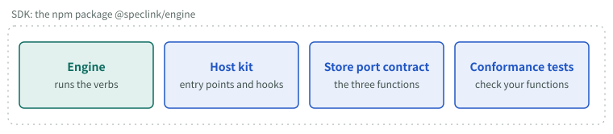
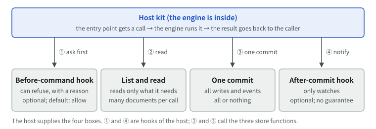

# Node SDK (@speclink/engine)

[繁體中文](sdk-node.zh-TW.md) · **English**

`@speclink/engine` is the SDK that embeds Speclink in a Node.js backend. You implement three store functions, and the specs go into your own database. The package gives you the engine, the host kit, and the conformance tests. After that, your system is the Server of a remote project: the original CLI and Speclink Desktop connect to it, and your own AI agent uses the same engine.

It is the same Rust engine that the CLI uses, connected to Node through [napi-rs](https://napi.rs). It is not a second implementation. The verb behavior, the `--json` output, and the skill content are the same as in the CLI.

Not sure that you want to embed? Read [Embed Speclink in your system](../README.md#embedding) in the README first. To try remote projects without writing code, use the [official demonstration server](../README.md#official-server).

## <a id="contents"></a>What the package contains

SDK is the name of this toolbox. It contains four things:



| Part | What it does | Names you use |
| --- | --- | --- |
| Engine | Runs verbs: reads specs, runs the workflow, and returns the content to write | `createEngine`, `skills` |
| Host kit | The layer for the host: each call brings an identity and a scope, two hooks, two entry points | `createHost`, `agentTool` |
| Store port contract | The three functions that you implement, and their rules | `StorePort` (type), `StoreConflictError`, `StoreUnavailableError` |
| Conformance tests | Check that your three functions obey the contract | `runStoreConformance` |

In this document, the host is your system. A scope is one independent set of specs, usually one repo of one project. A scope is a string that you choose. The engine does not interpret it.

## <a id="install"></a>Install

```bash
npm install @speclink/engine
```

The package is on npm from 0.2.0, and its version follows the Speclink releases. It needs Node.js 18 or later. Prebuilt packages are available for five platforms: Windows x64, macOS x64 and arm64, and Linux x64 and arm64 (glibc). The install downloads only the package for your platform, and you do not need Rust. There is no prebuilt package for musl Linux such as Alpine.

```js
const { createHost, createEngine, skills } = require('@speclink/engine')
```

### Alternative: build from the repo

Build from source when you change the engine or when your platform has no prebuilt package. This needs the Rust toolchain.

```bash
git clone https://github.com/MomoChenisMe/speclink.git
cd speclink/crates/adapters/speclink-node
npm ci
npm run build          # builds the .node file for the current platform
```

Then load it by path:

```js
const { createHost } = require('/path/to/speclink/crates/adapters/speclink-node')
```

`npm run build` builds for the current platform only, so run it on the platform where you deploy.

## <a id="local-project"></a>Run verbs on a local project

`createEngine` accepts only a local folder: the project root that contains `speclink/`. Use it for scripts, internal tools, and tests. To put the specs in your own database, use `createHost` in the next section.

```js
const engine = createEngine({ store: { type: 'fs', root: '/path/to/project' } })
// Optional: specDir (the default is the same as the CLI: spec_dir in .speclink.yaml, then speclink/, then a legacy openspec/, then "speclink")
// Optional: actor ("Name <email>", the operator that stamps and new changes record; without it, the engine uses the git identity of the project)

const list = await engine.dispatch(['list', '--json'])
await engine.dispatch(
  ['new', 'artifact', 'proposal', '--change', 'add-auth', '--stdin'],
  { stdin: '## Why\n…' },
)
```

When `store` has another shape, `createEngine` throws immediately and calls none of its methods.

The rules of `dispatch` (they also apply to `host.dispatch`):

- **Input**: an array of strings. It is the CLI command line without the program name. For verbs that read stdin in the CLI, pass the content as `stdin` and keep `--stdin` in the array.
- **Output**: a Promise. The result is the same as the CLI `--json` output, with camelCase fields. Verbs without a `--json` form (for example `new change`) return `{ output }`, where `output` is the text that the CLI prints to stdout, without color codes. When the CLI also prints a note to stderr, the object has `stderr` too. For the field shapes, see the [verb and flag contract](verb-contract.md).
- **Unknown flags are refused**: an unknown flag or an extra positional argument is refused with `invalid_argv`. It is not ignored.
- **`discuss conclude`**: when the conclusion is written but the closing archive step fails, this is not an error. The object has `closingError` with the reason. Do not run `discuss conclude` again. Run `discuss archive`.
- **The event loop is not blocked**: each call runs on a background thread, and you can start many calls at the same time.

All verbs that have an engine command work, and this includes the workflow configuration verbs (`workflow-config`). The verbs that need a checkout are refused with `invalid_argv`: `drift`, `review prepare`, `review scope`, `verify scope`, and `instructions --skill`. One `archive` call archives one change.

On failure, the Promise rejects with an `Error`. The `message` is the same message that the CLI prints, so you can give it to the user or the agent. The `code` is the class:

| `code` | Meaning |
| --- | --- |
| `invalid_argv` | An argument is wrong, the verb needs a checkout, or the written content has a wrong format |
| `not_found` | The change or the discussion does not exist |
| `invalid_config` | The configuration file exists but cannot be parsed (the engine does not use defaults) |
| `refused` | A precondition is not satisfied, or the before-command hook refuses (`createHost` only) |
| `revision_conflict` | A version does not match at commit: another caller changed the same document first (`createHost` only) |
| `unavailable` | The store is temporarily not available, and you can try again (`createHost` only) |
| `internal` | A store function or a hook fails in another way (`createHost` only) |
| `error` | Other engine errors |
| `panic` | An internal engine error |

## <a id="create-host"></a>Embed the engine in your backend

`createHost` builds one host kit. One process shares one host kit, and all users go through it.

```js
const host = createHost({
  store,                 // Required: the three store functions (see the next section)
  hooks,                 // Optional: the two hooks (see "The four steps of a verb")
  scopes,                // Optional: the projects and repos that a person can use (see "Serve the CLI and Speclink Desktop")
  authMethods,           // Optional: the login methods that you support
  skills: ['discuss', 'propose', 'ingest', 'archive'], // Optional: the skills for the engineers who connect
  limits: { importBytes: 32 * 1024 * 1024 },           // Optional: the size limit of an import
})
```

| Input | When it is absent |
| --- | --- |
| `store` | `createHost` throws immediately when `list`, `read`, or `commit` is missing, and names the missing functions |
| `hooks` | Each verb is allowed, and nothing is notified after a commit |
| `scopes` | The scope list and each project path return 404. A host that uses only the Agent tool opens nothing by accident |
| `authMethods` | The login methods path returns 404, and clients keep their old login behavior |
| `pushTransports` | The handshake declares polling only |
| `skills` | All skills of the engine are supplied. An empty array or an unknown name throws immediately |
| `limits.importBytes` | 33554432 (32 MiB) |

`createHost` does not accept `actor`: the identity comes with each call, not one time at construction. An unknown option throws immediately.

An identity has two fields. `id` is an identifier that stays the same when the user is renamed. `displayName` is the name that document stamps show. The two fields must not be empty.

```js
const identity = { id: 'u_42', displayName: 'Alice' }
```

`skills` selects which skills are supplied. The text of each skill always comes from the engine. The host cannot change it and cannot add its own skills.

## <a id="store-port"></a>Implement the three store functions

The store port is three functions. Each function works on one scope. A function can return its value or a Promise.

```ts
interface StorePort {
  list(scope: string, prefix: string): PortListing
  read(scope: string, keys: string[]): (PortDocument | null)[]
  commit(scope: string, commit: PortCommit): number
}
```

| Function | Receives | Returns |
| --- | --- | --- |
| `list` | A scope and a key prefix | The current version of the scope, and the documents whose key starts with the prefix (key, version, last modified time), in byte order of the keys, each key one time |
| `read` | A scope and a list of keys | One result for each key, in the same order. A document that does not exist is `null`. All results must come from one completed commit |
| `commit` | A scope and one commit | The new version of the scope (a number) |

One commit (`PortCommit`) carries all writes of one verb:

```js
{
  actor: { id: 'u_42', displayName: 'Alice' },
  command: 'new-change',          // the stable name of the command
  at: 1763440000000,              // milliseconds
  ops: [
    { op: 'put', key: 'changes/add-auth/.meta.yaml', content: '…', expected: null }, // null: the document must not exist
    { op: 'put', key: 'changes/add-auth/tasks.md', content: '…', expected: 3 },     // a number: the document must have this version
    { op: 'delete', key: 'changes/old/proposal.md', expected: 2 },
  ],
  events: [{ name: 'change-created', payload: { … } }],
}
```

**Three guarantees** (your implementation must give them):

1. **One commit applies all of its operations or none.** Do it in one database transaction.
2. **A version that does not match rejects the full commit.** Check each `expected` before the first write. When one check fails, reject the full commit and throw `StoreConflictError`.
3. **The events are in the same commit as the writes.** When you need each event delivered, write `events` to your own event table in the same transaction.

When a commit succeeds, the scope version increases by one. Each document that the commit writes gets the new scope version as its version and `at` as its last modified time.

Documents have string keys, and the engine sets the naming rules. Your store does not need to know the document types. It stores by key:

| Key | Content |
| --- | --- |
| `changes/<name>/…` | An active change: `.meta.yaml`, `proposal.md`, `design.md`, `tasks.md`, `specs/<capability>/spec.md`, `.evidence.json` |
| `specs/<capability>/spec.md` | A spec |
| `archive/changes/<date-name>/…` | An archived change |
| `discussions/<slug>.md`, `archive/discussions/<date-slug>.md` | Discussion records |
| `config.yaml`, `LANGUAGE.md`, `board/order` | The workflow configuration, the glossary, the board order |

Limits: a key has a maximum of 512 bytes, and a scope has a maximum of 256 bytes. Versions and times are integers from 0 to 2^53 − 1.

On failure, throw an object with a `code`. The SDK reads only the fields and does not use `instanceof`:

| Condition | Throw |
| --- | --- |
| A version does not match | `new StoreConflictError(key, actual)`: `actual` is the current version of that document, or `null` when it does not exist |
| Temporarily not available (lost connection, timeout) | `new StoreUnavailableError(message)`: the caller can try again |
| Other | Any error. The caller gets `internal` |

This is a minimum implementation that keeps the data in a `Map` in memory. With a database, put the full body of `commit` in one transaction:

```js
const { StoreConflictError } = require('@speclink/engine')

function memoryStore() {
  const scopes = new Map() // scope → { version, docs: Map<key, { content, version, modifiedAt }>, events: [] }
  const state = (scope) => {
    if (!scopes.has(scope)) scopes.set(scope, { version: 0, docs: new Map(), events: [] })
    return scopes.get(scope)
  }
  const byBytes = (a, b) => Buffer.compare(Buffer.from(a), Buffer.from(b))

  const store = {
    list(scope, prefix) {
      const s = state(scope)
      const entries = [...s.docs.entries()]
        .filter(([key]) => key.startsWith(prefix))
        .sort(([a], [b]) => byBytes(a, b))
        .map(([key, doc]) => ({ key, version: doc.version, modifiedAt: doc.modifiedAt }))
      return { version: s.version, entries }
    },
    read(scope, keys) {
      const s = state(scope)
      return keys.map((key) => (s.docs.has(key) ? { ...s.docs.get(key) } : null))
    },
    commit(scope, commit) {
      const s = state(scope)
      // Check each expected value first, then write.
      for (const op of commit.ops) {
        const actual = s.docs.has(op.key) ? s.docs.get(op.key).version : null
        if (op.expected !== actual) throw new StoreConflictError(op.key, actual)
      }
      const version = s.version + 1
      for (const op of commit.ops) {
        if (op.op === 'put') s.docs.set(op.key, { content: op.content, version, modifiedAt: commit.at })
        else s.docs.delete(op.key)
      }
      for (const event of commit.events) s.events.push({ ...event, version })
      s.version = version
      return version
    },
  }
  // recordedEvents is for the conformance tests: the events that this scope kept, oldest first.
  return { store, recordedEvents: (scope) => state(scope).events.map((e) => ({ ...e })) }
}
```

Notes for your implementation:

- **Each function must give a result.** The engine waits with no time limit. If you need a timeout, put it in the function.
- **Do not wait for another `dispatch` of the same host kit in these three functions.** The `dispatch` waits for the function, so the two wait for each other and never finish.
- **Results go to the engine as JSON.** Numbers keep their value. A value that JSON cannot hold (a cycle, a BigInt) makes the call fail.

For an SQL database, see the three Rust examples (SQLite, PostgreSQL, file system) for the tables and for the steps of one commit: [Store port examples](server-store-drivers.md). There is no JavaScript example at this time.

## <a id="conformance"></a>Check your implementation with the conformance tests

`runStoreConformance` runs the sixteen checks of the contract on your three functions. The Rust implementations run the same checks. Two of the checks call your store from many threads at the same time, to test your transactions.

```js
const { runStoreConformance } = require('@speclink/engine')

let n = 0
const { store, recordedEvents } = memoryStore()
const report = await runStoreConformance({
  store,
  newScope: () => `conformance-${++n}`, // a new, unused scope on each call
  recordedEvents,                       // optional: without it, the check events-with-commit is skipped
})

console.log(report.passed) // true
for (const check of report.checks.filter((c) => c.outcome !== 'passed')) {
  console.log(check.name, check.outcome, check.detail)
}
```

Expected result: `report.passed` is `true`, and the `outcome` of all sixteen checks is `passed` (one is `skipped` when you do not give `recordedEvents`). Each check has a stable name, for example `conflict-stale-version`, `conflict-rejects-whole-commit`, and `concurrent-single-winner`. On failure, `detail` gives the cause.

Put this in your tests and run it on your real database. The scopes from `newScope` get data, so use a database for tests only.

## <a id="four-steps"></a>The four steps of a verb

The host kit runs a verb in the same four steps for each entry point:



1. **The before-command hook** (`beforeCommand`): the host can refuse and give a reason.
2. **List and read**: the engine reads the documents that it needs through `list` and `read`. It reads only what it needs.
3. **One commit**: the engine gives all writes and events to `commit`, in one call. A verb that only reads does not have this step.
4. **The after-commit hook** (`afterCommit`): the host only watches.

The two hooks are optional:

```js
const hooks = {
  // Asked exactly one time for each call, before any write.
  async beforeCommand({ identity, scope, command, params, changedKeys }, { read }) {
    // No return value (or { allow: true }) allows the call.
    if (command !== 'archive') return
    // Without a name, the engine selects the change, and this rule cannot read its state.
    if (typeof params.change !== 'string') return { allow: false, reason: 'Give the name of the change to archive' }
    // `read` runs a verb that only reads, for the identity and the scope of this call.
    const shown = await read(['show', params.change, '--json']).catch((err) => {
      // The change does not exist: allow the call, and the engine gives its own `not_found`.
      if (err.code === 'not_found') return null
      throw err
    })
    if (shown === null) return
    if (shown.review?.state !== 'stamped') return { allow: false, reason: 'The change did not pass the review' }
    if (shown.verify?.state !== 'stamped') return { allow: false, reason: 'The change did not pass the verification' }
    if (!shown.landed) return { allow: false, reason: 'The code did not land, so the change cannot be archived' }
  },
  // Called after a successful commit. The dispatch does not wait for it, and its result and errors are ignored.
  afterCommit({ identity, scope, command, scopeVersion, events }) {
    notifyChannel(scope, events)
  },
}
```

- **`beforeCommand` receives** the identity, the scope, the stable name of the command (for example `archive`, `new-change`, `workflow-config-edit`), and the params. You can only read the params. A change to them has no effect: a hook can refuse or watch, but it cannot change content. A workflow configuration write also has `changedKeys` (the keys that the write changes, for example `['tdd']`).
- **A refusal** ends the call with `refused`, and the message is your reason. A request through the HTTP entry point gets the same sentence. Except for workflow configuration writes, the refusal comes before the store gets a call.
- **A hook that fails** (a throw, or an answer of another shape, `null` included) does not allow the call: the call ends with `internal`.
- **The events** in `commit` and `afterCommit` name what the commit changed, with a small payload. A stamp has `commit` when it recorded one (`review-stamped`, `verify-stamped`). A workflow configuration write that writes the document has `workflow-config-changed` with the changed `keys` and no values. For all event names, see [Event stream](verb-contract.md#events).
- **`afterCommit` does not guarantee delivery.** If the process stops after the commit and before the notification, that event does not come again. When you need at-least-once delivery, write `events` to your own event table in the same transaction as `commit`, and send them from that table with your own program.
- **`read` gets the data for the decision.** It is the second argument of `beforeCommand`. It takes argv as `dispatch` does, and it gives the same result and the same errors, for the identity and the scope of this call. It accepts only the verbs that write nothing: `list`, `show`, `status`, `plan`, `trace`, `evidence show`, `review show`, `verify show`, `discuss list`, `discuss show`, `discuss search`, `artifact cat`, `language show`, `workflow-config show`, `validate`, `analyze`, `instructions`. All other verbs are refused with `invalid_argv`, and the store gets no call. A `read` does not ask `beforeCommand` again. It works only while the hook runs: after the hook answers, `read` is refused with `invalid_argv`. If you do not catch an error from `read`, the hook fails.
- **A `read` and the command do not read the same data.** Each `read` is a different call to your store. If another commit comes between the `read` and the command, the two see different content. The engine's own checks (for an archive: the completed tasks and an open ticket) always use what the command reads. If your rules need the two to agree, do that in your own `read` and `commit` store functions.
- **Do not wait for a `dispatch` of the same host kit in a hook; use `read`.** That `dispatch` asks `beforeCommand` again, and it hangs when your store holds a lock of its own.

Speclink has no built-in rules such as "no archive before the code lands" or "the commit must be on a specified branch", and it does not limit who can release a claim. The engine only records the branch and the landed commit (see `change landed`). To block a call, use `beforeCommand`, as in the example above.

### <a id="release-hook"></a>Let only the holder and an admin release a claim

Any person who can write to the scope can release a claim. The hook gets a release under the command name `claim-release`, with the change name in `params.name`. A hook that refuses only `claim` does not refuse a release. This hook lets only the holder and an admin release:

```js
async function beforeCommand({ identity, command, params }, { read }) {
  if (command !== 'claim-release') return
  // isAdmin is your own function. Speclink gives the identity no role.
  if (await isAdmin(identity)) return
  const change = await read(['show', params.name, '--json']).catch((err) => {
    // An unknown change: allow the call, and the release gives its own `not_found`.
    if (err.code === 'not_found') return null
    throw err
  })
  if (change === null) return
  const holder = change.claimed
  if (!holder) return
  // A claim with no identifier is judged by the name, as the engine does.
  const isHolder = holder.byId ? holder.byId === identity.id : holder.by === identity.displayName
  if (!isHolder) return { allow: false, reason: 'Only the holder or an admin can release this claim' }
}
```

- **Only a `not_found` goes through.** For an unknown change, the hook allows the call, and the release gives its own `not_found`. Any other failure of `read` is thrown: the hook fails, and the call ends with `internal`. A permission hook must not allow a release that it could not judge, for example when your store is down for a moment.
- **It is a function declaration**, so you can paste it as it is. Connect it with `createHost({ store, hooks: { beforeCommand } })`.
- **A claim from before identifiers has no `byId`.** The example then compares the name, so the holder can always release.
- **Where the `reason` appears**: the CLI prints it as it is on stderr. Speclink Desktop has no action that releases a claim. When your hook refuses a claim, the failure message of Speclink Desktop shows the reason.

### <a id="stamp-scope"></a>Compare the files at the stamp before an archive

A commit that a squash, a rebase, or a cherry-pick makes has a new identifier, so the `commit` of a stamp does not tell whether the main branch has the reviewed files. Compare the files themselves: `read(['show', name, '--json', '--detail'])` gives `scope` in each stamped station, `review.scope` and `verify.scope`. Each item is `{ path, hash }`: the path from the repo root, with forward slashes, and the fingerprint at the stamp. A station that is not stamped has no `scope`.

The fingerprint: if the bytes of the file read as UTF-8, change each CRLF to LF, and take the SHA-256 of the text as lowercase hexadecimal. Keep a leading BOM. If the bytes do not read as UTF-8, take the SHA-256 of the raw bytes. This function gives the value that the engine records:

```js
import { createHash } from 'node:crypto'

function fingerprint(bytes) {
  // A string or a path is no file content: refuse it, do not hash it.
  if (!(bytes instanceof Uint8Array)) throw new TypeError('fingerprint takes the bytes of a file')
  // fatal: bytes that are not UTF-8 throw. ignoreBOM: a leading BOM stays in the text.
  const decoder = new TextDecoder('utf-8', { fatal: true, ignoreBOM: true })
  let text
  try {
    text = decoder.decode(bytes)
  } catch {
    // Not UTF-8: the raw bytes, line endings and all.
    return createHash('sha256').update(bytes).digest('hex')
  }
  return createHash('sha256').update(text.replaceAll('\r\n', '\n'), 'utf8').digest('hex')
}

async function beforeCommand({ command, params }, { read }) {
  if (command !== 'archive') return
  // Without a name, the engine selects the change, and this rule cannot read its files.
  if (typeof params.change !== 'string') return { allow: false, reason: 'Give the name of the change to archive' }
  const shown = await read(['show', params.change, '--json', '--detail']).catch((err) => {
    // An unknown change: allow the call, and the engine gives its own `not_found`.
    if (err.code === 'not_found') return null
    throw err
  })
  if (shown === null) return
  for (const station of [shown.review, shown.verify]) {
    for (const { path, hash } of station?.scope ?? []) {
      // readOnMainBranch is your own function: the bytes of the file, or null when it is not there.
      const bytes = await readOnMainBranch(path)
      if (bytes === null || fingerprint(bytes) !== hash) return { allow: false, reason: `${path} changed after the stamp` }
    }
  }
}
```

- **A file that was deleted before the stamp is not in `scope`.** To make sure that it is also deleted on the main branch, check it yourself.
- **`scope` is what the stamp recorded.** The output does not tell whether a file changed after the stamp. The comparison is yours.

## <a id="agent-tool"></a>For an Agent tool

`host.dispatch` is the entry point for the Agent of the host. You call it in your process, without HTTP.

```js
const result = await host.dispatch({
  identity: { id: 'u_42', displayName: 'Alice' }, // from your session, not from the model
  scope: 'acme/web',
  argv: ['new', 'change', 'add-auth'],
  fields: { source: 'chat', ticket: 'OPS-128' },    // optional: free fields
})
```

- **Your program gives the identity and the scope.** They are not in `argv`, so the model cannot change them. An empty identity or scope is refused with `invalid_argv` before any store call.
- **The verbs, the `stdin` rules, the result, and the errors** are the same as for `dispatch` in [Run verbs on a local project](#local-project).
- **`agentTool`** is a tool definition that is ready to use, so you do not write the description for the model. Its `name` is `speclink`. Its `description` lists all available verbs (from the same definition that the parser uses; the verbs that need a checkout are not in it). Its `inputSchema` has only `argv` and an optional `stdin`.
- **A result names no local path.** The documents are in your store, not in a folder. Thus the `{ output }` text of `new change` through `host.dispatch` has no `Path:` line. `createEngine` on a local project prints the line as before.
- **A `path` in a structured result is a key in your store, not a file.** `discuss new` and `discuss promote` return a structured value, with no text; `new artifact --json` does the same. The `path` key stays in these results. To read a document, call `artifact cat`, `show`, or `discuss show`. The `description` of `agentTool` tells the model the same, so the model does not try to open the path.

```js
const { agentTool } = require('@speclink/engine')

const speclinkTool = {
  name: agentTool.name,
  description: agentTool.description,
  inputSchema: agentTool.inputSchema,
  async handler({ argv, stdin }, session) {
    try {
      return await host.dispatch({ identity: session.user, scope: session.scope, argv, stdin })
    } catch (err) {
      return { error: err.message, code: err.code } // give the error to the model, so that it can correct the call
    }
  },
}
```

**An overview screen needs one call.** `list --json --detail` returns each change with the records that it has: the two quality stations, the claim, the branch, and the landing. You do not call `show` for each change, and you do not call the HTTP entry point from your own process:

```js
const { changes } = await host.dispatch({ identity: session.user, scope: session.scope, argv: ['list', '--json', '--detail'] })
const reviewed = changes.filter((change) => change.review?.state === 'stamped')
const mine = changes.filter((change) => change.claimed?.byId === session.user.id)
```

A key appears only when the change has that record. For the keys and their rules, see [`speclink list --json --detail`](verb-contract.md#list-detail).

**Free fields** are key-value pairs that the host defines. The engine stores them and does not interpret them. An example is the ticket that a change came from. `fields` is written only when the verb creates a change or a discussion (`new change`, `discuss new`, `discuss promote`), in the commit that creates it. All other verbs ignore it, so you can pass the same fields with each call. It has priority over a `--field` with the same key. `beforeCommand` sees the fields that will be written in `params.fields` and can check them. The rules: a key uses `a-z`, `0-9`, `_`, `.`, `-`, starts with a letter, and has 64 characters maximum; a value is one line of 1024 bytes maximum; the maximum is 32 keys. Fields that break the rules are refused with `invalid_argv`, and nothing is written. Do not put a secret in a field: each reader of the change can see it.

**The host kit does not read git or your files.** For verbs that need local facts, your program collects the facts and passes them as input:

- Stamps (`review stamp`, `verify stamp`): put the file fingerprints and the commit in the `stdin` JSON, for example `{ "scope": [{ "path": "src/auth.ts", "hash": "<sha256>" }], "missing": [], "headCommit": "<commit>" }`. For how to compute a fingerprint, see [Compare the files at the stamp before an archive](#stamp-scope).
- `task done`: the task is checked as usual, but no changed files are recorded.
- Landing: report it with `change landed <name> --commit <commit>`.

## <a id="http-entry"></a>Serve the CLI and Speclink Desktop

`host.handleRequest` is the HTTP entry point for the original CLI and Speclink Desktop. You mount one route and give it all requests below `/api/speclink/v1/`:

```js
// For Express 4 and 5: mount it before any body parser, so that the body stays as raw bytes.
// Use app.use on the prefix. Express 5 does not accept a wildcard without a name, such as '/api/speclink/v1/*'.
app.use('/api/speclink/v1', express.raw({ type: '*/*', limit: '4mb' }), async (req, res, next) => {
  const identity = await verifyToken(req.headers.authorization) // your code; null when it cannot verify
  const [path, query] = req.originalUrl.split('?')
  const answer = await host.handleRequest(
    { method: req.method, path, query, headers: req.headers, body: Buffer.isBuffer(req.body) ? req.body : undefined },
    identity,
  )
  if (answer === null) return next() // not a path of the entry point: your own routes handle it
  res.status(answer.status).set(answer.headers).send(Buffer.from(answer.body))
})
```

- **You verify the token. The entry point does not read `Authorization`.** When you find an identity, give it to the entry point. When you do not, pass `null`. Do not return 401 yourself. The entry point decides which paths need no login: the login methods path answers a `null` identity, and the other paths return 401.
- **Pass `path` and `query` as you received them** (do not decode them first). `body` is bytes.
- **A `null` result** means that the path does not belong to the entry point. A method other than GET, HEAD, POST, PUT, and DELETE gets 405.
- **The paths are always below `/api/speclink/v1/`.** The clients expect the API there, so you cannot mount it below another prefix.
- **The hooks are the same as for `host.dispatch`.** Reads that do not go through the engine (the workflow configuration text, archived content, search) do not ask `beforeCommand` one by one. The rule for them is whether the person can see the scope.
- The third parameter can carry free fields: `host.handleRequest(request, identity, { fields })`. The rules are the same as for `fields` of `host.dispatch`.

**`scopes`** answers which projects and repos a person can use. It is asked one time for each request and is not cached. If it is slow, cache it yourself.

```js
async function scopes(identity) {
  return [
    {
      key: 'acme', name: 'Acme',
      repos: [
        // scope: the scope that requests for this repo read and write. When canWrite is false, a request that writes gets 403.
        { key: 'web', name: 'Web', scope: 'acme/web', canWrite: true, canWritePolicy: false },
      ],
    },
  ]
}
```

When `canWritePolicy` is `false`, a workflow configuration write that changes a policy key (`schema`, `locale`, `spec_locale`, `tdd`, `audit`, `worktree`) gets 403. When `scopes` throws, the request gets 503.

**The login methods declaration** tells the client how to log in. The entry point answers it at `GET /api/speclink/v1/auth-methods`, and no login is necessary:

```js
const authMethods = {
  methods: ['browser', 'token'],
  browser: { issuer: 'https://login.example.com', clientId: 'speclink', scopes: ['openid'] },
}
```

The client uses the first method that the host declares, in the order `browser`, `device`, `token`. The entry point does not supply login endpoints, accounts, or memberships: those are yours. For browser login (`browser`), your login service must do three things:

1. Publish an RFC 8414 metadata document below `issuer` (`/.well-known/oauth-authorization-server`; when the client does not find it, it reads `/.well-known/openid-configuration`). The document lists the authorization URL and the token URL.
2. Accept a callback to `http://127.0.0.1:<any port>/callback`. The client uses a random port from the operating system each time.
3. Register `clientId` as a public client with no secret, and support PKCE (S256).

After the client gets a token, it sends the token in the `Authorization: Bearer` header, and your route verifies it. You do not have to declare `browser`: the client then uses an access token (`token`), and your system issues it.

**TLS certificates.** The CLI and Speclink Desktop use the trust store of the operating system on the computer of the user to check the TLS certificate of your host and of your login service. A certificate from a public CA needs no action. If a CA of your organisation issues the certificate, each user must install that CA into the trust store of the operating system. The clients have no setting for an additional CA and no setting that skips the check. When the check fails, the CLI prints `Error: server unreachable — the server's TLS certificate was rejected (…)`, and Speclink Desktop shows the connection as interrupted.

**Push events** are off by default: the handshake declares polling only, and the client asks at intervals if the scope changed. When you supply a stream yourself (SSE or WebSocket), declare its URL in `pushTransports`. The handshake gives your declaration as you wrote it. The entry point does not supply a stream.

- **Write the `url` in one of two forms.** A path that starts with `/` is relative to the project URL, as `/sync-state` is. A full URL must have the origin of your host: the same scheme, host, and port. Speclink Desktop uses the first `sse` transport. It does not connect to a URL of another origin, and it does not send the credential there: it polls instead. It does not use `websocket`.
- **Send a heartbeat.** When the stream is idle, send an SSE comment line more often than every 45 seconds. A client that gets no data for 45 seconds treats the connection as broken and subscribes again. The demonstration server sends one every 15 seconds.
- **Send only the resource.** An event tells the client which resource changed, and the client reads it again. Use the table in [Event stream](verb-contract.md#events) to turn an event into `scope` and `resourceId`. Do not send the event payload to clients.

## <a id="export-import"></a>Export and import

```js
// Export: all documents of this scope, with the scope version at the time of the read.
const bundle = await host.exportScope({ identity, scope: 'acme/web' })
// → { formatVersion: 2, scopeVersion: 17, documents: [{ key, content, digest }, …] }

// Import: write into an empty scope, in one commit.
const report = await host.importScope({ identity, scope: 'acme/web-copy', bundle })
// → { scopeVersion: 1, documents: 42 }
```

- **An export** uses only your `list` and `read`. If the scope changes during the export, it starts again, three times maximum, and then rejects with `unavailable`. It never mixes old and new content.
- **An import** needs an empty scope. If the scope is not empty, the import is refused with `refused`. A bundle that is not valid (a digest that does not match the content, a key outside the naming rules of the engine, a key that appears two times, content over the limit) is refused with `invalid_argv`, and the message names the key. On failure, the scope stays as it was.
- **The two calls ask `beforeCommand` first.** The command names are `scope-export` (no params) and `scope-import` (the params are the number of documents and the number of bytes, without the content). You decide who can export and import.
- **The bundle has two versions.** An export always gives version 2 (each document is named by its key). An import accepts the two versions: version 1 is the format that an older Speclink Desktop sends.
- **Size limit**: `limits.importBytes` is the maximum number of bytes that an import accepts. The default is 32 MiB. An export has no limit. For an import through HTTP, the entry point compares the size of the request body before it parses the body, and returns 413 above the limit.
- **The body limit of your framework must not be smaller than this value.** The entry point gets a body that the framework already read. Thus, for the import path, set the body limit of the framework to `limits.importBytes` or more (the 4 MB in the Express example above is not sufficient for an import).
- **Compression belongs to the route layer.** The host kit does not compress or decompress. If you want compression, turn it on in your framework.

### <a id="export-local"></a>Export a local project

`engine.exportScope()` makes the local project that `createEngine` points at into a bundle of version 2. Give the bundle as it is to `host.importScope`, and the project moves into an empty scope of your store. The documents are the same ones that "Migrate to Server" in Speclink Desktop sends: the active changes (metadata, artifacts, and evidence), the canonical specs, the live and the archived discussions, all the documents of the archived changes, the workflow config, the vocabulary, and the board order.

```js
// Move local projects, each into its own empty scope.
const moves = [
  ['/srv/checkouts/web', 'acme/web'],
  ['/srv/checkouts/api', 'acme/api'],
]
for (const [root, scope] of moves) {
  const bundle = await createEngine({ store: { type: 'fs', root } }).exportScope()
  // → { formatVersion: 2, documents: [{ key, content, digest }, …] } (no scopeVersion)
  const report = await host.importScope({ identity, scope, bundle })
  // → { scopeVersion: 1, documents: 42 }
}
```

- **It only reads.** It changes no file of the project. The documents are in byte order of their keys. A local project has no scope version, so the bundle has no `scopeVersion`. An import does not read it.
- **You never get a partial bundle on these failures.** If a change (active or archived) has metadata that does not parse, or a document that the naming rules of the engine do not cover, the call rejects with `error`, and the message names the file. A file that is there but cannot be read (no permission, or not UTF-8) is not a failure: the bundle has no document for it.
- **It reads only files inside the project.** If a folder on the way to the spec folder, the spec folder, or a file or a folder under it is a symbolic link, the call rejects with `error` before it reads a document. The older evidence folder `.speclink/touched/` follows the same rule. The message starts with `symbolic link in the spec folder:` and names the item by its path from the project root. It never shows what the link points at. Replace the link with the file itself, or remove it. A folder there that cannot be listed also stops the call, with a message that starts with `cannot list`. If the name of the spec folder (`spec_dir` in `.speclink.yaml`, or the `specDir` of `createEngine`) is an absolute path, or has a `..` or `.` segment, the call rejects with `error`. The message starts with `spec folder outside the project:` and names it. To export a spec folder at a different place, point `root` at the folder above it.
- **A `root` with no spec folder is refused.** After the name and link checks, the call rejects with `error` when `root` holds no spec folder under that name: nothing is there, or the folder has no `changes/`, `specs/`, `discussions/`, and no `config.yaml`. A folder that holds only `LANGUAGE.md` is refused too. The message starts with `no spec folder:` and names the folder, never the path of `root`. The files stay as they were. This catches a download that is in the wrong place, which otherwise gives no document and looks like a success. A spec folder with no document still gives a bundle with no documents. To export an empty project, make its spec folder first.
- **Do not write to the project during the export.** The export reads the files one at a time and takes no snapshot. A write at the same time, through the same engine, the CLI, or another program, can put old and new content into one bundle.
- **The scope of the import must be empty**, and the size limit `limits.importBytes` (default 32 MiB) applies. A large project makes a large bundle. If necessary, increase the limit of the host that imports it.
- **The bundle has the full text** of the workflow config and of all the discussions. You decide who can run an export.
- **Custom schemas**: the schema of each change is found in the project first, then in the user-level config directory of the user that runs the export. On a host machine, put a custom schema in that directory, or keep it in the project.

The CLI has no import or export verb. There are three ways to move a project: "Migrate to Server" in Speclink Desktop, `engine.exportScope()` with `host.importScope` in your own program, and, between two scopes, `GET /export` and `POST /import` of the HTTP entry point.

### <a id="server-side-import"></a>Import on the server

Your backend can bring the specs of an existing repo into a scope. It downloads the files, exports them with `createEngine`, and imports the bundle with `host.importScope` in the same process:

```js
// The backend downloaded only the spec folder of the repo, to /tmp/acme-web/specs-folder/.
const engine = createEngine({ store: { type: 'fs', root: '/tmp/acme-web', specDir: 'specs-folder' } })
const bundle = await engine.exportScope()
const report = await host.importScope({ identity, scope: 'acme/web', bundle })
// → { scopeVersion: 1, documents: 42 }
```

- **`root` and `specDir`**: when you download only the spec folder, point `root` at the folder above it, and give the folder name in `store.specDir`. Without `specDir`, the engine finds the folder as the CLI does: first `spec_dir` in `root/.speclink.yaml`, then `speclink/`, then the older `openspec/`. A `root` with no spec folder under that name is refused with a message that starts with `no spec folder:`.
- **Size limit**: `limits.importBytes` (default 32 MiB) also applies to a `host.importScope` that your program calls in the same process. The export has no limit. For a large project, increase the limit of the host.
- **The import is a one-time move, not a sync.** A change in the repo after the import does not come into the scope, and a change in the scope does not go back to the repo.
- **To import again**, delete all documents of the scope in your store first, then import. This deletes all the work that people did in the host after the import: the changes, the discussions, and the stamps. An import into a scope that is not empty is refused.

## <a id="skills"></a>Generate skill files

A skill file is a set of instructions that an AI agent reads. There are two cases:

- **Engineers who connect**: when their CLI runs `speclink update`, it gets the skills from your Server (`skills` of `createHost` selects which ones). You do nothing more.
- **The Agent of the host**: use `skills.render` to generate the skill text, and give it to your Agent.

```js
skills.list() // [{ name: 'analyze', description: '…' }, …]

const skillMd = skills.render('propose', {
  target: 'neutral',
  invocation: 'tool-call',
  specInCheckout: false,
})
```

| Option | Values | Description |
| --- | --- | --- |
| `target` | `claude`, `codex`, `copilot`, `pi`, `cursor`, `neutral` | `neutral` is for custom tools: no `/speclink-` slash commands and no plan mode |
| `invocation` | `cli` (default), `tool-call` | `tool-call` writes each verb as "call the speclink tool with an argv array", for use with `agentTool`. `cli` writes shell commands |
| `specInCheckout` | `true` (default), `false` | Whether the spec folder is in the checkout where the skill is used. An embedded host and a remote project pass `false`: the skill then names no spec folder path and has no git step on spec files |
| `specDir` | string | The spec directory name in the skill text. The default is `speclink` |
| `toolName` | string | For `neutral` only: the tool name in the skill text. The default is `speclink` |

An Agent without a code checkout can use these skills: `discuss`, `propose`, `ingest`, `archive`, `improve`, `analyze`, and `trace`. The skills `apply`, `review`, `verify`, `quality`, `commit`, and the worktree skills need a code checkout. Leave them to the tools on the side of the engineers.

## <a id="example"></a>Complete example

This example does all steps: the three store functions, the conformance tests, the host kit, the Agent tool, and one route. It does not repeat the three store functions. Save the `memoryStore` code from [Implement the three store functions](#store-port) as `memory-store.js`, and add the line `module.exports = { memoryStore }` at the end. Then save the code below as a second file in the same folder. It uses the built-in `http` module of Node. For Express, see [Serve the CLI and Speclink Desktop](#http-entry).

```js
const http = require('node:http')
const { createHost, runStoreConformance, agentTool, skills } = require('@speclink/engine')
const { memoryStore } = require('./memory-store')

// 1. The three store functions: memoryStore from memory-store.js (in memory; in production, make commit one database transaction).

// The parts of your system: fixed data replaces them here.
const ALICE = { id: 'u_42', displayName: 'Alice' }
const verifyToken = async (authorization) => (authorization === 'Bearer demo-token' ? ALICE : null)

async function main() {
  // 2. The conformance tests: make sure that the three functions obey the contract.
  let n = 0
  const probe = memoryStore()
  const report = await runStoreConformance({
    store: probe.store,
    newScope: () => `conformance-${++n}`,
    recordedEvents: probe.recordedEvents,
  })
  if (!report.passed) throw new Error('store port failed the conformance tests')

  // 3. The host kit: one for the full process.
  const { store } = memoryStore()
  const host = createHost({
    store,
    hooks: {
      async beforeCommand({ command, params }, { read }) {
        if (command !== 'archive') return
        if (typeof params.change !== 'string') return { allow: false, reason: 'Give the name of the change to archive' }
        const shown = await read(['show', params.change, '--json']).catch((err) => {
          if (err.code === 'not_found') return null // the engine gives its own error
          throw err
        })
        if (shown && !shown.landed) return { allow: false, reason: 'The code did not land, so the change cannot be archived' }
      },
      afterCommit({ scope, command, scopeVersion }) {
        console.log(`[${scope}] ${command} → version ${scopeVersion}`)
      },
    },
    scopes: async () => [
      {
        key: 'acme', name: 'Acme',
        repos: [{ key: 'web', name: 'Web', scope: 'acme/web', canWrite: true, canWritePolicy: true }],
      },
    ],
    authMethods: { methods: ['token'] },
  })

  // 4. The Agent tool: the model gives argv, and your session gives the identity and the scope.
  const speclinkTool = {
    name: agentTool.name,
    description: agentTool.description,
    inputSchema: agentTool.inputSchema,
    async handler({ argv, stdin }, session) {
      try {
        return await host.dispatch({ identity: session.user, scope: session.scope, argv, stdin })
      } catch (err) {
        return { error: err.message, code: err.code }
      }
    },
  }
  const session = { user: ALICE, scope: 'acme/web' }
  await speclinkTool.handler({ argv: ['new', 'change', 'add-auth'] }, session)
  const listed = await speclinkTool.handler({ argv: ['list', '--json', '--detail'] }, session)
  console.log(listed.changes.map((change) => change.name)) // [ 'add-auth' ]

  // The skill text for your Agent: verbs are tool calls, and the specs are not in a checkout.
  const proposeSkill = skills.render('propose', { target: 'neutral', invocation: 'tool-call', specInCheckout: false })
  console.log(`the propose skill has ${proposeSkill.length} characters`)

  // 5. One route: give all requests below /api/speclink/v1/ to the entry point.
  const server = http.createServer(async (req, res) => {
    const chunks = []
    for await (const chunk of req) chunks.push(chunk)
    const [path, query] = req.url.split('?')
    const answer = await host.handleRequest(
      { method: req.method, path, query, headers: req.headers, body: Buffer.concat(chunks) },
      await verifyToken(req.headers.authorization),
    )
    if (answer === null) {
      res.writeHead(404).end()
      return
    }
    res.writeHead(answer.status, answer.headers).end(Buffer.from(answer.body))
  })
  server.listen(8080, () => console.log('listening on http://127.0.0.1:8080'))
}

main().catch((err) => {
  console.error(err)
  process.exit(1)
})
```

Expected output:

```text
[acme/web] new-change → version 1
[ 'add-auth' ]
the propose skill has … characters
listening on http://127.0.0.1:8080
```

After the start, run `curl http://127.0.0.1:8080/api/speclink/v1/auth-methods` in a second terminal to see the login methods declaration (`{"methods":["token"]}`). To connect the CLI to this example, run `speclink link http://127.0.0.1:8080/api/speclink/v1/projects/acme --repo web` in a test folder. Then run `speclink auth login --pat` and paste `demo-token` as the access token. For the full connection steps, see [Remote getting started](remote-getting-started.md).

## <a id="limits"></a>Current limits

- There is no prebuilt package for musl Linux.
- The result of `dispatch` has no specific TypeScript type. The [verb and flag contract](verb-contract.md) gives the shapes.

This section does not repeat the other limits of an embedded host: the verbs that need a checkout, no git access in the host kit, push events, a JavaScript store port example, custom artifact workflows, and more. The [known gaps](product-status.md#known-gaps) in the product status list them, with what to do today.
