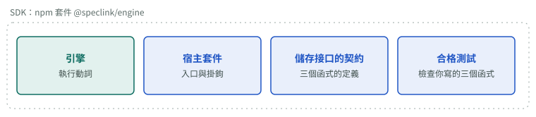
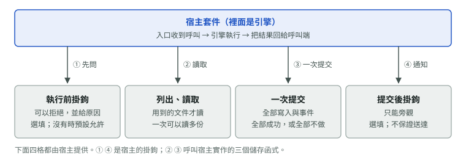

# Node SDK（@speclink/engine）

**繁體中文** · [English](sdk-node.md)

`@speclink/engine` 是把 Speclink 內嵌進 Node.js 後端用的 SDK。你實作三個儲存函式，把規格存進自己的資料庫；套件給你引擎、宿主套件與合格測試。做完之後，你的系統就是遠端專案的 Server：原版的 CLI 與 Speclink Desktop 連得上，你自己的 AI Agent 也用同一個引擎。

它就是 CLI 用的那顆 Rust 引擎，透過 [napi-rs](https://napi.rs) 接到 Node，不是另外重寫的版本。動詞的行為、`--json` 的輸出與技能的內容都和 CLI 相同。

還沒決定要不要內嵌？先看 README 的[把 Speclink 內嵌進你的系統](../README.zh-TW.md#embedding)。只想試遠端專案、不想寫程式，用[官方的示範用 server](../README.zh-TW.md#official-server)。

## <a id="contents"></a>這個套件有什麼

SDK 是這個工具箱的名字。裡面有四樣東西：



| 東西 | 做什麼 | 你用到的名稱 |
| --- | --- | --- |
| 引擎 | 執行動詞：讀規格、跑流程、交出要寫入的內容 | `createEngine`、`skills` |
| 宿主套件 | 給宿主的那一層：每次呼叫帶身分與範圍、兩個掛鉤、兩個入口 | `createHost`、`agentTool`、`commandNames` |
| 儲存接口的契約 | 你要實作的三個函式與它們的規則 | `StorePort`（型別）、`StoreConflictError`、`StoreUnavailableError` |
| 合格測試 | 檢查你的三個函式符不符合契約 | `runStoreConformance` |

這份文件裡，「宿主」指你的系統，「範圍」（scope）指一份獨立的規格集合，通常是一個專案的一個 repo。範圍是你自己取的字串，引擎不解讀它。

`commandNames` 是凍結的陣列，列出 `beforeCommand` 與你的儲存的 `commit` 可能收到的每一個命令名稱：引擎的命令，加上宿主套件自己的三個，`scope-export`、`scope-import` 與 `put-board-order`（`handleRequest` 寫看板排序時用的名稱）。陣列的順序不是契約，它也只給名稱：不告訴你命令會不會寫入，因為不寫入的命令也可能帶出整份文件。用它寫一個測試，確認你的權限對照表涵蓋每一個名稱，新版本多出來的命令就不會被誤擋：

```js
// permissions.test.js，用 Node 內建的測試工具。permissionOf 是你的對照表：命令名稱 → 權限動作。
const { test } = require('node:test')
const assert = require('node:assert')
const { commandNames } = require('@speclink/engine')
const { permissionOf } = require('./permissions')

test('權限對照表涵蓋每一個命令名稱', () => {
  const missing = commandNames.filter((name) => permissionOf(name) === undefined)
  assert.deepStrictEqual(missing, [])
})
```

## <a id="install"></a>安裝

```bash
npm install @speclink/engine
```

0.2.0 起可從 npm 安裝，版號跟著 Speclink 的 release 走。需要 Node.js 18 以上。Windows x64、macOS x64 與 arm64、Linux x64 與 arm64（glibc）五個平台都有預先編譯好的套件，安裝時只下載你的平台那一份，不需要 Rust。Alpine 這類 musl Linux 沒有預編譯套件。

```js
const { createHost, createEngine, skills } = require('@speclink/engine')
```

### 替代路徑：自 repo 建置

要改引擎本身，或你的平台沒有預編譯套件時，從原始碼建置（需要 Rust 工具鏈）：

```bash
git clone https://github.com/MomoChenisMe/speclink.git
cd speclink/crates/adapters/speclink-node
npm ci
npm run build          # 為目前的平台建出 .node 檔
```

然後用路徑引用：

```js
const { createHost } = require('/path/to/speclink/crates/adapters/speclink-node')
```

`npm run build` 只建出目前平台的檔案，所以要在部署的目標平台上建置。

## <a id="local-project"></a>在本機專案上執行動詞

`createEngine` 只接受本機資料夾：指向含 `speclink/` 的專案根目錄。它適合腳本、內部工具與測試。要把規格存進自己的資料庫，用下一節的 `createHost`。

```js
const engine = createEngine({ store: { type: 'fs', root: '/path/to/project' } })
// 選填：specDir（預設與 CLI 相同：依序取 .speclink.yaml 的 spec_dir、speclink/、舊的 openspec/，都沒有時為 "speclink"）
// 選填：actor（"Name <email>"，蓋章與建立變更時記下的操作者；沒給時用該專案的 git 身分）

const list = await engine.dispatch(['list', '--json'])
await engine.dispatch(
  ['new', 'artifact', 'proposal', '--change', 'add-auth', '--stdin'],
  { stdin: '## Why\n…' },
)
```

`store` 傳入其他形狀的物件時，`createEngine` 會立刻拋錯，而且不會呼叫它的任何方法。

`dispatch` 的規則（`host.dispatch` 也一樣）：

- **輸入**：字串陣列，和 CLI 的寫法一樣，只是去掉程式名。CLI 從 stdin 讀內容的動詞，改用 `stdin` 傳入，並在陣列裡帶 `--stdin`。
- **輸出**：Promise，結果和 CLI `--json` 的輸出相同。欄位大多是 camelCase，少數既有欄位是 snake_case，[動詞與旗標契約列出它們](verb-contract.zh-TW.md#snake-case-fields)。沒有 `--json` 形式的動詞（例如 `new change`）回傳 `{ output }`，`output` 是 CLI 印到 stdout 的文字，不帶色碼。CLI 另有提示印到 stderr 時，物件另帶 `stderr`。欄位的形狀見[動詞與旗標契約](verb-contract.zh-TW.md)。
- **不認得的旗標會被拒絕**：多出來的旗標或位置參數以 `invalid_argv` 拒絕，不會被靜默忽略。
- **`discuss conclude`**：結論已經寫入、但收尾的封存失敗時不算錯誤，物件另帶 `closingError` 說明原因。這時不要再執行一次 `discuss conclude`，改執行 `discuss archive`。
- **不會卡住事件迴圈**：每次呼叫都在背景執行緒執行，可以同時發出多個。

有引擎命令的動詞全部能用，工作流設定的動詞（`workflow-config`）也在內。`workflow-config set` 的值給空字串（`['workflow-config', 'set', 'locale', '']`）時，把 `locale` 或 `spec_locale` 設回未設定；`tdd`、`audit`、`worktree` 給空字串則以 `invalid_argv` 拒絕。需要 checkout 的動詞以 `invalid_argv` 拒絕：`drift`、`review prepare`、`review scope`、`verify scope`、`instructions --skill`。一次 `archive` 只封存一個變更。

失敗時 Promise 以 `Error` 拒絕。`message` 和 CLI 印出的訊息相同，可以直接交給使用者或 Agent；`code` 是分類：

| `code` | 意思 |
| --- | --- |
| `invalid_argv` | 參數有誤、這個動詞需要 checkout，或寫入的內容格式不對 |
| `not_found` | 找不到變更或討論 |
| `invalid_config` | 設定檔存在但無法解析（不會改用預設值） |
| `refused` | 前置條件不成立，或執行前掛鉤拒絕（只有 `createHost`） |
| `revision_conflict` | 提交時版本對不上：別人先改了同一份文件（只有 `createHost`） |
| `unavailable` | 儲存暫時不能用，可以重試（只有 `createHost`） |
| `internal` | 儲存函式或掛鉤以其他方式失敗（只有 `createHost`） |
| `error` | 其他引擎錯誤 |
| `panic` | 引擎內部錯誤 |

## <a id="create-host"></a>把引擎內嵌進你的後端

`createHost` 建立一個宿主套件，整個程序共用一個，所有使用者都經過它。

```js
const host = createHost({
  store,                 // 必填：三個儲存函式，見下一節
  hooks,                 // 選填：兩個掛鉤，見「一個動詞的四個步驟」
  scopes,                // 選填：這個人可以用哪些專案與 repo，見「服務 CLI 與 Speclink Desktop」
  authMethods,           // 選填：支援哪些登入方式
  skills: ['discuss', 'propose', 'ingest', 'archive'], // 選填：給連進來的工程師哪幾支技能
  limits: { importBytes: 32 * 1024 * 1024 },           // 選填：匯入的大小上限
})
```

| 輸入 | 沒給的時候 |
| --- | --- |
| `store` | 缺 `list`、`read` 或 `commit` 時立刻拋錯，並列出缺少的函式 |
| `hooks` | 每個動詞都允許，提交之後不通知任何人 |
| `scopes` | 範圍清單與每個專案路徑都回 404。只用 Agent 工具的宿主不會意外開放任何東西 |
| `authMethods` | 登入方式的路徑回 404，用戶端維持舊的登入行為 |
| `pushTransports` | 握手只宣告輪詢 |
| `skills` | 提供引擎的全部技能。空陣列或引擎沒有的名稱會立刻拋錯 |
| `limits.importBytes` | 33554432（32 MiB） |

`createHost` 不接受 `actor`：身分跟著每一次呼叫來，不是建立時給一次。不認得的選項會立刻拋錯。

身分是兩個欄位：`id` 是改名之後也不會變的識別，`displayName` 是文件上蓋章用的名字。兩者都不能是空的。

```js
const identity = { id: 'u_42', displayName: 'Alice' }
```

`skills` 只決定「提供哪幾支」。技能的文字一律來自引擎，宿主不能改，也不能加自己的技能。

## <a id="store-port"></a>實作三個儲存函式

儲存接口是三個函式，每個函式都作用在一個範圍上。可以直接回傳值，也可以回傳 Promise。

```ts
interface StorePort {
  list(scope: string, prefix: string): PortListing
  read(scope: string, keys: string[]): (PortDocument | null)[]
  commit(scope: string, commit: PortCommit): number
}
```

| 函式 | 收到 | 回傳 |
| --- | --- | --- |
| `list` | 範圍、鍵的前綴 | 範圍目前的版本，加上鍵以這個前綴開頭的文件（鍵、版本、最後修改時間），依鍵的位元組順序排列，每個鍵一次 |
| `read` | 範圍、一組鍵 | 每個鍵一個結果，順序和輸入相同；文件不存在時是 `null`。全部結果要來自同一次完成的提交 |
| `commit` | 範圍、一筆提交 | 範圍的新版本（一個數字） |

一筆提交（`PortCommit`）帶著一個動詞的全部寫入：

```js
{
  actor: { id: 'u_42', displayName: 'Alice' },
  command: 'new-change',          // 命令的固定名稱
  at: 1763440000000,              // 毫秒
  ops: [
    { op: 'put', key: 'changes/add-auth/.meta.yaml', content: '…', expected: null }, // null：必須不存在
    { op: 'put', key: 'changes/add-auth/tasks.md', content: '…', expected: 3 },     // 數字：目前必須是這個版本
    { op: 'delete', key: 'changes/old/proposal.md', expected: 2 },
  ],
  events: [{ name: 'change-created', payload: { … } }],
}
```

**三項保證**（你的實作要做到）：

1. **一次提交全部成功或全部不做。** 用一次資料庫交易完成。
2. **版本對不上就整筆拒絕。** 第一筆寫入之前，先檢查每一個 `expected`；有一個不成立就拒絕整筆提交，拋出 `StoreConflictError`。
3. **事件與寫入在同一次提交裡。** 需要每個事件都送達時，在同一次交易裡把 `events` 寫進你自己的事件表。

提交成功時：範圍的版本加一；這次寫入的每份文件，版本是範圍的新版本、最後修改時間是 `at`。

文件用字串鍵，命名規則由引擎決定。你的儲存照鍵存取就夠。下面這張表是契約：既有的鍵不會改，你可以用它在自己的儲存裡統計文件（見[範圍的摘要](#scope-summary)）：

| 鍵 | 內容 |
| --- | --- |
| `changes/<名稱>/…` | 進行中的變更：`.meta.yaml`、`proposal.md`、`design.md`、`tasks.md`、`specs/<capability>/spec.md`、`.evidence.json` |
| `specs/<capability>/spec.md` | 正式規格 |
| `archive/changes/<日期-名稱>/…` | 已封存的變更 |
| `discussions/<slug>.md`、`archive/discussions/<日期-slug>.md` | 討論記錄 |
| `config.yaml`、`LANGUAGE.md`、`board/order` | 工作流設定、詞彙表、看板順序 |

限制：鍵最長 512 位元組，範圍最長 256 位元組；版本與時間是 0 到 2^53 − 1 的整數。

失敗時拋出帶 `code` 的物件。SDK 只讀欄位，不看 `instanceof`：

| 情況 | 拋出 |
| --- | --- |
| 版本對不上 | `new StoreConflictError(key, actual)`：`actual` 是那份文件目前的版本，不存在時是 `null` |
| 暫時不能用（連線中斷、逾時） | `new StoreUnavailableError(message)`：呼叫端可以重試 |
| 其他 | 任何錯誤；呼叫端收到 `internal` |

下面是用 `Map` 存在記憶體的最小實作。換成資料庫時，`commit` 整段放進一次交易：

```js
const { StoreConflictError } = require('@speclink/engine')

function memoryStore() {
  const scopes = new Map() // scope → { version, docs: Map<key, { content, version, modifiedAt }>, events: [] }
  const state = (scope) => {
    if (!scopes.has(scope)) scopes.set(scope, { version: 0, docs: new Map(), events: [] })
    return scopes.get(scope)
  }
  const byBytes = (a, b) => Buffer.compare(Buffer.from(a), Buffer.from(b))

  const store = {
    list(scope, prefix) {
      const s = state(scope)
      const entries = [...s.docs.entries()]
        .filter(([key]) => key.startsWith(prefix))
        .sort(([a], [b]) => byBytes(a, b))
        .map(([key, doc]) => ({ key, version: doc.version, modifiedAt: doc.modifiedAt }))
      return { version: s.version, entries }
    },
    read(scope, keys) {
      const s = state(scope)
      return keys.map((key) => (s.docs.has(key) ? { ...s.docs.get(key) } : null))
    },
    commit(scope, commit) {
      const s = state(scope)
      // 先檢查每一個 expected，再開始寫。
      for (const op of commit.ops) {
        const actual = s.docs.has(op.key) ? s.docs.get(op.key).version : null
        if (op.expected !== actual) throw new StoreConflictError(op.key, actual)
      }
      const version = s.version + 1
      for (const op of commit.ops) {
        if (op.op === 'put') s.docs.set(op.key, { content: op.content, version, modifiedAt: commit.at })
        else s.docs.delete(op.key)
      }
      for (const event of commit.events) s.events.push({ ...event, version })
      s.version = version
      return version
    },
  }
  // recordedEvents 給合格測試用：這個範圍留下的事件，由舊到新。
  return { store, recordedEvents: (scope) => state(scope).events.map((e) => ({ ...e })) }
}
```

實作時要注意：

- **每個函式都要有結果。** 引擎會一直等，沒有時間上限。需要逾時就寫在函式裡。
- **不要在這三個函式裡等同一個宿主套件的另一個 `dispatch`。** `dispatch` 正在等這個函式，兩邊會互相等待而卡住。
- **回傳值以 JSON 傳給引擎。** 數字會保持原值；JSON 裝不下的值（循環參照、BigInt）會讓這次呼叫失敗。

用 SQL 資料庫時，資料表與一次提交的寫法可以參考三個 Rust 範例（SQLite、PostgreSQL、檔案系統），見[儲存接口的範例](server-store-drivers.zh-TW.md)。目前沒有 JavaScript 寫的範例。

### <a id="scope-summary"></a>範圍的摘要

管理頁可以顯示每個範圍的摘要：有幾份文件、最後是誰寫入的、各階段有幾個變更。Speclink 不提供另外的摘要呼叫。這些資料來自你自己的儲存和一個動詞：

| 資料 | 來源 |
| --- | --- |
| 正式規格的數量 | 你自己的儲存裡以 `specs/` 開頭的鍵 |
| 進行中變更的數量 | 以 `changes/` 開頭的鍵：數第二段不重複的名稱 |
| 已封存變更的數量 | 以 `archive/changes/` 開頭的鍵：數第三段不重複的名稱 |
| 討論的數量 | 以 `discussions/` 與 `archive/discussions/` 開頭的鍵 |
| 最後寫入的人與時間 | 你的 `commit` 函式收到的 `actor` 與 `at` |
| 各階段的變更數 | 每個範圍一次 `host.dispatch` 的 `list --json` |

- **用鍵的前綴在你自己的儲存裡數。** 上面那張鍵的對照表就是前綴的契約。資料庫的一次查詢可以數很多個範圍。
- **在你的 `commit` 函式裡記下最後一次寫入。** 把這次提交的 `actor` 與 `at` 寫進你自己的資料表，和寫入放在同一次交易。
- **`list --json` 會經過 `beforeCommand`**，和每個動詞一樣。它回傳每一個進行中的變更與它的 `status`。加上 `--detail` 還會回傳每個變更的記錄，見[給 Agent 工具用](#agent-tool)。

## <a id="conformance"></a>用合格測試檢查你的實作

`runStoreConformance` 對你的三個函式跑契約的十六項檢查，和 Rust 的實作跑的是同一份。其中兩項會從多個執行緒同時呼叫你的儲存，檢查交易有沒有做對。

```js
const { runStoreConformance } = require('@speclink/engine')

let n = 0
const { store, recordedEvents } = memoryStore()
const report = await runStoreConformance({
  store,
  newScope: () => `conformance-${++n}`, // 每次呼叫給一個沒用過的範圍
  recordedEvents,                       // 選填：沒給時跳過 events-with-commit 那一項
})

console.log(report.passed) // true
for (const check of report.checks.filter((c) => c.outcome !== 'passed')) {
  console.log(check.name, check.outcome, check.detail)
}
```

預期結果：`report.passed` 是 `true`，十六項的 `outcome` 都是 `passed`（沒給 `recordedEvents` 時有一項是 `skipped`）。每一項有固定的名稱，例如 `conflict-stale-version`、`conflict-rejects-whole-commit`、`concurrent-single-winner`；失敗時 `detail` 說明原因。

把它放進你的測試，對真正的資料庫跑。`newScope` 給的範圍會被寫入資料，用測試專用的資料庫。

## <a id="four-steps"></a>一個動詞的四個步驟

不論請求從哪個入口進來，宿主套件都照同樣的四個步驟執行一個動詞：



1. **執行前掛鉤**（`beforeCommand`）：宿主可以拒絕，並給原因。
2. **列出與讀取**：引擎經 `list` 與 `read` 讀它需要的文件，用到才讀。
3. **一次提交**：引擎把全部寫入與事件交給 `commit`，只呼叫一次。純讀取的動詞沒有這一步。
4. **提交後掛鉤**（`afterCommit`）：宿主只能旁觀。

兩個掛鉤都是選填的：

```js
const hooks = {
  // 每次呼叫問剛好一次，在任何寫入之前。
  async beforeCommand({ identity, scope, command, params, changedKeys }, { read }) {
    // 不回傳（或回傳 { allow: true }）就是允許。
    if (command !== 'archive') return
    // 沒有給名稱時由引擎自己選變更，這條規則讀不到它的狀態。
    if (typeof params.change !== 'string') return { allow: false, reason: '封存時請指定變更名稱' }
    // `read` 執行只讀取的動詞，用這次呼叫的身分與範圍。
    const shown = await read(['show', params.change, '--json']).catch((err) => {
      // 變更不存在：放行，由引擎自己回 `not_found`。
      if (err.code === 'not_found') return null
      throw err
    })
    if (shown === null) return
    if (shown.review?.state !== 'stamped') return { allow: false, reason: '還沒通過審查' }
    if (shown.verify?.state !== 'stamped') return { allow: false, reason: '還沒通過驗證' }
    if (!shown.landed) return { allow: false, reason: '程式碼還沒落地，不能封存' }
  },
  // 提交成功之後呼叫。dispatch 不等它，它的回傳值與錯誤都被忽略。
  afterCommit({ identity, scope, command, scopeVersion, events }) {
    notifyChannel(scope, events)
  },
}
```

- **`beforeCommand` 收到**誰、哪個範圍、命令的固定名稱（例如 `archive`、`new-change`、`workflow-config-edit`）與參數。參數只能讀，改了沒有作用：掛鉤可以拒絕或旁觀，不能改內容。工作流設定的寫入另外帶 `changedKeys`（這次會改的鍵，例如 `['tdd']`）。
- **拒絕**時，這次呼叫以 `refused` 結束，訊息就是你給的原因；經 HTTP 入口進來的請求得到同一句話。除了工作流設定的寫入，拒絕都發生在儲存收到任何呼叫之前。
- **掛鉤自己失敗**（拋錯、回傳其他形狀，`null` 也算）時不算允許：這次呼叫以 `internal` 結束。
- **事件**（`commit` 與 `afterCommit` 收到的 `events`）指出這次提交改了什麼，內容刻意精簡。蓋章記下了 commit 時帶 `commit`（`review-stamped`、`verify-stamped`）。真的寫入了文件的工作流設定寫入有一筆 `workflow-config-changed`，帶變動的 `keys`，沒有值。全部的事件名稱見[事件流](verb-contract.zh-TW.md#events)。
- **`afterCommit` 不保證送達。** 程序在提交之後、通知之前中斷，這個事件就不會再來。需要「至少送達一次」時，在 `commit` 的同一次交易裡把 `events` 寫進你自己的事件表，再由你的程式從那張表送出。
- **用 `read` 讀出判斷需要的資料。** 它是 `beforeCommand` 的第二個參數。它和 `dispatch` 一樣吃 argv，結果與錯誤也相同，用的是這次呼叫的身分與範圍。它只接受不寫入任何文件的動詞：`list`、`show`、`status`、`plan`、`trace`、`evidence show`、`review show`、`verify show`、`discuss list`、`discuss show`、`discuss search`、`artifact cat`、`language show`、`workflow-config show`、`validate`、`analyze`、`instructions`。其他動詞以 `invalid_argv` 拒絕，儲存不會收到任何呼叫。`read` 不會再問一次 `beforeCommand`。它只在掛鉤執行期間有效：掛鉤回答之後再呼叫，會以 `invalid_argv` 拒絕。沒有接住 `read` 的錯誤，就算掛鉤自己失敗。
- **`read` 讀到的內容和命令本身讀到的不是同一份。** 每次 `read` 都是對儲存的另一次呼叫。`read` 和命令之間有別人提交時，兩邊看到的內容會不同。引擎自己的守門（以封存來說：任務完成度與未結的工單）一律以命令本身讀到的內容判斷。你的規則需要兩邊一致時，在自己的 `read` 與 `commit` 儲存函式裡處理。
- **不要在掛鉤裡等同一個宿主套件的 `dispatch`，要讀資料就用 `read`。** 那個 `dispatch` 會再問一次 `beforeCommand`，而且宿主的儲存自己持有鎖時會卡住。

Speclink 不內建「沒有落地就不能封存」「commit 必須在某個分支」這類規則，也不限定誰可以釋放認領。引擎只記錄分支與落地的 commit（見 `change landed`）；要擋，用 `beforeCommand` 自己擋，像上面的例子。

### <a id="release-hook"></a>只讓認領的人與管理者釋放認領

能寫入這個範圍的人都可以釋放認領。掛鉤收到的釋放命令名稱是 `claim-release`，變更名稱在 `params.name`；只擋 `claim` 的掛鉤擋不到釋放。下面的掛鉤只讓認領的人與管理者釋放：

```js
async function beforeCommand({ identity, command, params }, { read }) {
  if (command !== 'claim-release') return
  // isAdmin 是你自己的函式：Speclink 不給身分任何角色。
  if (await isAdmin(identity)) return
  const change = await read(['show', params.name, '--json']).catch((err) => {
    // 變更不存在：放行，由釋放本身回 `not_found`。
    if (err.code === 'not_found') return null
    throw err
  })
  if (change === null) return
  const holder = change.claimed
  if (!holder) return
  // 沒有識別的認領以名稱判斷，和引擎相同。
  const isHolder = holder.byId ? holder.byId === identity.id : holder.by === identity.displayName
  if (!isHolder) return { allow: false, reason: '只有認領的人或管理者可以釋放這個認領' }
}
```

- **只讓 `not_found` 通過。** 變更不存在時掛鉤放行，由釋放本身回 `not_found`。`read` 的其他失敗都往外拋：掛鉤失敗，這次呼叫以 `internal` 結束。權限掛鉤判斷不了時不能放行，例如你的儲存暫時連不上。
- **它是函式宣告**，可以原樣貼上，用 `createHost({ store, hooks: { beforeCommand } })` 接上。
- **加入識別之前的認領沒有 `byId`。** 範例這時改比對名稱，認領的人一定能釋放。
- **`reason` 出現在哪裡**：CLI 把它原文印到 stderr。Speclink Desktop 沒有釋放認領的操作；你的掛鉤拒絕認領時，Speclink Desktop 的失敗提示會帶出原因。

### <a id="stamp-scope"></a>封存前比對蓋章時的檔案

squash、rebase、cherry-pick 做出的 commit 編號都不同，所以章的 `commit` 判斷不了正式分支上是不是審過的檔案。要比對檔案本身：`read(['show', name, '--json', '--detail'])` 在每個已蓋章的關卡給出 `scope`，也就是 `review.scope` 與 `verify.scope`。每一項是 `{ path, hash }`：相對 repo 根目錄、以正斜線分隔的路徑，以及蓋章時的指紋。沒有蓋章的關卡沒有 `scope`。

指紋的算法：檔案的位元組能以 UTF-8 解讀時，把每個 CRLF 換成 LF，取這段文字的 SHA-256（小寫十六進位），開頭的 BOM 保留、不剝掉；不能以 UTF-8 解讀時，取原始位元組的 SHA-256。下面的函式算出的值和引擎記下的相同：

```js
import { createHash } from 'node:crypto'

function fingerprint(bytes) {
  // 字串或路徑不是檔案內容：拒絕，不拿來算。
  if (!(bytes instanceof Uint8Array)) throw new TypeError('fingerprint takes the bytes of a file')
  // fatal：不是 UTF-8 的位元組會拋錯。ignoreBOM：開頭的 BOM 留在文字裡。
  const decoder = new TextDecoder('utf-8', { fatal: true, ignoreBOM: true })
  let text
  try {
    text = decoder.decode(bytes)
  } catch {
    // 不是 UTF-8：用原始位元組，行尾也不換。
    return createHash('sha256').update(bytes).digest('hex')
  }
  return createHash('sha256').update(text.replaceAll('\r\n', '\n'), 'utf8').digest('hex')
}

async function beforeCommand({ command, params }, { read }) {
  if (command !== 'archive') return
  // 沒有給名稱時由引擎自己選變更，這條規則讀不到它的檔案。
  if (typeof params.change !== 'string') return { allow: false, reason: '封存時請指定變更名稱' }
  const shown = await read(['show', params.change, '--json', '--detail']).catch((err) => {
    // 變更不存在：放行，由引擎自己回 `not_found`。
    if (err.code === 'not_found') return null
    throw err
  })
  if (shown === null) return
  for (const station of [shown.review, shown.verify]) {
    for (const { path, hash } of station?.scope ?? []) {
      // readOnMainBranch 是你自己的函式：回傳檔案的位元組，檔案不存在時回傳 null。
      const bytes = await readOnMainBranch(path)
      if (bytes === null || fingerprint(bytes) !== hash) return { allow: false, reason: `${path} 在蓋章後改過` }
    }
  }
}
```

- **蓋章前已刪除的檔不在 `scope` 裡。** 要確認正式分支上也刪掉了，自己另外比對。
- **`scope` 是蓋章時記下的內容。** 這個輸出不判斷檔案在蓋章後有沒有改過，比對由你自己做。

### <a id="replace-hook"></a>只讓管理者取代範圍

`host.importScope` 的每一次呼叫都先問 `beforeCommand`，試跑也問。命令名稱是 `scope-import`，參數是 `documents`（文件數）、`bytes`（位元組數）、`mode`（`'create'` 或 `'replace'`）與 `dryRun`（布林），沒有文件內容。建立模式與取代模式用同一個命令名稱，所以只依名稱放行 `scope-import` 的掛鉤，也會放行取代。要分開，就讀 `params.mode`：

```js
async function beforeCommand({ identity, command, params }) {
  if (command !== 'scope-import' || params.mode !== 'replace') return
  // isAdmin 是你自己的函式：Speclink 不給身分任何角色。
  if (!(await isAdmin(identity))) return { allow: false, reason: '只有管理者可以重新匯入' }
}
```

- **試跑也擋。** 試跑的回報會列出範圍裡的鍵，也就是變更與討論的名稱。要讓更多人試跑，再看 `params.dryRun`。
- **經 HTTP 入口的匯入**也收到這四個參數，`mode` 一定是 `'create'`、`dryRun` 一定是 `false`：原版的用戶端沒有辦法取代。

## <a id="agent-tool"></a>給 Agent 工具用

`host.dispatch` 是給宿主自己的 Agent 用的入口：在你的程序裡直接呼叫，不經過 HTTP。

```js
const result = await host.dispatch({
  identity: { id: 'u_42', displayName: 'Alice' }, // 來自你的 session，不是來自模型
  scope: 'acme/web',
  argv: ['new', 'change', 'add-auth'],
  fields: { source: 'chat', ticket: 'OPS-128' },    // 選填：自由欄位
})
```

- **身分與範圍由你的程式給。** 它們不在 `argv` 裡，模型改不到。空的身分或範圍會在呼叫儲存之前以 `invalid_argv` 拒絕。
- **動詞、`stdin` 的規則、回傳值與錯誤**和[在本機專案上執行動詞](#local-project)的 `dispatch` 相同。
- **`agentTool`** 是現成的工具定義，不用自己寫給模型看的說明：`name` 是 `speclink`，`description` 列出全部可用的動詞（和解析用的是同一份定義；需要 checkout 的動詞不在裡面），`inputSchema` 只有 `argv` 與選填的 `stdin`。
- **回傳的文字不會指向本機路徑。** 文件存在你的儲存裡，不在資料夾裡。所以經 `host.dispatch` 執行 `new change` 時，`{ output }` 的文字沒有 `Path:` 那一行。`createEngine` 開本機專案時照舊會印那一行。
- **結構化結果裡的 `path` 是儲存裡的鍵，不是檔案。** `discuss new` 與 `discuss promote` 回傳的是結構化的值，沒有文字；`new artifact --json` 也一樣。這些結果仍然帶著 `path` 這個鍵。要讀文件，請呼叫 `artifact cat`、`show` 或 `discuss show`。`agentTool` 的 `description` 也對模型說了同一件事，模型就不會去開那個路徑。

```js
const { agentTool } = require('@speclink/engine')

const speclinkTool = {
  name: agentTool.name,
  description: agentTool.description,
  inputSchema: agentTool.inputSchema,
  async handler({ argv, stdin }, session) {
    try {
      return await host.dispatch({ identity: session.user, scope: session.scope, argv, stdin })
    } catch (err) {
      return { error: err.message, code: err.code } // 把錯誤交回模型，讓它自己修正
    }
  },
}
```

**總覽畫面只要一次呼叫。** `list --json --detail` 回傳每個變更和它記下的狀態：兩個品質關卡、認領、分支與落地。不必對每個變更各呼叫一次 `show`，也不必在自己的程序裡呼叫 HTTP 入口：

```js
const { changes } = await host.dispatch({ identity: session.user, scope: session.scope, argv: ['list', '--json', '--detail'] })
const reviewed = changes.filter((change) => change.review?.state === 'stamped')
const mine = changes.filter((change) => change.claimed?.byId === session.user.id)
```

每個鍵都只在變更有那一筆記錄時出現。鍵的清單與規則見 [`speclink list --json --detail`](verb-contract.zh-TW.md#list-detail)。

**其他畫面也用動詞讀。** 下面這些讀取都不必呼叫 HTTP 入口：

| 畫面要顯示 | 呼叫 `host.dispatch` 時給的 argv | 說明 |
| --- | --- | --- |
| 已封存的變更 | `['list', '--archived', '--json']` | [`list --archived`](verb-contract.zh-TW.md#list-archived) |
| 已封存變更的一份文件 | `['artifact', 'cat', '<文件>', '--change', '<datedName>']` | [`list --archived`](verb-contract.zh-TW.md#list-archived) |
| 建立的人、來源討論與進行中關卡的輪數 | `['list', '--json', '--detail']`；單一變更用 `['show', '<變更>', '--json', '--detail']` | [`list --json --detail`](verb-contract.zh-TW.md#list-detail) |
| 審查或驗證工單的全文 | `['review', 'show', '<變更>', '--json', '--detail']` 或 `['verify', 'show', '<變更>', '--json', '--detail']` | [工單全文](verb-contract.zh-TW.md#ticket-detail) |
| 討論轉出的變更 | `['discuss', 'list', '--json']` 或 `['discuss', 'show', '<slug>', '--json']` | [`promotedTo`](verb-contract.zh-TW.md#discussion-promoted-to) |

**自由欄位**是宿主自訂的鍵值，引擎只存不解讀，例如這個變更是從哪張工單來的。`fields` 只在動詞建立變更或討論時寫入（`new change`、`discuss new`、`discuss promote`），和建立在同一次提交裡；其他動詞會忽略它，所以每次呼叫都帶同一組也沒關係。它優先於 `--field` 給的同名欄位，`beforeCommand` 可以在 `params.fields` 看到將要寫入的欄位並檢查。規則：鍵由 `a-z`、`0-9`、`_`、`.`、`-` 組成並以字母開頭，最長 64 個字元；值是單行、最多 1024 位元組；最多 32 個鍵。不合規則時以 `invalid_argv` 拒絕，什麼都不寫。不要把密鑰放進欄位：讀得到這個變更的人都看得到。

**宿主套件不讀 git，也不讀你的檔案。** 需要本機事實的動詞，由你的程式收集後當成輸入：

- 蓋章（`review stamp`、`verify stamp`）：檔案指紋與 commit 放進 `stdin` 的 JSON，例如 `{ "scope": [{ "path": "src/auth.ts", "hash": "<sha256>" }], "missing": [], "headCommit": "<commit>" }`。指紋怎麼算，見[封存前比對蓋章時的檔案](#stamp-scope)。
- `task done`：任務照常勾選，但不記錄改了哪些檔。
- 落地：用 `change landed <名稱> --commit <commit>` 回報。

## <a id="http-entry"></a>服務 CLI 與 Speclink Desktop

`host.handleRequest` 是給原版 CLI 與 Speclink Desktop 的 HTTP 入口。你只要掛一條路由，把 `/api/speclink/v1/` 底下的請求全部交給它：

```js
// Express 4 與 5 都適用：掛在任何 body parser 之前，讓 body 保持原始位元組。
// 用 app.use 掛在前綴上；Express 5 不接受 '/api/speclink/v1/*' 這種沒有名字的萬用字元。
app.use('/api/speclink/v1', express.raw({ type: '*/*', limit: '4mb' }), async (req, res, next) => {
  const identity = await verifyToken(req.headers.authorization) // 你的程式；驗不出時回傳 null
  const [path, query] = req.originalUrl.split('?')
  const answer = await host.handleRequest(
    { method: req.method, path, query, headers: req.headers, body: Buffer.isBuffer(req.body) ? req.body : undefined },
    identity,
  )
  if (answer === null) return next() // 不是入口的路徑：交給你自己的路由
  res.status(answer.status).set(answer.headers).send(Buffer.from(answer.body))
})
```

- **你驗 token，入口不看 `Authorization`。** 驗得出就把身分交給入口；驗不出就傳 `null`，不要自己回 401。哪些路徑不用登入由入口決定：登入方式的路徑對 `null` 照常回答，其他路徑回 401。
- **`path` 與 `query` 照收到的樣子傳**（不要先解碼），`body` 是位元組。
- **回傳 `null`** 表示這個路徑不是入口的。GET、HEAD、POST、PUT、DELETE 以外的方法得到 405。
- **路徑固定在 `/api/speclink/v1/` 底下**，用戶端假設 API 在這裡，不能掛到別的前綴。
- **掛鉤和 `host.dispatch` 共用。** 不經引擎的讀取（工作流設定的原文、已封存的內容、搜尋）不會逐一問 `beforeCommand`，由「這個人看不看得到這個範圍」決定。
- 第三個參數可以帶自由欄位：`host.handleRequest(request, identity, { fields })`，規則和 `host.dispatch` 的 `fields` 相同。

**`scopes`** 回答「這個人可以用哪些專案與 repo」。每個請求問一次，不快取；慢的話自己快取。

```js
async function scopes(identity) {
  return [
    {
      key: 'acme', name: 'Acme',
      repos: [
        // scope：這個 repo 的請求讀寫哪一個範圍。canWrite 為 false 時，寫入的請求得到 403。
        { key: 'web', name: 'Web', scope: 'acme/web', canWrite: true, canWritePolicy: false },
      ],
    },
  ]
}
```

`canWritePolicy` 為 `false` 時，會改到政策鍵（`schema`、`locale`、`spec_locale`、`tdd`、`audit`、`worktree`）的工作流設定寫入得到 403。`scopes` 拋錯時，請求得到 503。

專案有多個 repo 時，請求用 `X-Speclink-Repo` 標頭指名一個；沒有指名時，入口回 409 並列出候選，不替它選。專案底下的 `/whoami` 是例外：它列出這個專案的全部 repo，不需要指名，回應也沒有 ETag。CLI 的 `link`、`init --store remote` 與 `auth status` 用它檢查 repo。

**登入方式的宣告**讓用戶端知道要怎麼登入。入口在 `GET /api/speclink/v1/auth-methods` 回答它，不需要登入：

```js
const authMethods = {
  methods: ['browser', 'token'],
  browser: { issuer: 'https://login.example.com', clientId: 'speclink', scopes: ['openid'] },
}
```

`browser` 的 `scopes` 可以不寫。入口的回應一定帶 `browser.scopes`：沒有宣告時是空陣列。

用戶端依 `browser`、`device`、`token` 的順序選第一個宿主有宣告的方式。入口不做登入的端點、帳號與成員：那些是你的。要支援瀏覽器登入（`browser`），你的登入服務要做到三件事：

1. 在 `issuer` 底下提供 RFC 8414 的說明文件（`/.well-known/oauth-authorization-server`；找不到時用戶端改讀 `/.well-known/openid-configuration`），列出授權與換 token 的網址。
2. 接受 `http://127.0.0.1:<任意埠>/callback` 的回呼。用戶端每次用作業系統給的隨機埠。
3. 把 `clientId` 登記成不帶密鑰的公開用戶端，並支援 PKCE（S256）。

用戶端拿到 token 之後放在 `Authorization: Bearer` 標頭送來，由你的路由驗證。不宣告 `browser` 也可以：用戶端改用存取金鑰（`token`），金鑰由你的系統發。

**TLS 憑證。** CLI 與 Speclink Desktop 用使用者那台電腦的作業系統信任庫，檢查宿主與登入服務的 TLS 憑證。公開 CA 簽發的 TLS 憑證不用額外處理。用組織自己的 CA 簽發時，每位使用者都要把那個 CA 裝進作業系統的信任庫。用戶端沒有另外指定 CA 的設定，也沒有略過檢查的設定。檢查失敗時，CLI 印出 `Error: server unreachable — the server's TLS certificate was rejected (…)`，Speclink Desktop 顯示連線中斷。

**推送事件**預設關閉：握手只宣告輪詢，用戶端定時問「這個範圍有沒有變」。你自己提供串流（SSE 或 WebSocket）時，用 `pushTransports` 宣告它的網址；握手照你寫的內容原樣宣告。入口不提供串流。

- **`url` 用兩種寫法之一。** 以 `/` 開頭的路徑接在專案網址之後，和 `/sync-state` 一樣。完整網址必須和你的宿主是同一個 origin：協定、主機、埠都相同。Speclink Desktop 使用第一個 `sse` transport；網址是別的 origin 時不連線，也不把憑證送過去，改用輪詢。Desktop 不使用 `websocket`。
- **送心跳。** 串流閒置時，每隔不到 45 秒送一行 SSE 註解。用戶端 45 秒沒有收到任何資料，就把連線視為中斷並重新訂閱。示範用 server 每 15 秒送一次。
- **只送資源。** 事件告訴用戶端哪個資源變了，用戶端再重新讀取。用[事件流](verb-contract.zh-TW.md#events)的對照表把事件轉成 `scope` 與 `resourceId`；不要把事件的 payload 送給用戶端。
- **使用者失去權限時關閉串流。** 入口不提供串流，所以不會替你關。使用者被停用或被移出專案時，由你結束他開著的串流。串流結束後，用戶端重新訂閱並輪詢；兩個請求都被拒絕（403）時，Speclink Desktop 顯示「沒有存取權限」並停用寫入。串流沒有關閉的話，Speclink Desktop 要等到串流中斷才會發現。只用輪詢的宿主不用處理這一點：Speclink Desktop 最長 30 秒內顯示。示範用 server 每個心跳間隔確認一次。

## <a id="export-import"></a>匯出與匯入

```js
// 匯出：這個範圍的全部文件，加上讀取當下的範圍版本。
const bundle = await host.exportScope({ identity, scope: 'acme/web' })
// → { formatVersion: 2, scopeVersion: 17, documents: [{ key, content, digest }, …] }

// 匯入：寫進一個空的範圍，用一次 commit。
const report = await host.importScope({ identity, scope: 'acme/web-copy', bundle })
// → { scopeVersion: 1, documents: 42, added: [/* 42 個鍵 */], changed: [], removed: [] }

// 取代：讓已經有文件的範圍等於另一份包。newer 是較新的包，例如 repo 重新匯出的規格。
// 先試跑，看會動到哪些文件；試跑不寫入。
const plan = await host.importScope({ identity, scope: 'acme/web', bundle: newer, mode: 'replace', dryRun: true })
// → { scopeVersion: 17, documents: 3,
//     added: ['specs/billing/spec.md'],
//     changed: ['config.yaml', 'specs/auth/spec.md'],
//     removed: ['changes/add-x/proposal.md', 'discussions/d1.md'] }
const replaced = await host.importScope({ identity, scope: 'acme/web', bundle: newer, mode: 'replace' })
// → 同樣的三個清單，scopeVersion: 18
```

- **匯出**只用你的 `list` 與 `read`。匯出途中範圍有變就重來，最多三次，再不行以 `unavailable` 拒絕：不會把新舊內容混在一起。
- **匯入有兩種模式。** `mode: 'create'`（預設）只寫進空的範圍，範圍不是空的就以 `refused` 拒絕。`mode: 'replace'` 讓範圍的內容等於包：包有而範圍沒有的鍵新增，內容不同的鍵更新，**範圍有而包沒有的鍵全部刪除**。流程設定、匯入之後才在宿主裡建立的變更與討論、你自己放進同一個範圍的文件，都在刪除的範圍內。兩種模式都用一次 `commit` 寫完，失敗時範圍維持原樣。
- **包的內容不對**（摘要和內容不符、鍵不合引擎的命名規則、鍵重複、超過上限）以 `invalid_argv` 拒絕，訊息會指出是哪個鍵。兩種模式的檢查相同，都在呼叫你的儲存之前完成。
- **`dryRun: true` 只回報、不寫入。** 試跑做全部的檢查與比對，回報的三個清單和緊接著真的執行所得到的相同，但是不呼叫 `commit`，也不通知 `afterCommit`。兩種模式都能試跑。取代之前先試跑，把 `removed` 給做決定的人看。
- **回報**是 `{ scopeVersion, documents, added, changed, removed }`。`added`（新增）、`changed`（更新）、`removed`（刪除）是鍵的陣列，各依鍵的位元組順序排列，只有鍵、沒有內容。`documents` 是寫入的份數，等於 `added` 加 `changed` 的長度。建立模式的 `added` 是包裡全部的鍵，另外兩個是空的。有提交時 `scopeVersion` 是提交之後的版本；沒有提交時（試跑、取代沒有任何鍵要寫入或刪除、建立模式的空包）是列出範圍當時的版本。
- **內容相同的文件不重寫。** 取代只寫入內容不同的文件；內容相同的文件，版本與修改時間都不變，連線中的用戶端不用重新讀取它們。沒有任何鍵要寫入或刪除時，取代不提交，也沒有事件。
- **空的包不能取代。** 取代模式收到沒有任何文件的包時以 `invalid_argv` 拒絕，你的儲存不會收到任何呼叫：一次呼叫不能清空整個範圍。建立模式收到空的包照舊成功，寫入零份。
- **取代期間別人的寫入。** 列出範圍之後、提交之前，別人改動或刪除了這次要寫入或刪除的鍵時，整筆取代以 `refused` 拒絕，什麼都沒有寫入；取代不會自己重試，再執行一次即可。有兩種寫入取代不會察覺：別人改了一個兩邊內容相同、所以這次不用寫的鍵；別人新增了一個列出時不存在、包裡也沒有的鍵。這兩種情況下取代照樣成功，那份文件留著別人的內容；取代之後再試跑一次，就看得到差異。要保證範圍完全等於包，取代期間在 `beforeCommand` 拒絕其他寫入。
- **`mode` 與 `dryRun` 寫錯會被拒絕**，檢查在呼叫你的儲存與 `beforeCommand` 之前：`mode` 不是 `'create'` 或 `'replace'`，或 `dryRun` 不是布林（字串 `'false'`、數字 `0`、值是 `undefined` 的 `dryRun` 鍵都算），以 `invalid_argv` 拒絕。取代模式的呼叫只能有 `identity`、`scope`、`bundle`、`mode`、`dryRun` 五個鍵，多了別的鍵（例如把 `dryRun` 打成 `dryrun`）也拒絕。這樣一次本來要試跑的呼叫不會變成真的刪除。
- **取代模式與試跑只在程序內的呼叫提供。** HTTP 入口的 `POST /import`（`handleRequest`）只收空的範圍。
- **兩者都先問 `beforeCommand`**：命令名稱是 `scope-export`（沒有參數）與 `scope-import`。`scope-import` 的參數是 `documents`（文件數）、`bytes`（位元組數）、`mode`（`'create'` 或 `'replace'`）與 `dryRun`（布林），不含內容。試跑的回報會列出範圍裡的鍵，所以試跑也先問。誰可以匯出、匯入與取代由你決定，例子見[只讓管理者取代](#replace-hook)。
- **包有兩個版本。** 匯出一律給第 2 版（每份文件以鍵命名）。匯入兩版都收：第 1 版是舊的 Speclink Desktop 送的格式。
- **大小上限**：`limits.importBytes` 是匯入最多收多少位元組，預設 32 MiB；匯出沒有上限。經 HTTP 匯入時，入口在解析之前比對請求本文的大小，超過就回 413。
- **你的框架的本文上限要不小於它。** 入口拿到的是框架已經讀完的本文，所以匯入那條路徑的框架上限要調到至少 `limits.importBytes`（上面 Express 範例的 4 MB 對匯入不夠）。
- **壓縮由路由層做。** 宿主套件不壓縮也不解壓縮，要壓縮就在你的框架打開。

要對失敗顯示你自己的說明，看 `error.reason`，不要看 `message`：訊息的措辭可能改變。`host.importScope` 有五種失敗帶 `reason`：

| `code` | `reason` | 失敗 |
| --- | --- | --- |
| `refused` | `scope_not_empty` | 建立模式：範圍裡已經有文件 |
| `invalid_argv` | `empty_bundle` | 取代模式：包沒有任何文件 |
| `refused` | `scope_changed` | 取代模式：列出範圍之後、提交之前，別人改動或刪除了這次要寫入或刪除的鍵。什麼都沒有寫入，再執行一次即可 |
| `invalid_argv` | `bundle_too_large` | 內容超過 `limits.importBytes` |
| `invalid_argv` | `invalid_bundle_document` | 有一份文件不合規則：鍵不合命名規則、摘要和內容不符、鍵重複，或看板排序超過它的大小上限 |

其他失敗都沒有 `reason` 屬性（`'reason' in error` 是 `false`）：`beforeCommand` 的拒絕、儲存的失敗、引擎不收的包版本、不是包的值、第 1 版的包裡名稱組不出鍵的文件（第 2 版的包遇到同樣的問題是 `invalid_bundle_document`），以及 `mode`、`dryRun` 不合格或取代模式的呼叫帶其他的鍵。`host.exportScope` 目前沒有任何失敗帶 `reason`。之後的版本可能替還沒有代碼的失敗加上代碼，但不會改變上表代碼的意思。`GET /export` 與 `POST /import` 的回應不變。

### <a id="export-local"></a>匯出本機專案

`engine.exportScope()` 把 `createEngine` 指向的本機專案做成第 2 版的包。把包原樣交給 `host.importScope`，專案就搬進你的儲存裡一個空的範圍。包裡的文件和 Speclink Desktop「遷移到 Server」送出的相同：進行中的變更（metadata、artifact 與 evidence）、正式規格、進行中與已封存的討論、已封存變更的全部文件、流程設定、詞彙表與看板順序。

```js
// 批次搬遷：每個本機專案搬進各自的空範圍。
const moves = [
  ['/srv/checkouts/web', 'acme/web'],
  ['/srv/checkouts/api', 'acme/api'],
]
for (const [root, scope] of moves) {
  const bundle = await createEngine({ store: { type: 'fs', root } }).exportScope()
  // → { formatVersion: 2, documents: [{ key, content, digest }, …] } （沒有 scopeVersion）
  const report = await host.importScope({ identity, scope, bundle })
  // → { scopeVersion: 1, documents: 42, added: [/* 42 個鍵 */], changed: [], removed: [] }
}
```

- **只讀不寫**：不改專案的任何檔案。文件依鍵的位元組順序排列。本機專案沒有範圍版本號，所以包沒有 `scopeVersion`；匯入本來就不讀它。
- **這些失敗不會給不完整的包**：任何一個變更（進行中或已封存）的 metadata 無法解析，或有引擎命名規則對不上的文件時，以 `error` 拒絕，訊息指出是哪個檔案（metadata 的 `reason` 是 `invalid_change_metadata`）。檔案存在但讀不出來（沒有權限，或內容不是 UTF-8）不算失敗：包裡就沒有那份文件。
- **只讀專案裡面的檔案**：通往規格資料夾路上的資料夾、規格資料夾本身，或它底下任何一個檔案或資料夾是符號連結時，在讀取任何文件之前以 `error` 拒絕；舊位置的 evidence 資料夾 `.speclink/touched/` 也照這條規則。`reason` 是 `symlink_in_spec_folder`；訊息以 `symbolic link in the spec folder:` 開頭，用相對專案根目錄的路徑指出那個項目，不會顯示連結指向哪裡；把連結換成實體檔案或移除即可。那些位置有列不出內容的資料夾時也會拒絕：`reason` 是 `spec_folder_unreadable`，訊息以 `cannot list` 開頭。規格資料夾名稱（`.speclink.yaml` 的 `spec_dir`，或 `createEngine` 的 `specDir`）是絕對路徑，或含 `..`、`.` 路徑段時，以 `error` 拒絕：`reason` 是 `spec_folder_outside_project`，訊息以 `spec folder outside the project:` 開頭並指出那個名稱。要匯出別處的規格資料夾，把 `root` 指到它的上一層。
- **`root` 底下沒有規格資料夾時拒絕**：名稱與符號連結的檢查都通過之後，`root` 底下以那個名稱找不到規格資料夾——什麼都沒有，或資料夾裡沒有 `changes/`、`specs/`、`discussions/`，也沒有 `config.yaml`——就以 `error` 拒絕。只有 `LANGUAGE.md` 的資料夾也會被拒絕。`reason` 是 `no_spec_folder`；訊息以 `no spec folder:` 開頭並指出資料夾名稱，不含 `root` 的路徑；檔案都不變。這是為了抓出放錯位置的下載內容：不擋的話它會得到零份文件，看起來像成功。規格資料夾存在但沒有文件時，照常得到沒有文件的包。要匯出空的專案，先建立它的規格資料夾。
- **匯出期間不要寫入這個專案**：匯出是逐一讀檔，不做快照。同一時間經同一個引擎、CLI 或其他程式寫入，包裡可能同時有新舊內容。
- **這樣匯入的範圍必須是空的**（要寫進已經有文件的範圍，見[在伺服端匯入](#server-side-import)的重新匯入），而且受 `limits.importBytes` 的大小上限限制（預設 32 MiB）。大的專案會做出大的包，必要時調高匯入端宿主的上限。
- **包裡有全文**：流程設定與每一份討論的全文都在包裡。誰可以執行匯出由你決定。
- **自訂的產出流程**：每個變更的產出流程先在專案裡找，再到執行匯出那個使用者的使用者層設定目錄找。在宿主機器上匯出時，把自訂流程放在那個目錄，或改用專案內的流程。變更指名的產出流程不能用時，呼叫會被拒絕：`reason` 是 `change_schema_unusable`。

`engine.exportScope()` 有六種失敗帶 `reason`，它們的 `code` 都是 `error`。要顯示你自己的說明，看 `reason`，不要看訊息的開頭：

| `reason` | 失敗 |
| --- | --- |
| `no_spec_folder` | `root` 底下沒有規格資料夾 |
| `spec_folder_outside_project` | 規格資料夾的名稱指到專案之外 |
| `symlink_in_spec_folder` | 通往規格資料夾的路上、規格資料夾本身或它底下有符號連結，或舊位置的 evidence 資料夾 `.speclink/touched/` 裡有符號連結 |
| `spec_folder_unreadable` | 規格資料夾底下有列不出內容的資料夾，或舊位置的 evidence 資料夾列不出內容 |
| `invalid_change_metadata` | 進行中或已封存變更的 metadata 無法解析 |
| `change_schema_unusable` | 進行中或已封存變更指名的產出流程不能用：找不到、定義無法載入，或有引擎列不出的檔案樣式 |

`reason` 是 `invalid_change_metadata` 或 `change_schema_unusable` 時，Error 另有兩個字串屬性，告訴你是哪一個變更造成失敗：

- **`change`**：變更的資料夾名稱。已封存的變更是帶日期的名稱，例如 `2026-03-03-old-one`。
- **`path`**：那個變更的 metadata 檔，是相對於專案根目錄的路徑，用正斜線，例如 `speclink/changes/archive/2026-03-03-old-one/.meta.yaml`。它指名實際存在的檔案：變更只有舊檔名 `.openspec.yaml` 時，路徑就是那個檔案。變更沒有 metadata 檔時，路徑是 `.meta.yaml` 的位置，那裡沒有檔案。

其他失敗都沒有 `change` 與 `path` 屬性。`change_schema_unusable` 的訊息以 `change '<名稱>': ` 開頭。這兩個值是磁碟上的名稱，原樣給你：顯示它們與訊息時，當成純文字。

其他失敗都沒有 `reason` 屬性，例如有引擎命名規則對不上的文件。

CLI 沒有匯入匯出的動詞。搬專案有三個入口：Speclink Desktop 的「遷移到 Server」、在你自己的程式裡用 `engine.exportScope()` 加 `host.importScope`，以及在兩個範圍之間用 HTTP 入口的 `GET /export` 與 `POST /import`。

### <a id="server-side-import"></a>在伺服端匯入

你的後端可以把既有 repo 的規格搬進一個範圍：下載檔案，用 `createEngine` 匯出，再在同一個程序裡用 `host.importScope` 匯入：

```js
// 後端只把 repo 的規格資料夾下載到 /tmp/acme-web/specs-folder/。
const engine = createEngine({ store: { type: 'fs', root: '/tmp/acme-web', specDir: 'specs-folder' } })
const bundle = await engine.exportScope()
const report = await host.importScope({ identity, scope: 'acme/web', bundle })
// → { scopeVersion: 1, documents: 42, added: [/* 42 個鍵 */], changed: [], removed: [] }
```

- **`root` 與 `specDir`**：只下載規格資料夾時，`root` 指到它的上一層，資料夾名稱給 `store.specDir`。不給 `specDir` 時，引擎和 CLI 一樣找資料夾：先讀 `root/.speclink.yaml` 的 `spec_dir`，再找 `speclink/`，最後找舊的 `openspec/`。`root` 底下以那個名稱找不到規格資料夾時會拒絕，`reason` 是 `no_spec_folder`。
- **大小上限**：`limits.importBytes`（預設 32 MiB）也管你的程式在同一個程序裡呼叫的 `host.importScope`。匯出沒有上限；大的專案要調高宿主的上限。
- **耗時與進度**：`engine.exportScope()` 與 `host.importScope()` 沒有進度回呼。約 1,600 份文件、約 19 MB 的規格資料夾，兩步各在數秒內完成。建立模式的匯入只呼叫你的 `list` 函式一次與 `commit` 函式一次，所以寫入的時間在你自己的 `commit` 函式裡。取代模式另外會分批呼叫你的 `read` 函式，讀出兩邊都有的鍵來比對，每批最多 200 個鍵。下載規格資料夾是你的後端自己的工作，進度由你的後端提供。
- **匯入是一次性的搬遷，不是同步。** 匯入之後 repo 裡的改動不會進到範圍，範圍裡的改動也不會回到 repo。
- **要重新匯入**，用取代模式（`mode: 'replace'`），並且先試跑。不用自己清空儲存。**取代會刪掉匯入之後大家在宿主裡做的全部改動**：變更、討論與蓋章都會消失，範圍的內容變成和匯入包一樣。流程設定（`config.yaml`）也會變成 repo 的版本，管理者在宿主裡調過的政策要再寫回去。照下面的順序做：

```js
// 重新匯入 acme/web：repo 的規格資料夾已經重新下載到 /tmp/acme-web/specs-folder/。
const who = { identity, scope: 'acme/web' }
const engine = createEngine({ store: { type: 'fs', root: '/tmp/acme-web', specDir: 'specs-folder' } })
const bundle = await engine.exportScope()

// 1. 讀出宿主管理的流程政策：取代之後，流程設定是 repo 的版本。
const before = await host.dispatch({ ...who, argv: ['workflow-config', 'show', '--json'] })

// 2. 試跑，不寫入。把會刪除的鍵給管理者確認（adminConfirms 是你自己的函式）。
const plan = await host.importScope({ ...who, bundle, mode: 'replace', dryRun: true })
if (!(await adminConfirms(plan.removed))) return

// 3. 取代。
const report = await host.importScope({ ...who, bundle, mode: 'replace' })

// 4. 把宿主管理的政策鍵寫回去（這裡是 tdd 與 audit）。
for (const key of ['tdd', 'audit']) {
  await host.dispatch({ ...who, argv: ['workflow-config', 'set', key, String(before[key])] })
}
```

- **`removed` 要給人看過。** 它列出會被刪除的每一個鍵：`changes/<名稱>/…` 是變更，`discussions/<名稱>.md` 是討論。管理者看不到 repo，要靠這份清單決定。試跑與取代之間範圍還可能改變，真的執行的回報才是實際刪除的清單。
- **政策鍵由你決定。** 範例寫回 `tdd` 與 `audit`；你的宿主管理哪些鍵，就寫回哪些鍵。`locale` 與 `spec_locale` 讀到 `null` 時，給空字串設回未設定。取代與寫回是兩次提交：中間的片刻，流程設定是 repo 的版本。
- **先調政策、再第一次匯入**，用同一段範例。流程設定是範圍裡的一份文件，管理者調過政策之後範圍就不是空的，建立模式會以 `scope_not_empty` 拒絕。

## <a id="skills"></a>產生技能檔

技能檔是給 AI Agent 讀的步驟說明。有兩種情況：

- **連進來的工程師**：他們的 CLI 執行 `speclink update` 時，從你的 Server 取得技能（`createHost` 的 `skills` 決定給哪幾支）。你不用做別的事。
- **宿主自己的 Agent**：用 `skills.render` 產生技能的文字，交給你的 Agent 載入。

```js
skills.list() // [{ name: 'analyze', description: '…' }, …]

const skillMd = skills.render('propose', {
  target: 'neutral',
  invocation: 'tool-call',
  specInCheckout: false,
})
```

| 選項 | 值 | 說明 |
| --- | --- | --- |
| `target` | `claude`、`codex`、`copilot`、`pi`、`cursor`、`neutral` | `neutral` 給自訂工具用：沒有 `/speclink-` 斜線指令，也不提 plan mode |
| `invocation` | `cli`（預設）、`tool-call` | `tool-call` 把動詞寫成「呼叫 speclink 工具，參數是 argv 陣列」，搭配 `agentTool`；`cli` 寫成 shell 指令 |
| `specInCheckout` | `true`（預設）、`false` | 規格在不在使用技能的那個 checkout 裡。內嵌的宿主與遠端專案傳 `false`：技能不會提到規格資料夾的路徑，也沒有對規格檔的 git 步驟 |
| `specDir` | 字串 | 技能內文裡的規格目錄名，預設 `speclink` |
| `toolName` | 字串 | 只用於 `neutral`：技能內文裡的工具名稱，預設 `speclink` |

沒有程式碼 checkout 的 Agent 用得到的是 `discuss`、`propose`、`ingest`、`archive`、`improve`、`analyze`、`trace` 這幾支。`apply`、`review`、`verify`、`quality`、`commit` 與 worktree 的技能需要程式碼的 checkout，交給工程師那一邊的工具。

## <a id="example"></a>完整範例

這個範例走完全部：三個儲存函式、合格測試、宿主套件、Agent 工具與一條路由。三個儲存函式不重貼：把[實作三個儲存函式](#store-port)那一段 `memoryStore` 存成 `memory-store.js`，在檔尾加一行 `module.exports = { memoryStore }`，再把下面的程式存成同一個資料夾的另一個檔。這裡用 Node 內建的 `http`，換成 Express 的寫法見[服務 CLI 與 Speclink Desktop](#http-entry)。

```js
const http = require('node:http')
const { createHost, runStoreConformance, agentTool, skills } = require('@speclink/engine')
const { memoryStore } = require('./memory-store')

// 1. 三個儲存函式：memory-store.js 的 memoryStore（記憶體版；正式環境把 commit 換成一次資料庫交易）。

// 你的系統的部分：這裡用固定的資料代替。
const ALICE = { id: 'u_42', displayName: 'Alice' }
const verifyToken = async (authorization) => (authorization === 'Bearer demo-token' ? ALICE : null)

async function main() {
  // 2. 合格測試：先確認三個函式符合契約。
  let n = 0
  const probe = memoryStore()
  const report = await runStoreConformance({
    store: probe.store,
    newScope: () => `conformance-${++n}`,
    recordedEvents: probe.recordedEvents,
  })
  if (!report.passed) throw new Error('store port failed the conformance tests')

  // 3. 宿主套件：整個程序共用一個。
  const { store } = memoryStore()
  const host = createHost({
    store,
    hooks: {
      async beforeCommand({ command, params }, { read }) {
        if (command !== 'archive') return
        if (typeof params.change !== 'string') return { allow: false, reason: '封存時請指定變更名稱' }
        const shown = await read(['show', params.change, '--json']).catch((err) => {
          if (err.code === 'not_found') return null // 由引擎自己回錯
          throw err
        })
        if (shown && !shown.landed) return { allow: false, reason: '程式碼還沒落地，不能封存' }
      },
      afterCommit({ scope, command, scopeVersion }) {
        console.log(`[${scope}] ${command} → 版本 ${scopeVersion}`)
      },
    },
    scopes: async () => [
      {
        key: 'acme', name: 'Acme',
        repos: [{ key: 'web', name: 'Web', scope: 'acme/web', canWrite: true, canWritePolicy: true }],
      },
    ],
    authMethods: { methods: ['token'] },
  })

  // 4. Agent 工具：模型給 argv，身分與範圍由你的 session 給。
  const speclinkTool = {
    name: agentTool.name,
    description: agentTool.description,
    inputSchema: agentTool.inputSchema,
    async handler({ argv, stdin }, session) {
      try {
        return await host.dispatch({ identity: session.user, scope: session.scope, argv, stdin })
      } catch (err) {
        return { error: err.message, code: err.code }
      }
    },
  }
  const session = { user: ALICE, scope: 'acme/web' }
  await speclinkTool.handler({ argv: ['new', 'change', 'add-auth'] }, session)
  const listed = await speclinkTool.handler({ argv: ['list', '--json', '--detail'] }, session)
  console.log(listed.changes.map((change) => change.name)) // [ 'add-auth' ]

  // 給你的 Agent 的技能文字：動詞寫成工具呼叫，規格不在 checkout 裡。
  const proposeSkill = skills.render('propose', { target: 'neutral', invocation: 'tool-call', specInCheckout: false })
  console.log(`propose 技能有 ${proposeSkill.length} 個字元`)

  // 5. 一條路由：/api/speclink/v1/ 底下的請求全部交給入口。
  const server = http.createServer(async (req, res) => {
    const chunks = []
    for await (const chunk of req) chunks.push(chunk)
    const [path, query] = req.url.split('?')
    const answer = await host.handleRequest(
      { method: req.method, path, query, headers: req.headers, body: Buffer.concat(chunks) },
      await verifyToken(req.headers.authorization),
    )
    if (answer === null) {
      res.writeHead(404).end()
      return
    }
    res.writeHead(answer.status, answer.headers).end(Buffer.from(answer.body))
  })
  server.listen(8080, () => console.log('listening on http://127.0.0.1:8080'))
}

main().catch((err) => {
  console.error(err)
  process.exit(1)
})
```

預期的輸出：

```text
[acme/web] new-change → 版本 1
[ 'add-auth' ]
propose 技能有 … 個字元
listening on http://127.0.0.1:8080
```

執行之後，另一個終端機可以用 `curl http://127.0.0.1:8080/api/speclink/v1/auth-methods` 看到登入方式的宣告（`{"methods":["token"]}`）。CLI 在一個測試資料夾裡用 `speclink link http://127.0.0.1:8080/api/speclink/v1/projects/acme --repo web` 連上這個範例，再執行 `speclink auth login --pat`，貼上 `demo-token` 當存取金鑰。連線的完整步驟見 [Remote 入門](remote-getting-started.zh-TW.md)。

## <a id="limits"></a>目前的限制

- 沒有 musl Linux 的預編譯套件。
- `dispatch` 的回傳值沒有個別的 TypeScript 型別，形狀以[動詞與旗標契約](verb-contract.zh-TW.md)為準。

內嵌宿主的其他限制不在這裡重複：需要 checkout 的動詞、宿主套件不讀 git、推送事件、JavaScript 的儲存接口範例、自訂的產出流程等，連同替代做法都列在專案能力狀態的[已知缺口](product-status.zh-TW.md#known-gaps)。
