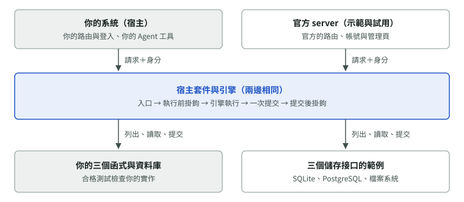
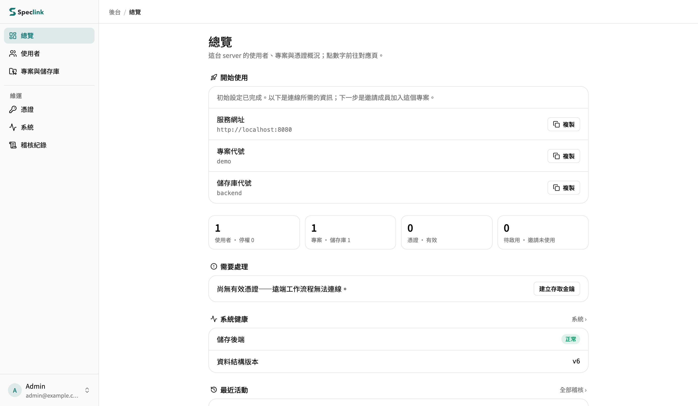
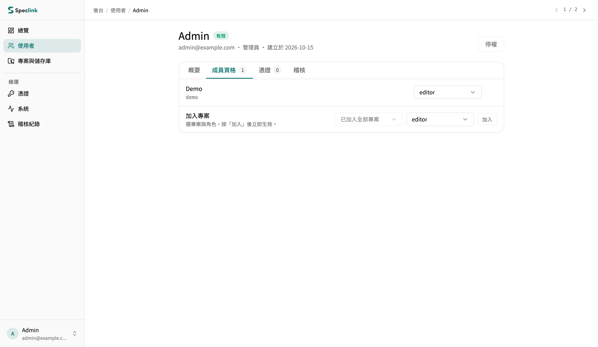

# Server 部署

**繁體中文** · [English](server-deployment.md)

官方 server 是示範與試用用的。它讓你不寫程式就能試遠端專案。正式使用請把引擎內嵌進自己的系統。見[把 Speclink 內嵌進你的系統](../README.zh-TW.md#embedding)。

這份文件說明怎麼把官方的 `speclink-server`（示範用 server）跑起來試用：選跑法、設定、HTTPS、管理指令，以及升級與回退。第一次試用請先照 [Remote 入門](remote-getting-started.zh-TW.md)走一次；那份文件帶你完成初始設定、成員資格與 Speclink Desktop、CLI 的連線。

## <a id="shared-host-kit"></a>官方 server 與你的系統共用宿主套件

`speclink-server` 和內嵌了引擎的宿主（也就是你自己的系統），是用同一套宿主套件與同一份儲存契約組成的。所以 CLI 與 Speclink Desktop 對兩者同樣可用。兩邊還有的差異列在專案能力狀態的[已知缺口](product-status.zh-TW.md#known-gaps)。



兩邊由上到下都是三層，只有中間一層相同：

| 層 | 你的系統（宿主） | 官方 server |
| --- | --- | --- |
| 最上層：各自不同 | 你的一條路由與你的登入 | 官方的路由、帳號與管理頁 |
| 中間一層：相同 | 宿主套件與引擎 | 宿主套件與引擎 |
| 最下層：各自不同 | 你實作的三個儲存函式與你的資料庫 | 三個儲存接口的範例（`sqlite`、`postgres`、`serverfs`） |

官方 server 把帳號、登入與管理頁都做好了，所以不寫程式就能試。你已經有自己的後端時，請走內嵌這條路：做法見 README 的[把 Speclink 內嵌進你的系統](../README.zh-TW.md#embedding)與 [Node SDK](sdk-node.zh-TW.md)。本文只講官方這一份怎麼跑起來。

## <a id="choose"></a>選一種跑法

| 跑法 | 適合 | 資料位置 |
| --- | --- | --- |
| [npx](#npx) | 有 Node.js 的單機試用 | `./speclink-data/` |
| [Docker](#docker) | 單一容器 | 容器內 `/data` |
| [Docker Compose（SQLite）](#compose) | 要長時間開著、讓幾個人一起試用時的預設選擇 | named volume |
| [Docker Compose（PostgreSQL）](#compose) | 已經有 PostgreSQL 維運的團隊 | PostgreSQL＋named volume |
| [從原始碼建置](#build-from-source) | 需要自己的 binary | 組態檔指定的位置 |

不論哪種跑法，都是同一支 binary。瀏覽器主控台（`apps/server-web`）在編譯時就內嵌進 `speclink-server`，和 API 由同一個網址提供。執行時不需要 Node.js、外部的 `dist` 資料夾、CDN，也不需要另一個靜態檔服務。

每種儲存後端都只支援**一個** server instance。不要 `--scale`，也不要讓兩個 server 指向同一份資料；SQLite 與 PostgreSQL 不會擋第二個 instance，詳見[儲存接口的範例](server-store-drivers.zh-TW.md)。

啟動後，每種跑法的行為都一樣：

- `GET /healthz` 回 `200` 代表程序活著；`GET /readyz` 回 `200` 代表儲存後端可用，不可用時回 `503`。
- 第一次啟動（還沒有管理員）時，stdout 印出一次性的 `/setup?token=…` 連結，24 小時內有效。完成設定後，設定就永久關閉。
- 組態有錯（檔案讀不到、格式不對、未知的儲存後端）時，server 不開埠，直接以非零 exit code 結束。

## <a id="npx"></a>npx

需要 Node.js 18 以上。支援 macOS（arm64、x64）、Linux（x64、arm64）與 Windows（x64）。

```bash
npx @speclink/server
```

不帶參數時，啟動器做三件事：

1. 依[環境變數](#configuration)產生 `speclink-data/config.yaml`。每次啟動都重新產生，手改的內容會被蓋掉。
2. 預設用 SQLite，資料放在 `./speclink-data/`。
3. 啟動 server，只聽 `127.0.0.1:<SPECLINK_PORT>`。

帶了參數時，啟動器把參數原封不動交給 server binary，例如 `npx @speclink/server invite --config ./speclink-data/config.yaml …`。想要固定的 `speclink-server` 指令，可以 `npm i -g @speclink/server`。

npx 預設只有本機連得到。要讓其他電腦連線，建議改用 Docker Compose，並在前面架 [HTTPS 反向代理](#https)。如果一定要用 npx，請自己維護一份組態檔，用 `npx @speclink/server --config <檔案> --addr 0.0.0.0:8080` 啟動；帶 `--config` 時，啟動器不會改寫你的組態檔。

## <a id="docker"></a>Docker

官方映像是 `ghcr.io/momochenisme/speclink-server`，支援 `linux/amd64` 與 `linux/arm64`。每次發版會推三個 tag：完整版號（例如 `0.8.0`）、`主.次` 版號（例如 `0.8`）與 `latest`。

```bash
docker run -d --name speclink \
  -p 8080:8080 \
  -v speclink-data:/data \
  ghcr.io/momochenisme/speclink-server:latest
docker logs speclink        # 取得一次性設定連結
```

映像內建一份組態：store 與 identity 兩個 SQLite 檔都放在 `/data`，`public_url` 是預設的 `http://localhost:8080`。server 以 uid 10001 的非 root 使用者執行，容器的健康檢查打 `/healthz`。

組態檔不展開環境變數。要改 `public_url` 或換儲存後端，就掛載自己的組態檔，蓋掉映像內的那一份：

```bash
docker run -d --name speclink \
  -p 8080:8080 \
  -v speclink-data:/data \
  -v ./server.yaml:/etc/speclink/config.yaml:ro \
  ghcr.io/momochenisme/speclink-server:latest
```

埠對映不是 `8080:8080`，或對外網址不是 `http://localhost:8080` 時，一定要改 `public_url`。否則設定連結的網址不對，瀏覽器送出的表單也會因為來源不符而被拒。

## <a id="compose"></a>Docker Compose

repo 的 `deploy/` 有兩份 compose 檔。兩份都用 named volume 保存 `/data`，並由環境變數產生組態。

SQLite（預設）：

```bash
cd deploy
docker compose pull          # 先拉官方映像
docker compose up -d
docker compose logs server   # 取得一次性設定連結
```

PostgreSQL（server＋postgres 兩個服務）：

```bash
cd deploy
cp .env.example .env         # 填入 SPECLINK_POSTGRES_PASSWORD；.env 不進版本控制
docker compose -f docker-compose.postgres.yml pull
docker compose -f docker-compose.postgres.yml up -d
```

PostgreSQL 版的 server 會等 postgres 健康後才啟動；帳號資料（identity）仍是 `/data` 底下的 SQLite 檔。儲存後端的限制見[儲存接口的範例](server-store-drivers.zh-TW.md)。

compose 檔同時寫了 `image:` 與 `build:`。沒有先 `pull` 而本機也沒有映像時，`up` 會從原始碼建置映像；這需要完整的 repo，Rust 編譯要幾分鐘。

容器重啟後，資料留在 volume 裡，設定連結不會再印。

## <a id="build-from-source"></a>從原始碼建置

從原始碼建置的順序是 `npm ci`、`npm run build -w apps/server-web`，再編譯 `speclink-server`。在 repo 的 checkout 裡執行：

```bash
npm ci
npm run build -w apps/server-web
cargo build --release -p speclink-server
```

產物是 `target/release/speclink-server`。第二步產出的 `apps/server-web/dist` 會在第三步內嵌進 binary。少了 `apps/server-web/dist/index.html`，release 建置會直接編譯失敗，不會產出只有 API、沒有主控台的 binary。Docker 映像用多階段建置走同一個順序，最終映像裡沒有 Node.js。

準備好組態檔後啟動：

```bash
./target/release/speclink-server --config /etc/speclink/server.yaml --addr 0.0.0.0:8080
```

binary 一定要帶 `--config`。`--addr` 預設是 `127.0.0.1:8080`，只有本機連得到；要對外服務，就明確指定綁定位址。用 systemd 等程序管理器時，設 `Restart=on-failure` 即可。

## <a id="configuration"></a>環境變數與組態檔

### 環境變數

| 變數 | 適用跑法 | 預設 | 說明 |
| --- | --- | --- | --- |
| `SPECLINK_STORE` | npx | `sqlite` | 儲存後端：`sqlite`、`serverfs` 或 `postgres`。 |
| `SPECLINK_DATA_DIR` | npx | `./speclink-data` | 資料目錄，組態檔、資料庫都放這裡。 |
| `SPECLINK_PORT` | npx、Compose | `8080` | npx：server 在 `127.0.0.1` 上聽的埠。Compose：主機對外的埠（容器內固定是 8080）。 |
| `SPECLINK_PUBLIC_URL` | npx、Compose | `http://localhost:<SPECLINK_PORT>` | 對外網址，也就是使用者瀏覽器網址列上的協定、主機與埠。設定連結、邀請連結與同源檢查都以它為準。要讓其他電腦連線時一定要設。 |
| `SPECLINK_POSTGRES_URL` | npx | 無（`postgres` 時必填） | PostgreSQL 連線 URL，建議不含密碼。 |
| `SPECLINK_POSTGRES_PASSWORD` | 所有跑法 | 無（Compose 的 PostgreSQL 版必填） | PostgreSQL 密碼。server 程式自己讀這個變數，補進不含密碼的連線 URL。 |
| `SPECLINK_CONFIG` | npx | 無 | 改用一份既有的組態檔。設了之後，上面 npx 專用的變數都不作用，也不帶 `--addr`，所以 server 聽 `127.0.0.1:8080`。這時 `invite` 這類子命令仍要自己帶 `--config`。 |

直接執行 binary 或 `docker run` 時，只有 `SPECLINK_POSTGRES_PASSWORD` 會被讀取；其他設定都寫在組態檔裡。

### 組態檔

server 只讀一份 YAML 組態檔：

| 欄位 | 必填 | 說明 |
| --- | --- | --- |
| `store` | 是 | 儲存後端（`driver` 加上 `path` 或 `url`），見[儲存接口的範例](server-store-drivers.zh-TW.md)。 |
| `identity` | 是 | 帳號資料庫：`driver: sqlite` 加上 `path`。 |
| `public_url` | 否 | 對外網址，預設 `http://localhost:8080`。 |
| `events` | 否 | 即時事件串流的調整值：`retention`（每個範圍保留的事件數，預設 1024）、`buffer`（每條連線的緩衝，預設 256）、`heartbeat_secs`（心跳間隔秒數，預設 15）。 |

範例：

```yaml
store:
  driver: sqlite
  path: /var/lib/speclink/store.db
identity:
  driver: sqlite
  path: /var/lib/speclink/identity.db
public_url: https://speclink.example.com
```

舊版組態裡的 `tokens` 或 `projects` 段已經廢除。留著它們，server 會拒絕啟動，並說明替代做法。

## <a id="https"></a>HTTPS 與反向代理

server 本身不處理 TLS。要讓其他電腦連線時，請在前面架一層反向代理，由它提供 HTTPS。

這是必要的：登入用的 cookie 一律帶 `Secure` 屬性，瀏覽器只在 HTTPS 或 `http://localhost` 下保存它。用 `http://` 加上非 localhost 的網址部署時，瀏覽器不會保存登入狀態，主控台與裝置登入的核准頁都登不進去。

反向代理要做到這幾件事：

- 提供 HTTPS，把請求轉給 server 的埠。
- 把 `public_url` 設成使用者實際開的 HTTPS 網址。協定、主機或埠不一致時，瀏覽器送出的寫入請求會被拒（`403`，`same_origin_required`）。
- 不要緩衝 `/api/speclink/v1/projects/<專案代號>/events`。這是長時間開著的事件串流（Server-Sent Events），server 每 15 秒送一次心跳；代理的閒置逾時要比這個長。

## <a id="manage"></a>管理指令

管理主控台能做的事，大多也有命令列版本，適合寫成腳本。每個子命令都要用 `--config` 指向 server 的組態檔：

| 指令 | 用途 |
| --- | --- |
| `invite --email <email> --display <名稱>` | 建立一次性邀請，印出接受網址。`--project <專案代號>` 可重複，對方接受後成為該專案的 `editor`；`--admin` 給管理員身分；`--expires-in-days` 預設 7 天。 |
| `user suspend --email <email>`／`user reactivate --email <email>` | 停權或復權。最後一位有效的管理員不能停權。 |
| `token revoke --token-id <id>` | 撤銷一把存取金鑰。id 以 `pat_` 開頭，不是金鑰明文；主控台只顯示前綴，所以一般在 `/admin/credentials` 撤銷比較方便。 |
| `project create --key <專案代號> [--name <名稱>]` | 建立專案。 |
| `repo create --project <專案代號> --key <儲存庫代號> [--name <名稱>]` | 在專案裡建立儲存庫。 |

沒有替既有帳號加成員資格的命令列指令；請用 `/admin/users`。

依跑法不同，指令的開頭也不同：

```bash
# npx（在資料目錄的上一層執行）
npx @speclink/server invite --config ./speclink-data/config.yaml \
  --email dev@example.com --display "Dev" --project demo

# Docker Compose（server 執行中）
docker compose exec server speclink-server invite \
  --config /etc/speclink/config.yaml \
  --email dev@example.com --display "Dev" --project demo
```

備份、驗證與還原的指令見 [Server 備份與還原](server-backup.zh-TW.md)。

## <a id="verify-deployment"></a>部署後檢查

部署好、完成 `/setup` 之後，用下面三項確認 server 真的能用。

第一，看主控台總覽。剛完成設定時，總覽最上面會出現一次「開始使用」區塊，列出服務網址、專案代號與儲存庫代號：



- 服務網址要和使用者實際開的網址一樣。不一樣就改 `public_url`。
- 「系統健康」顯示「正常」，資料結構版本有值。
- 「需要處理」寫著「尚無有效憑證——遠端工作流程無法連線」是正常的。有人用 Desktop 或 CLI 登入、或建立存取金鑰之後，它就會消失。

第二，看使用者頁，確認成員資格。能登入不等於看得到專案；管理員身分和專案成員資格是分開的。初始設定建立的管理員一開始沒有成員資格，使用者頁上那一列顯示「尚無專案」。加了成員資格之後，使用者詳情頁的「成員資格」分頁會列出每個專案與角色：



每位要用遠端的人，點進他的使用者詳情頁，「成員資格」分頁裡都要有目標專案。加成員資格的步驟見 [Remote 入門](remote-getting-started.zh-TW.md#grant-membership)。

第三，從另一台電腦打一次健康檢查：

```bash
curl -o /dev/null -w "%{http_code}\n" https://<你的網址>/healthz
```

回 `200` 才算通過。

## <a id="upgrade"></a>升級

升級通常就是換新版重啟。server 只跑一個 instance，所以沒有滾動更新。

只有一種情況不能直接換版本：現在跑的是 0.12.0 或更早的版本，要換到 0.12.0 之後的版本。這時請照[從 0.12.0 或更早的版本升級](#upgrade-from-0-12)的三個步驟做。

其他情況的步驟：

1. 先備份，並確認 `verify-backup` 通過。做法見 [Server 備份與還原](server-backup.zh-TW.md)。
2. 換成新版並重啟：
   - Docker Compose：`docker compose pull && docker compose up -d`。volume 不受影響。
   - npx：`npx @speclink/server@<新版號>`。
   - 自建 binary：換掉 binary 後重啟。
3. 確認 `/healthz` 與 `/readyz` 都回 `200`。

新版需要較新的帳號資料庫（identity）結構時，server 啟動時會自動升級它。組態或資料不相容時，server 直接以非零 exit code 結束，不會帶著錯誤啟動。

### <a id="upgrade-from-0-12"></a>從 0.12.0 或更早的版本升級

0.12.0 之後的版本，儲存後端改用新的資料表與檔案配置。新版讀不到 0.12.0 與更早版本建立的資料，也不會自動轉換。資料要用備份與還原搬過去，一共三個步驟。

下面的指令是直接執行 binary 的寫法。在 Docker 裡執行子命令的寫法見[在 Docker 裡備份與還原](server-backup.zh-TW.md#docker)。

**第一步：用舊版備份。** 先停 server，再用**舊版**執行：

```bash
speclink-server backup \
  --config /etc/speclink/server.yaml \
  --output /var/backups/speclink/before-upgrade.tar
```

**預期輸出**（數字依你的資料而定）：

```text
備份完成：1 個 scope、2 個成員 → /var/backups/speclink/before-upgrade.tar
```

接著用舊版檢查這份備份：

```bash
speclink-server verify-backup --input /var/backups/speclink/before-upgrade.tar
```

**預期輸出**：

```text
備份完整：格式版本 1、2 個成員、1 個 scope
```

舊版做的備份是格式第 1 版，新版讀得懂。備份一定要用舊版做：新版打不開舊資料，也就備份不了它。

**第二步：把組態指向空的儲存位置與空的帳號資料庫。** 修改組態檔的 `store` 與 `identity` 兩段，指到還沒有資料的位置。原本的檔案留在原位，不要刪也不要搬；先記下原本的兩個位置，回退時要指回去。

```yaml
store:
  driver: sqlite
  path: /var/lib/speclink/new/store.db      # 原本是 /var/lib/speclink/store.db
identity:
  driver: sqlite
  path: /var/lib/speclink/new/identity.db   # 原本是 /var/lib/speclink/identity.db
public_url: https://speclink.example.com
```

這一步沒有輸出。各種儲存後端的「空的位置」：

- `sqlite`：一個還不存在的檔案路徑。檔案所在的資料夾要先建好。
- `serverfs`：一個還不存在或空的資料夾。
- `postgres`：一個新的、空的資料庫。
- Docker Compose：SQLite 檔都在 named volume 的 `/data` 底下，所以空的位置就是一個新的、空的 volume。PostgreSQL 版另外要一個空的資料庫。
- npx：不帶參數啟動時，啟動器每次都依環境變數重寫組態檔。把 `SPECLINK_DATA_DIR` 設成新的資料夾，就是換到空的位置。`restore` 要用 `--config` 指定組態檔，所以請先自己寫一份指向新資料夾的組態檔；啟動器用的路徑是 `<資料夾>/store.db`（`serverfs` 是 `<資料夾>/store`）與 `<資料夾>/identity.db`。

「空」的完整定義見 Server 備份與還原的[兩條規則](server-backup.zh-TW.md#rules)。

**第三步：用新版還原，並確認驗證報告。** 換成**新版**，先不要啟動 server，執行：

```bash
speclink-server restore \
  --config /etc/speclink/server.yaml \
  --input /var/backups/speclink/before-upgrade.tar
```

**預期輸出**：

```text
還原完成且驗證通過：1 個 scope 全數比對一致
```

這一行就是驗證報告。`restore` 寫完資料後，會把每個專案／儲存庫重讀一次，和備份逐項比對。看到這一行、而且指令回 0，才啟動 server，並確認 `/healthz` 與 `/readyz` 都回 `200`。帳號資料已經一起還原，所以 server 不會印設定連結，原本的帳號與存取金鑰照常可用。

比對有任何一項不符時，指令回非零，並逐項列出差異，例如：

```text
還原後驗證發現不符，此目標不可投產：
  - scope demo/backend: 2 document(s), expected 3
```

這時不要啟動 server。照[回退](#rollback)回到舊版，舊資料還在原位。

### <a id="refused-start"></a>沒做這三個步驟就用新版啟動

把新版直接指向舊資料啟動時，server 會拒絕啟動，而且不改動資料：

- 它以非零 exit code 結束，不開埠，也不印設定連結。
- 儲存後端的資料與帳號資料庫都維持原樣。
- 它在 stderr 印出下面的訊息，內容就是上面的三個步驟。位置與組態檔路徑會換成你的：

```text
error: the store at /var/lib/speclink/store.db was created by speclink-server 0.12 or earlier.
This version uses a different layout and did not change your data.

To move the data to this version:
  1. With the old version, run:
       speclink-server backup --config /etc/speclink/server.yaml --output <file>
  2. Point the config at an empty store location and an empty identity database.
  3. With this version, run:
       speclink-server restore --config /etc/speclink/server.yaml --input <file>
```

儲存後端是 `postgres` 時，第一行的位置會寫成 `the configured PostgreSQL database`。

接下來要做的事：換回舊版。資料沒被動過，舊版可以照常啟動。然後從第一步開始，照三個步驟做。

新版的 `backup` 遇到舊資料時，印的是同一段訊息，也不會產生備份檔。把 `restore` 的目標指向舊資料，同樣會被拒絕。

## <a id="rollback"></a>回退

回退就是部署**上一版**的 binary 或映像：

- Docker Compose：把 compose 檔的 `image:` 改成上一版的 tag（例如 `ghcr.io/momochenisme/speclink-server:0.7.0`），再 `docker compose up -d`。volume 不受影響。
- npx：`npx @speclink/server@<上一版號>`。
- 自建 binary：checkout 上一版的 tag 重新建置，或改用上一版的映像。

到 0.12.0 為止，各版的資料格式都相同（帳號資料庫結構版本 6、儲存格式版本 1），在這些版本之間回退不需要動資料。主控台「系統」頁的「資料結構版本」顯示目前的帳號資料庫版本。

從 0.12.0 之後的版本退回 0.12.0 或更早的版本時，除了部署上一版，還要把組態指回原本的儲存位置與帳號資料庫：

1. 停掉新版的 server。
2. 部署上一版。
3. 把組態檔的 `store` 與 `identity` 兩段改回升級前的位置。
4. 啟動 server，確認 `/healthz` 與 `/readyz` 都回 `200`。

照三個步驟升級時，舊資料一直留在原位，沒有被改動，所以指回去就能用。升級之後才寫進新位置的資料不會出現在舊位置；舊版也讀不了新版做的備份（格式第 2 版），這些資料帶不回舊版。

之後如果有新版提高帳號資料庫的版本，升級時會自動改寫資料庫，而舊版 server 會拒絕開啟較新的資料庫。那時要回退，就得用升級前的備份，還原到空的目標。所以升級前一定要先備份。

## <a id="related"></a>相關文件

- [Remote 入門](remote-getting-started.zh-TW.md)：第一次設定、成員資格、Speclink Desktop 與 CLI 連線。
- [儲存接口的範例](server-store-drivers.zh-TW.md)：SQLite、serverfs、PostgreSQL 怎麼選。
- [Server 備份與還原](server-backup.zh-TW.md)：`backup`、`verify-backup`、`restore`、備份格式的版本與排程。
- [把 Speclink 內嵌進你的系統](../README.zh-TW.md#embedding)：正式使用的路徑。
