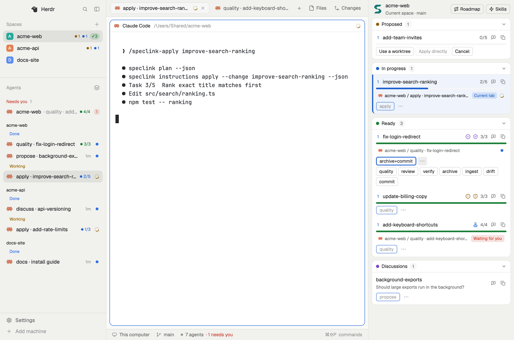
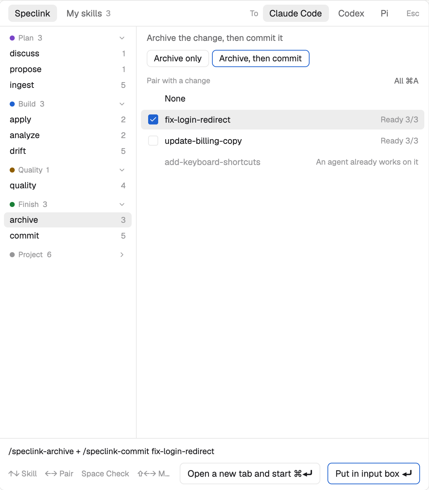

# speclink: a Herdr mod for Speclink

[繁體中文](README.md)

Open a panel in [Herdr](https://herdr.dev) that shows the changes and discussions of the current project. One click hands a skill to the correct agent, starts work on a change, or tells Speclink to open a detail page. You do not type a change name and you do not look for a window.



## How a change moves

The panel suggests the next step from the stage and the stamps. Most of the time, you click the one button on the row:

1. **Proposed**: click Start. The new agent opens in the current space. If the project uses the worktree flow, the panel first asks whether to use a worktree or apply directly.
2. **In progress**: the row shows the agent and the task progress. When only manual tasks are left, the suggestion changes to `worktree-merge` with a worktree, or to `quality` without one.
3. **Code tasks done, with a worktree**: click `worktree-merge` to merge into the main branch. Without a worktree, skip this step.
4. **Ready**: click `quality`. While it runs, the icons beside the name are blue. They turn purple when both stations are stamped.
5. **Both stations stamped**: click `archive+commit` to archive and commit.

To run another skill, click `⋯`.

## What the panel shows

The panel has two placements. Neither takes the keyboard. In both, the project follows the terminal that has focus, so a switch of space also switches the project.

- **Docked**: with the cloned `speclink` layout (see "Install"), the panel stays in the rightmost column of the window, beside the terminals. `⌘⇧S` opens or closes this column. Drag its edge to change the width. Each space remembers its own open or closed state, and a switch of space restores it. A space with no saved state starts open, so close it once in a project that does not use Speclink.
- **Popped up**: in other layouts, `⌘⇧S` opens or closes the panel as a floating window that you can drag.

What the panel contains:

- **Top**: the logo and the project name. The line below it says "Current space · <branch>". The Roadmap and Skills buttons are at the right.
- **Current tab**: when the agent in the current tab works on a change or discussion, that row has a blue bar on the left and a pale blue background, and its agent line says "Current tab". You cannot see this mark when the row is scrolled away or its card is closed. Scroll to the row or open the card.
- **Changes**: three permanent cards for proposed, in progress and ready. Each card title has a dot in the stage color and a count. Each row shows the wave, the name, the review and verify stamps, a worktree mark and the task progress. A blocked row is dimmed and names what it waits for.
- **Discussions**: a discussions card and a promoted card. A promoted discussion that still has unpromoted cuts stays on the discussions card, because its next step is propose.
- **The agent on this change or discussion**: the row shows the location and status of the agent. Click it to go there. The status looks the same as in the Agents list on the left: a turning arc for working, an empty ring for idle, a solid dot for done, and a pill when it waits for your answer. For a change, the panel matches the `speclink.change` label, then the worktree path, then the `speclink.focus` label that the Claude Code plugin reports. For a discussion, it matches only the `speclink.discussion` label. Start, the skill buttons, the Skills pop-up and the hook below set the labels. For what you type directly in an agent, the panel needs the hooks. An agent that wrote a proposal does not count for the change after it stops. When the proposal comes from a discussion, the agent stays on the row of that discussion, in the Discussions card or the Promoted card. Start the implementation separately.
- **Discussions not recorded yet**: discuss looks into the code and asks its questions before it records the discussion, and this can take tens of minutes. Until then, the top of the Discussions card shows a row "Discussing, not recorded yet" with the agent's title, location and status. When the record exists, the agent moves to the real row.
- **Skill buttons**: each row shows the suggested next step. See "Skills per stage" for how the panel selects it. `⋯` shows the other skills for this row. One click sends the skill, with the same rules as the suggested button. See "Where a skill goes". A row with no other skills has no `⋯`. A tooltip on the button tells where it goes.
- **Start**: a button on a change row that starts a new agent for this change only, in the current space. See "Start" below.
- **Skills**: the button at the top or `⌘⇧N` opens a pop-up where you select a skill and a change or discussion for it. Use it to open a new tab, use the input box, or check many changes. See "Skills pop-up" below.
- **Attach button**: the chat icon beside the name. It adds the name of the change or discussion to the input box in the current tab and does not send it. The button is gray when the current tab has no agent or the agent waits for your answer.
- **Open in Speclink**: click a change row or a discussion row to open its detail page. Click the wave number at the start of a row, or the Roadmap button at the top, to open the roadmap. Click the logo at the top left to go to the project of this space and show the board. If the project is not initialized or the space is on another machine, the logo only brings up the app.

Each card can collapse. More than 5 rows fold into "N more…". Each row has a copy button.

### The sidebar on the left

Only in the `speclink` layout.

- **Stage badge**: a project row in the Spaces list shows the number of changes in each stage, in the same order and colors as the panel cards: a dot and a number for proposed and in progress, and a green `✓2` for ready. A stage with 0 changes does not show. Move the pointer over the badge to see the stage names. It updates about every 30 seconds.
- **Agents list**: the list at the bottom left groups agents by space, in the same order as the Spaces list. Each space has its own Done, Working and Idle sections, and the title of a folded space shows the count for each status. An agent that waits for your answer goes in Needs you at the top, for any space. An agent with its own tab no longer shows a second time under the agent that started it. A row for an agent that works on a change ends with the stage color and the task progress. A tab with no name shows the change name. The match rules are the same as in the panel. The icon beside the title opens the sort menu, which can switch to Priority.

### Language

The interface follows the system language: Chinese on a Chinese system, and English on other systems. Restart Herdr after you change the system language.

This applies to the Speclink panel and the Skills pop-up, and to Herdr's own screens: the sidebar on the left, the tab bar, the status bar, the settings page, the Files and Changes panels, and the right-click and new tab menus.

Herdr's own screens do not need clones. All mods share one JS environment, so when the panel loads, each string on screen goes through the table in `i18n.js` first. A string that is not in the table stays in English. New text from a Herdr update starts in English and breaks nothing. File names in the tree and diff lines skip the table, so a folder named `Settings` keeps its name.

### When the space is not a Speclink project

If the current space is not a Speclink project, the panel shows a hint card with the project folder and an Initialize button. The Roadmap button is not there. The Skills button opens the pop-up on the My skills page, because your own skills work without Speclink.

The initialize button opens a new tab and runs `speclink init` in the project folder. The command asks, one question at a time, which agents to generate files for. It writes files only after your answers. To stop, close that tab. After the command completes, the panel shows the change list within 10 seconds.

Only a project that is not initialized shows this card. Other problems, such as a missing `speclink` or a broken config file, still show red text.

### Skills per stage

| State | Available skills (bold is the suggested next step, the one the row shows) |
| --- | --- |
| Proposed, not blocked | **apply**, analyze, ingest, drift, commit |
| Proposed, not blocked, code tasks left, `worktree` on, no worktree yet | the same, plus apply-with-worktree next to apply. When the row has the Start button, apply-with-worktree is under ⋯, because Start already offers a worktree |
| Proposed, blocked | apply is disabled, analyze, ingest, drift, commit |
| In progress | **apply**, ingest, drift, verify, quality, review, analyze, commit |
| In progress, only manual tasks left | the same, but the suggestion changes to **quality**, and there is no Start button |
| In progress, only manual tasks left, both stations stamped | the same, and the suggestion stays on **apply**, which handles the manual tasks. You do not need to run quality again |
| Ready | **quality**, review, verify, archive, archive+commit, ingest, drift, commit |
| Ready, both stations stamped and the stamps hold | the same, but the suggestion changes to **archive+commit** |
| Any stage, with a worktree | adds worktree-merge and removes archive and archive+commit (merge before you archive). When the code tasks are done, stamped or not, the suggestion is **worktree-merge**. Run quality after the merge |
| Discussion concluded again, change not updated | the suggestion changes to **ingest** |
| Open discussion | **discuss** |
| Concluded, or cuts left to promote | **propose --from-discussion**, discuss |

`archive+commit` sends the same command as the Claude Code mod: `/speclink-archive + /speclink-commit <change>`. Claude Code treats only the first slash command as a command. The rest becomes its arguments, so the model commits after the archive. In the Skills pop-up it is a method of `archive`. You can open only one at a time, because commits at the same time affect each other.

### Stamp icons

The change row shows the review and verify stamps next to the name, with the same icons as the board cards in the desktop app. The shape shows the station and the color shows the state. A station that has not started shows nothing.

| State | review | verify | Color |
| --- | --- | --- | --- |
| Stamped, and the stamp holds | badge with a check | shield with a check | purple |
| Stamped, changed since (run it again) | badge with an exclamation mark | shield with an exclamation mark | amber |
| Ticket open | stamp | shield | blue |
| An agent is running it | stamp | shield | blue, pulsing |

The panel decides in the same way as `speclink archive`. A station with an open ticket ignores its stamp. A stamp holds when the task count is the same, all code tasks are done, and the files in its scope have the same content. `quality` shows both stations as running, also before a ticket exists. A stamped station keeps its stamped look.

### Track what you type directly (optional)

The panel knows about work that starts from the panel or the Skills pop-up. For what you type directly in an agent, the panel needs hooks. Without them, that row shows no agent and still has the Start button.

**Claude Code:** add this to `~/.claude/settings.json`. New sessions then use it:

```json
"hooks": {
  "UserPromptSubmit": [{ "hooks": [{ "type": "command", "command": "node \"$HOME/.config/herdr-app/mods/speclink/label-skill.mjs\"", "timeout": 5 }] }],
  "PostToolUse": [{ "matcher": "Skill|Bash", "hooks": [{ "type": "command", "command": "node \"$HOME/.config/herdr-app/mods/speclink/label-skill.mjs\"", "timeout": 5, "async": true }] }],
  "SessionStart": [{ "matcher": "clear|resume", "hooks": [{ "type": "command", "command": "node \"$HOME/.config/herdr-app/mods/speclink/label-skill.mjs\"", "timeout": 5 }] }]
}
```

Each hook has one job:

- **`UserPromptSubmit`**: when a message starts with `/speclink-…`, it records the skill and the first argument (the slug after `--from-discussion` also counts).
- **`PostToolUse`**: when the model calls a skill, it records the skill and the arguments. When the agent runs a speclink command that changes a change or discussion, it records the name. So the panel also finds a command with no name, a request in plain words, a change that propose creates, and a slug that discuss creates. It also finds a command with a path (`~/.local/bin/speclink`) or in a variable (`S=…; $S discuss …`). Queries such as `show` and `status` do not count, because they can be only a mention. This hook runs in the background and does not slow the command. When a change comes from a discussion (`new change … --from-discussion`), the discussion label stays.
- **`SessionStart`**: `/clear` and `/resume` change the conversation, so it removes the old labels.

The hooks write no output and do not stop the message. Outside Herdr they do nothing. A conversation that `--resume` brings back shows up only after its next command.

**Codex:** add this to `~/.codex/hooks.json` and change the path to your absolute path. When Codex starts, it asks if you trust this hook. The hook works only after you trust it. It recognizes `$speclink-…` at the start of a message.

```json
{
  "hooks": {
    "UserPromptSubmit": [{ "hooks": [{ "type": "command", "command": "node /Users/you/.config/herdr-app/mods/speclink/label-skill.mjs", "timeout": 5 }] }]
  }
}
```

**Pi:** add this to `~/.pi/agent/settings.json` and change the path to your absolute path. It recognizes `/skill:speclink-…` at the start of a message and the speclink commands that Pi runs. A new or resumed conversation clears the old labels.

```json
{ "extensions": ["/Users/you/.config/herdr-app/mods/speclink/pi-labels.ts"] }
```

### Where a skill goes

The panel tries these in order and stops at the first match:

1. The agent that works on this change.
2. The agent in the current tab.
3. A new tab with the agent that you last selected in the Skills pop-up. If you never selected one, the most used installed agent.

Each step checks the folder of the agent. Skills for a change with a worktree run in the worktree. archive, worktree-merge and apply-with-worktree run in the main checkout. An agent in another folder does not match. When a change has a worktree with no agent in it, the apply button sends apply-with-worktree, which continues in the existing worktree. The button then shows apply-with-worktree.

The panel does not send to an agent that works, waits for your answer or shows an error. The button is disabled, and the tooltip on the button gives the reason. After a send, the window moves to that agent, and the skills that `⋯` opened close.

The buttons on the row always follow this order. If the change has a stopped agent and you want a new tab, use the Skills button at the top.

Claude Code, GitHub Copilot and Cursor get `/speclink-<skill>`. Codex gets `$speclink-<skill>`. Pi gets `/skill:speclink-<skill>`. Pi uses `.pi/skills` from `speclink init --tools pi`. Cursor uses `.cursor/skills` from `speclink init --tools cursor`. In a project with only the Codex `.agents/skills`, Pi can read those files too, but they use `$speclink-`, so select pi instead. Cursor also reads `.claude/skills` and `.agents/skills`. In a project with only Claude or Codex skills, the panel finds skills for Cursor and does not show the `--tools cursor` hint, but Cursor uses the Claude or Codex version (recorded as `--agent claude`, or written with `$speclink-`), so select cursor instead. The panel does not track labels for Cursor: Claude Code and Codex use a hook, Pi uses an extension, and Cursor has no such mechanism, so the panel only sends skills to it. Only Claude Code has analyze, so the button does not show for other agents. Other agents have no speclink skills, so the panel does not send to them.

### Start

Start is different from a skill button. A skill button first tries an existing agent. Start always makes a new agent. The new agent opens in a new tab in the current space, the tab name shows the change, and the view stays on the current tab.

| Situation | What Start does |
| --- | --- |
| `worktree` in the workflow config is on, and the change has no worktree yet | Asks first: "Use a worktree" (`/speclink-apply-with-worktree <change>`) or "Apply directly" (`/speclink-apply <change>`) |
| The change already has a worktree | Does not ask, and runs `/speclink-apply-with-worktree <change>` to continue |
| `worktree` is off | Does not ask, and runs `/speclink-apply <change>` |

The main folder runs one apply at a time. If an apply there is not finished, the apply-directly button does not work, and its tooltip names the change. The button works again when the tasks of that change are done or the change is archived, even if its tab is still open.

A change has the Start button only if it is not blocked, has unfinished tasks and has no agent on it. When a proposed change already has an agent (for example, the session that wrote the proposal), the row shows both `apply` and `apply-with-worktree`, so you can still choose. A change whose discussion was concluded again needs ingest first, so it has no Start button.

**Start the whole wave**: when `worktree` is on and the earliest wave has two or more changes that can start, a bar shows at the top of the panel and names those changes. One click starts all of them with no more questions, always with a worktree. The waves come from `speclink plan`.

### Skills pop-up



Press the Skills button at the top or `⌘⇧N` to open the pop-up. Press it again or press `Esc` to close. This works in all layouts, also when the panel column is closed.

The pop-up has two pages: **Speclink** and **My skills**. Click a page name or press `Tab` to switch. If you installed two or more agents, select the agent at the top right.

**Speclink page:**

- **Left**: skills in five groups: Plan, Build, Quality, Finish and Project. Each group lists only what you can do now. A skill with no change to pair is hidden, and a group with nothing to do is closed. The Project group is closed by default. Click a group name to open all of it or to close it. Select a skill with `↑` `↓` or the mouse. A closed group opens when you move into it. The number at the right is how many changes or discussions the skill can use now. The Project group works on the whole project and has no number.
- **Method**: different ways to do the same thing share one row. Select the method at the right, or press `⇧←` `⇧→`. `apply` has Main folder or worktree. `quality` has Both stations, Review only or Verify only. `archive` has Archive only or Archive, then commit.
- **Right**: the changes or discussions that this skill can use. The rules are the same as for skill buttons. Select one with `←` `→` or the mouse. You can also select None. The pop-up does not open with a change selected. Skills that do not use a change (discuss, propose and the project group) have an input box for a topic or a note.
- **Bottom**: the command that goes in, or the reason why it cannot be used now.

The bottom has two buttons, one for each result:

- **Put in input (Enter).** The command is pasted into the input box of the agent in the current tab and is not sent. You can type more and press Enter yourself. This also works when the agent is working. It does not work when the agent waits for your answer, because the paste can answer its dialog.
- **Start new tab (`⌘Enter`).** This works like the `herdr-dispatch` skill: `hc run` opens a new tab in the current space, the tab name is "skill · change", and the view stays on the current tab.

When the skill uses a change, each row has a checkbox, so you can open many tabs at once, one tab for each change. Click the box or press `Space` to check a row. Use `⌘A` or "All" to check all rows. A click on the row only selects it and does not check it.

- No check: both buttons use the selected row.
- One check: both buttons use the checked row.
- Two or more checks: the left button changes to "Start N tabs". "Put in input" does not work, because the input box takes one command at a time.

These rows have no checkbox and show the reason: an agent is busy on the change (an agent that finished and stopped does not count, so you can open a new tab for worktree-merge after apply), another change blocks it (apply), an apply in the main folder is not finished, or the project has no worktree flow (apply-with-worktree). If you check two applies that both need the main folder, the bottom line asks you to use apply-with-worktree. You can check only one row for `archive+commit`.

**My skills page:** the skills that you installed yourself. The selected row shows the full description. These skills do not pair with a change, so there is only a note, which goes after the command.

- **What it lists**: for Claude Code, the project `.claude/skills`, `~/.claude/skills` and the skills of enabled plugins. For Codex, the project `.agents/skills`, `~/.agents/skills` and `~/.codex/skills`. For Pi, the project `.pi/skills` and `.agents/skills`, `~/.pi/agent/skills` and `~/.agents/skills`. For Cursor, the project `.cursor/skills`, `.agents/skills`, `.claude/skills` and `.codex/skills`, and `~/.cursor/skills`, `~/.agents/skills`, `~/.claude/skills` and `~/.codex/skills`.
- **What it does not list**: `speclink-*` (on the other page), skills built into the agent, `~/.claude/skills/synced` from Anthropic, `~/.codex/skills/.system`, and skills with `user-invocable: false`.
- **Groups**: the name tells the use: Development, Design, Commit and release, Video, Animation, 3D, Content, Tools or Other. Each group has its own color. Each row shows its source at the right (Project, Personal or Plugin).
- **Families**: three or more skills in a group with the same start share one row, for example `gsap`. Click it to list them. A group with more than 12 rows is closed by default.
- **Search**: the search box matches names and descriptions. When it has text, all rows open. `→` moves to the note and `←` moves back.

**Which agent:** the pop-up starts with the agent in the current tab, then the agent you last selected, then the most used agent. The panel row buttons also use the agent you selected when they open a new tab. "Put in input" works only for the agent in the current tab. If you select another agent, this button does not work, because the command form and the skills do not match. If the project has no Speclink skills for this agent, the Speclink page shows the command to run. Only Claude Code can use analyze, so it shows dim for other agents.

### Open in Speclink

The panel uses `open` to send a `speclink://` URL. The desktop app goes to this project and then opens the page. If the app is not running, it starts. The URL can only open and show things. It writes no files.

The logo sends a `speclink://project` URL. The desktop app goes to the project of this space, closes an open detail page, and shows the card view of the board. It opens no detail page and no roadmap. A space in a worktree goes to the tab of the main project. If the project is not initialized or still loading, or if the space is on another machine, the logo sends no URL. It only brings up the app, and the tabs and the screen do not change.

## Requirements

- Herdr 0.1.13 or later (tested with this version). The lines that `dock-panel.mjs` edits follow the Herdr version, so the script stops on 0.1.12.
- The `speclink` CLI on PATH, with `unpromotedCuts` in `plan --json`. The panel reads the `--json` output of `speclink list`, `speclink plan`, `speclink discuss list`, `speclink workflow-config show` and `speclink instructions apply`. The CLI does not give the stamps, so the panel also reads `.meta.yaml` in the change folder.
- A project with `speclink init` done. If it is not done, the panel gives an initialize button.
- To open pages in Speclink, or to go to a project with the logo, a desktop app that knows `speclink://` URLs (a version after v0.11.0). Releases up to and including v0.11.0 do not have these URLs, so the logo only brings up the app. A version that you built yourself after 2026-11-03 may not know `speclink://project` yet. In that version the logo brings the app to the front, the project does not change, and the app shows "Can't open this speclink link". The message goes away after you update the app.
- To dock the panel or use the hooks, Node.js, which runs the script that clones the layout and the hooks.
- To check whether a stamp is stale and to read My skills, `perl`. macOS includes it.
- To use Codex, Pi or Cursor, `codex`, `pi` and `cursor-agent` on PATH, so Herdr can select them. The project needs the related skill files: `.agents/skills` for Codex (`speclink init --tools codex`), `.pi/skills` for Pi (`speclink init --tools pi`) and `.cursor/skills` for Cursor (`speclink init --tools cursor`). Pi needs a trusted project and a model login. If Codex is inside the ChatGPT app, add a link on PATH: `ln -s /Applications/ChatGPT.app/Contents/Resources/codex-cli/bin/codex ~/.local/bin/codex`. Install Pi with `npm i -g @earendil-works/pi-coding-agent`.

## Install

Work from the repo root, with Herdr open:

1. Copy the mod. Herdr loads it automatically.

   ```bash
   cp -R integrations/herdr/mods/speclink integrations/herdr/mods/speclink-new ~/.config/herdr-app/mods/
   ```

2. In `~/.config/herdr-app/keys.json`, add the first two lines to `global`. Then add the `layout:speclink` section ([keys.json](keys.json) has the same content). `⌘⇧N` opens the Skills pop-up. In the `speclink` layout, `⌘⇧S` opens or closes the right column. In other layouts, `⌘⇧S` pops up the floating window.

   ```json
   "cmd-shift-s": "mod.open:speclink",
   "cmd-shift-n": "mod.open:speclink-new"
   ```

   ```json
   "layout:speclink": { "cmd-shift-s": "layout.toggle:speclink" }
   ```

3. To dock the panel, run this line. It clones Herdr's `main` layout as the `speclink` layout, adds the panel as the rightmost column, replaces the left sidebar with clones connected to Speclink, and switches to it. To keep the pop-up only, skip this step.

   ```bash
   node scripts/herdr/dock-panel.mjs
   ```

4. To let the panel know the commands that you type in Claude Code, add the hooks. See "Track what you type directly".

Use `⌘⇧L` to switch layouts.

### Update the mod

The cloned sidebar mods hold copies of the panel files, so copy them too. Herdr reloads at once. The layout and the column widths do not change:

```bash
M=integrations/herdr/mods/speclink; H=~/.config/herdr-app/mods
cp -R $M integrations/herdr/mods/speclink-new $H/
cp $M/i18n.js $M/model.js $M/shared.js $H/speclink-agents/
cp $M/i18n.js $H/speclink-spaces/
```

If `integrations/herdr/spaces-badge/`, `integrations/herdr/agents-list/` or `scripts/herdr/dock-panel.mjs` changed, dock again. See the next section.

Do not install with a symbolic link. Herdr loads the code, but it does not draw the SVG icons behind a link, and a save does not reload the mod.

### Dock again after a Herdr update

A clone does not follow Herdr updates: new things in Herdr's `main` layout, Spaces list or Agents list do not appear in the `speclink` layout. `cloned_from.version` in `~/.config/herdr-app/layouts/speclink.json` is the Herdr version at the time of the clone. When it differs from `herdr-app --version`, dock again. Run the same line:

```bash
node scripts/herdr/dock-panel.mjs
```

The script does these steps:

1. It switches to `main`.
2. It renames the old clone to `layouts/speclink.json.old-<time>` and deletes the old `mods/speclink-spaces`, `mods/speclink-agents`, `mods/speclink-files`, `mods/speclink-changes` and `mods/speclink-tabs`.
3. It clones the new `spaces`, `agents`, `files`, `changes` and `tabs` and connects them. If Herdr changed the lines that the script edits in `spaces` or `agents`, the script stops before it changes anything. If it cannot edit `files`, `changes` or `tabs`, it warns, uses the built-in mod, and continues.
4. It clones the new `main`, adds the panel, and switches to the new `speclink` layout.

If you edited `keys.json`, a Herdr update does not add new shortcuts, so add them yourself. For example, for terminal search in 0.1.13, add `"cmd-f": "terminal.search"` to the `terminal` section.

After this, the panel column has its default width, and the other column widths and open or closed states are the same as in `main`. The state that each space remembers does not change. If you edited the old clone by hand, your edits are in the `.old` file, and you must move them yourself. You can delete the `.old` file when all is well.

### Remove

1. Press `⌘⇧L` to switch to `main`.
2. Delete `~/.config/herdr-app/layouts/speclink.json`, and `speclink`, `speclink-new`, `speclink-spaces`, `speclink-agents`, `speclink-files`, `speclink-changes` and `speclink-tabs` in `~/.config/herdr-app/mods/`.
3. Remove the additions from `keys.json`.

### Why a cloned layout

The conclusion of the `herdr-speclink-panel` discussion rejected a dedicated cloned `speclink` layout, because a clone does not follow Herdr updates. On 2026-11-04, after a look at the real screen, this decision was reversed and the cost of a clone was accepted: the floating window covers the terminal, and that is too far from the agreed right column.

The same conclusion rejected the Spaces sidebar badge, because it needs a clone of the spaces mod. The layout is a clone now and several projects run at once, so this was reversed on the same day. The built-in spaces mod has no extension point, so the script clones it, adds `integrations/herdr/spaces-badge/stage-badge.js`, and changes a few lines to connect it. One change moves the git arrows next to the badge, so they do not cover the name when the row is full.

The conclusion first said that Start opens a new space, on the assumption that it would indent under the project. A real test showed that it does not: the skill must check and commit documents in the main folder before it makes the worktree, and the terminal stays in the main folder. The result was only a second space with the same name. So on the same day Start changed to open in the current space, and to ask first about a worktree or a direct apply.

The Agents list works the same way. The built-in agents mod has no extension point, so the script clones it, adds `integrations/herdr/agents-list/speclink-rows.js` and the panel's `model.js` and `shared.js`, and changes about fifteen lines. The list and the panel then use the same rules to find the change that an agent works on.

The script also clones the Files and Changes panels and edits two or three lines, so file names and diff lines do not get translated. Herdr's other screens do not need clones. See "Language". The translations for all the clones are in the panel's `i18n.js`.

The script also clones the tab bar and removes one line. In Herdr's own tab bar, a scroll switches the tab, so one trackpad swipe switches several tabs and the window flashes. After the edit, a scroll only moves the tab bar. To switch tabs, click a tab or press `⌃Tab`, `⌘⇧]` or `⌘⇧[`.

Herdr's own `main` layout cannot dock a mod: `"place": "right"` in `mod.json` has no effect, and `layout.set` on `main` is refused.

## Known limits

- **A clone does not follow Herdr updates**: the `speclink` layout stays as `main` was at the time of the clone, and the Spaces and Agents lists stay as `spaces` and `agents` were. Dock again after a Herdr update. See "Dock again after a Herdr update".
- **The panel reads the stamps itself**: `list --json` leaves the stamps out on purpose, so the panel reads `.meta.yaml` in the change folder and uses `perl` to get the file fingerprints. A change with a worktree uses the copy in the worktree. On a machine with no `perl` or no `Digest::SHA`, the panel checks only the task count. `speclink archive` still decides, and it refuses a stale stamp.
- **A changed file in the scope takes up to 10 seconds to change the color**: the panel does not watch those files, so it waits for the timer.
- **"Promoted" is approximate**: it uses `status` from `discuss list` and the unpromoted cuts from `plan`.
- **What was tested with Codex and Pi**: status reports, paste into the input box, start and labels, with the real programs in an isolated Herdr window. Codex ran one turn and was stopped. Pi had no model login, so the test only shows that the command was sent. Neither finished a whole change. For Codex, only the `UserPromptSubmit` hook was tested. Cursor was not tested with the real program, only with the `model.js` tests.
- **Opening many tabs can hit a git lock**: the same as starting a whole wave. An agent that hits a lock stops and reports it.
- **The button and the folder have different names**: the button is "Skills" and the folder is still `speclink-new`, so `keys.json` does not change.
- **Pasting into the input box works only on macOS and takes about 0.7 seconds**: Herdr has no command that pastes without Enter, so the panel uses `script` to run a hidden `hc attach`, sends the paste, and leaves. It is one paste, not typing. It does not touch the clipboard or change the terminal size. The attach button shows a turning arc while it pastes and a check mark when it finishes. `script` works differently on other systems, so the paste fails with a notice. In this case, use the button that opens a new tab.
- **Row buttons do not check installed skills**: for example, in a project without Codex skill files, the button still sends `$speclink-…`. The Skills pop-up checks, and it shows how to install them.
- **My skills guesses the use from the name**: it matches `SKILL_USES` in `model.js`. A name with no match goes to Other. The description is the original text in `SKILL.md`, with no translation.
- **Plugins only for Claude Code**: skills in Codex plugins are not listed.
- **Opening pages works only on macOS**: the panel uses `open`. On other systems a notice says that the page cannot open. A project in a space on another machine cannot open, so its rows do nothing on click and there is no Roadmap button. The logo still works, but it only brings up the app on this computer and does not change the project.
- **The `SPECLINK_WORKTREE` environment variable is not read**: the panel reads only the workflow config. If the variable turns worktree off, Start still asks. If you choose a worktree, the skill stops and explains why.
- **A worktree does not show on the left by itself**: the agent's terminal stays in the main folder and only each command goes into the worktree, so Herdr shows no row for the worktree. To open a shell or run tests in the worktree, use Herdr's built-in Open worktree.
- **A folder that is new to Claude Code asks for trust first**: during that question the terminal is not yet an agent, so the panel does not see it, and the Start button comes back after 15 seconds. A trusted folder does not ask.
- **Starting a whole wave can hit a git lock**: each agent can commit specs or make a worktree in the main folder. An agent that hits a lock stops and reports it. Click its skill button again.
- **Some Herdr text is not translated**: the command palette, the worktree and add machine dialogs, and the What's new page stay in English. Herdr draws the update notice in the corner natively, so the mod cannot reach it.
- **The translation of Herdr's own screens uses undocumented behavior**: it assumes that all mods share one JS environment. If Herdr changes this, its screens go back to English and nothing breaks. In the `main` layout, the translation starts after you open the panel once.
- **A name that matches interface text gets translated**: for example, a tab or space named `Settings`. File names in the tree and diff lines are excluded.
- **Limits of the Agents list**: the sidebar is narrow, so a row with progress shows no time. A discuss or propose tab shows no progress, because it does not count as work on a change.
- **The badge needs a machine it can reach**: a machine that cannot be reached shows no badge. The narrow sidebar also shows no badge. If a row does not have enough space, the space name gets shorter, so the arrows and the badge stay visible.

## Development

```bash
node --test scripts/herdr/panel-model.test.mjs
herdr-app check ~/.config/herdr-app/mods/speclink
herdr-app check ~/.config/herdr-app/mods/speclink-new
```

`model.js` holds the pure logic: data merge, skill table, stamp states and delivery decisions. The tests run it directly. `i18n.js` holds the interface text. `shared.js` holds small helpers that the panel and the pop-up share and that use the Herdr API, including the code that reads the stamps. `label-skill.mjs` is the hook that tracks commands. `main.js` holds the panel view and the Herdr API calls. `my-skills.js` is the My skills page of the pop-up. `pi-labels.ts` is the Pi extension that tracks labels. `skill-picker.js` holds the Skills pop-up view. The rules for the input box and the new tab are in `model.js`. `column-sync.js` makes each space remember the state of the right column. It runs in the invisible floating block that `dock-panel.mjs` adds, because the panel does not redraw while its column is closed. `speclink-new` holds only settings: a mod can set only one overlay, and Herdr does not let a mod import code from another folder, so this folder opens the pop-up view of the `speclink` mod. `scripts/herdr/panel-model.test.mjs` also compares the skill table with `.claude/skills/speclink-*`, so it fails when speclink adds or removes a skill.
