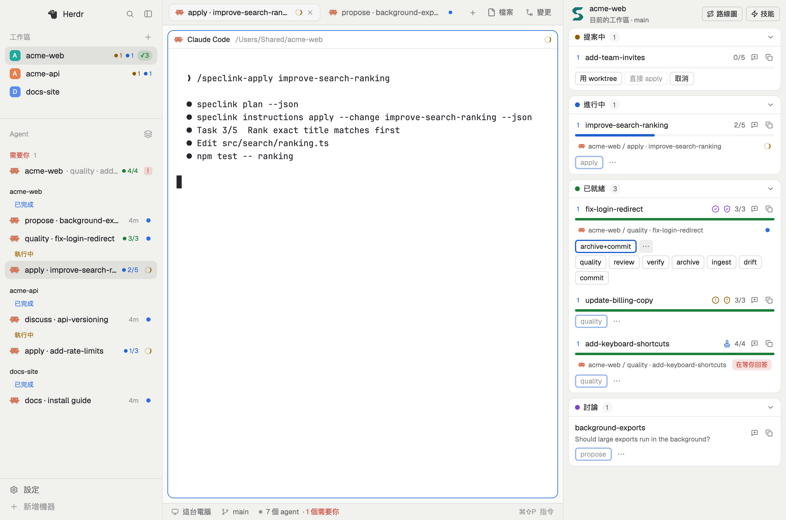
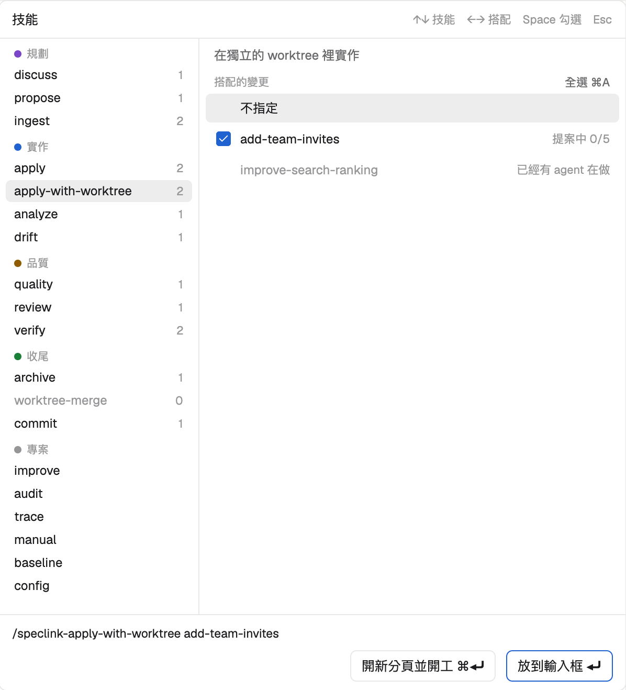

# speclink：Speclink 的 Herdr mod

[English](README.en.md)

在 [Herdr](https://herdr.dev) 裡開一個面板，看目前專案的變更與討論，按一下就把技能交給對的 agent、開工，或叫 Speclink 開詳情。全程不用手打變更名稱、不用找視窗。



## 面板有什麼

面板有兩種放法。兩種都不搶鍵盤，專案都跟著目前焦點所在的終端機走，切 space 就換專案。

- **停靠**：用複製出來的 `speclink` 版面（見「安裝」），面板常駐在視窗最右邊一欄，和終端機並排。`⌘⇧S` 開關這一欄，拖動邊界可以改寬度。每個 space 各自記住開或關，切 space 會還原，還沒記過的 space 預設打開，所以用不到 Speclink 的專案關一次就好。
- **彈出**：其他版面按 `⌘⇧S` 開關面板，面板是一個可以拖動的浮動視窗。

面板的內容：

- **頂端**：專案名稱，下面一行寫「目前的 space · 分支」。
- **變更**：提案中、進行中、已就緒三張卡常駐，標題有階段顏色的圓點和數量。每一列有波次、名稱、worktree 標記、任務進度。被擋住的列會變淡，並寫出在等誰。
- **討論**：討論卡與已轉出卡。已轉出但還有刀沒轉出的討論留在討論卡，因為下一步還要 propose。
- **做這個變更的 agent**：列上顯示 agent 的位置與狀態，點了切過去。狀態和左邊 Agents 清單相同：做事中是轉動的圓弧，閒置是空心圈，做完是實心點，等你回答是一顆膠囊。比對順序是 `speclink.change` 標籤、worktree 路徑、Claude Code 外掛回報的 `speclink.focus` 標籤。標籤由開工、面板的技能鈕、技能跳窗和下面的 hook 貼上。在 Claude Code 裡手打指令時，要裝 hook 面板才知道。
- **技能鈕**：每列只留建議的下一步。`⋯` 開技能跳窗，並先選好這個技能和這一列。滑鼠停在鈕上會寫出會送給誰。
- **附加鈕**：名稱旁邊的對話圖示，把變更或討論的名稱接到目前分頁的輸入框，不送出。目前分頁沒有 agent，或 agent 在等你回答時，這顆鈕會變灰。
- **階段徽章**：只在 `speclink` 版面。左邊 Spaces 清單的專案列會依階段寫出變更的數量，順序和顏色都和面板的卡片相同：提案中和進行中是圓點加數字，已就緒是綠色的 `✓2`。數量是 0 的階段不顯示。游標移上去會寫出階段名稱。約 30 秒更新一次。
- **Agents 清單**：只在 `speclink` 版面。左下的清單依 space 分組，順序和 Spaces 清單相同。每個 space 裡再分 已完成、執行中、閒置，收起 space 時標題右邊寫各狀態的數量。等你回答的 agent 不分 space，放在最上面的「需要你」。有自己分頁的 agent 不再重複接在開它的 agent 底下。在做變更的 agent，列尾有階段顏色和任務進度，沒取過名的分頁會寫變更名稱，比對規則和面板相同。時鐘圖示的選單還能切回依狀態排序。
- **語言**：介面跟隨系統語系，中文系統用中文，其他系統用英文。範圍是右邊的面板、技能跳窗和左邊的側欄。改系統語言後要重開 Herdr。
- **開工**：變更列上的鈕，在目前的工作區為這個變更開一個專用的新 agent。見下面的「開工」。
- **技能**：頂端的鈕或 `⌘⇧N` 開跳窗，選技能和搭配的變更或討論。見下面的「技能跳窗」。
- **叫 Speclink 開頁面**：點變更列或討論列開它的詳情頁，點列首的波次數字或頂端的「路線圖」開路線圖。點左上角的 Logo 切到這個 space 的專案並顯示看板；專案沒初始化或 space 在別台機器上時，只叫出 app。

每張卡可以收合，超過 5 列會摺疊成「還有 N 個…」，每一列都有複製鈕。

### 不是 Speclink 專案時

目前的 space 不是 Speclink 專案時，面板顯示一張提示卡，寫出專案資料夾和「初始化」鈕。沒有「路線圖」和「技能」，因為這些功能在這裡還用不了。

按「初始化」會開一個新分頁，在專案資料夾執行 `speclink init`。它會逐題問要產生哪些 agent 的檔案，答完才寫入。不想初始化就關掉那個分頁。初始化完成後，面板在 10 秒內換成變更清單。

只有「沒有初始化」會顯示這張卡。其他問題（例如找不到 `speclink`、設定檔壞掉）仍然顯示紅字。

### 各階段的技能

| 狀態 | 能用的技能（粗體是建議的下一步，也是列上顯示的那一顆） |
| --- | --- |
| 提案中，沒被擋 | **apply**、analyze、ingest |
| 提案中，被擋 | apply（灰掉，列上顯示這一顆）、analyze、ingest |
| 進行中 | **apply**、ingest、drift、verify、quality、review、commit |
| 進行中，只剩手動任務 | 同上，但建議改成 **quality**，也沒有開工鈕 |
| 已就緒 | **quality**、review、verify、archive、commit |
| 任何階段，有 worktree | 多一個 worktree-merge，少一個 archive（要先合併才能封存） |
| 討論重新定案，變更還沒更新 | 建議改成 **ingest** |
| 討論中 | **discuss** |
| 已定案，或還有刀沒轉出 | **propose --from-discussion**、discuss |

### 追蹤手打的指令（選用）

從面板和技能跳窗開始的工作，面板都知道。在 Claude Code 裡手打 `/speclink-apply <變更>` 時，面板要靠 hook 才知道，否則那一列看不到 agent，開工鈕也還在。

在 `~/.claude/settings.json` 加上這段，新開的 Claude Code session 就會生效：

```json
"hooks": {
  "UserPromptSubmit": [
    { "hooks": [{ "type": "command", "command": "node \"$HOME/.config/herdr-app/mods/speclink/label-skill.mjs\"", "timeout": 5 }] }
  ]
}
```

它只在訊息開頭是 `/speclink-…` 時貼標籤，不會輸出任何東西，也不會擋住訊息。變更名稱只認第一個參數。不在 Herdr 裡時什麼都不做。只支援 Claude Code。

### 技能會送給誰

依序找，找到就停：

1. 正在做這個變更的 agent。
2. 目前分頁的 agent。
3. 都沒有就開新分頁，跑最常用且已安裝的 agent。

每一步都會檢查 agent 所在的資料夾。有 worktree 的變更要在 worktree 裡跑技能；archive、worktree-merge、apply-with-worktree 要在主資料夾跑。agent 在別的資料夾就換下一步。有 worktree 但裡面沒有 agent 時，apply 鈕會改送 apply-with-worktree，接續原本的 worktree。

agent 在做事、在等你回答或出錯時不送，按鈕變灰，滑鼠停在按鈕上會寫出原因。送出後畫面切到那個 agent。

Claude Code 與 GitHub Copilot 送 `/speclink-<技能>`，Codex 送 `$speclink-<技能>`。analyze 只有 Claude Code 有，送給其他 agent 時不顯示。其他 agent 沒有 speclink 技能，不會當送達對象。

### 開工

開工和技能鈕不同：技能鈕優先交給現有的 agent，開工一定開新的 agent。新 agent 開在目前工作區的新分頁，分頁名稱會寫出變更，畫面留在原分頁。

| 情況 | 按下開工 |
| --- | --- |
| 工作流設定的 `worktree` 開啟，變更還沒有 worktree | 先問要「用 worktree」（`/speclink-apply-with-worktree <變更>`）還是「直接 apply」（`/speclink-apply <變更>`） |
| 變更已經有 worktree | 不問，跑 `/speclink-apply-with-worktree <變更>` 接續 |
| `worktree` 關閉 | 不問，跑 `/speclink-apply <變更>` |

主資料夾一次只能跑一個 apply。有 apply 還沒做完時，「直接 apply」不能按，游標移上去會寫是哪個變更。那個變更的任務做完或封存後就能按，分頁開著也沒關係。

沒被擋、任務還沒做完、也沒有 agent 在做的變更才有開工鈕。討論重新定案的變更要先 ingest，所以也沒有。

**整波開工**：`worktree` 開啟，而且最前面那一波有兩個以上能開工的變更時，面板頂端會多一列，寫出會開哪些變更。按一次就全部開工，不再多問，一律用 worktree。波次取自 `speclink plan`。

### 技能跳窗



按頂端的「技能」或 `⌘⇧N` 開跳窗，再按一次或按 `Esc` 關閉。所有版面都能用，面板那一欄收起來也一樣。

- **左邊**：所有技能，分成規劃、實作、品質、收尾、專案五組。用 `↑` `↓` 或滑鼠選。右邊的數字是現在有幾個變更或討論可以搭配，沒有變更可搭配的技能會變淡。「專案」組用在整個專案，不搭配東西，所以沒有數字。
- **右邊**：這個技能能搭配的變更或討論，規則和技能鈕相同。用 `←` `→` 或滑鼠選，也可以不指定。不搭配變更的技能（discuss、propose 和專案組）有輸入框，可以打主題或補充說明。
- **底部**：寫出會打進去的指令，或為什麼現在不能用。

底部有兩顆鈕，兩種結果都可以直接按：

- **放到輸入框（Enter）。** 把指令貼進目前分頁 agent 的輸入框，不送出。你可以接著打字，再自己按 Enter。agent 在做事也可以放；在等你回答時不放，因為貼上可能答掉對話框。
- **開新分頁並開工（`⌘Enter`）。** 做法和 `herdr-dispatch` 技能相同：用 `hc run` 在目前的 space 開新分頁，分頁名稱是「技能 · 變更」，畫面留在原分頁。

技能搭配變更時，每一列前面有勾選框，可以一次開多個分頁，一個變更一個分頁。點框或按 `Space` 勾選，`⌘A` 或「全選」勾全部。點那一列只是選它，不會勾。

- 沒有勾：兩顆鈕都用目前選的那一列。
- 勾一個：兩顆鈕都用勾的那一個。
- 勾兩個以上：左邊的鈕變成「開 N 個分頁並開工」。「放到輸入框」不能用，因為輸入框一次只放一個。

這些變更沒有勾選框，那一列會寫原因：已經有 agent、被別的變更擋住（apply）、主資料夾有 apply 還沒做完、專案沒開 worktree 流程（apply-with-worktree）。同時勾兩個都要在主資料夾跑的 apply 時，底部會請你改選 apply-with-worktree。

### 叫 Speclink 開頁面

面板用 `open` 送出 `speclink://` 網址，桌面 app 會切到這個專案再開頁面。app 沒開時會自動啟動。網址只能開啟與檢視，不會寫入任何檔案。

Logo 送 `speclink://project` 網址：桌面 app 切到這個 space 的專案，關掉開著的詳情頁，顯示看板的卡片檢視，不開詳情頁也不開路線圖。worktree 裡的 space 會切到主專案的分頁。專案沒初始化、還在載入，或 space 在別台機器上時，Logo 不帶網址，只叫出 app，分頁和畫面不變。

## 需求

- Herdr 0.1.12 以上（以這一版測試）。
- `speclink` CLI 在 PATH 上，版本要有 `plan --json` 的 `unpromotedCuts`。面板只讀 `speclink list`、`speclink plan`、`speclink discuss list`、`speclink workflow-config show` 的 `--json` 輸出。
- 專案執行過 `speclink init`。沒有的話，面板會給「初始化」鈕。
- 要叫 Speclink 開頁面，或按 Logo 切專案時，桌面 app 要認得 `speclink://` 網址（v0.11.0 之後的版本）。v0.11.0 和更舊的發佈版沒有這個網址，Logo 只叫出 app。2026-11-03 之後自行建置、但還不認得 `speclink://project` 的版本，按 Logo 時 app 會到前景，專案不切換，並跳出「無法開啟這個 speclink 網址」，更新 app 後就不會再出現。
- 要停靠時需要 Node.js，用來執行複製版面的腳本。

## 安裝

在 repo 根目錄操作，Herdr 要開著：

1. 複製 mod。Herdr 會自動載入。

   ```bash
   cp -R integrations/herdr/mods/speclink integrations/herdr/mods/speclink-new ~/.config/herdr-app/mods/
   ```

2. 在 `~/.config/herdr-app/keys.json` 的 `global` 加上前兩行，再加上 `layout:speclink` 這一段（內容和 [keys.json](keys.json) 相同）。`⌘⇧N` 開技能跳窗。在 `speclink` 版面，`⌘⇧S` 開關右邊那一欄；在其他版面，`⌘⇧S` 彈出浮動視窗。

   ```json
   "cmd-shift-s": "mod.open:speclink",
   "cmd-shift-n": "mod.open:speclink-new"
   ```

   ```json
   "layout:speclink": { "cmd-shift-s": "layout.toggle:speclink" }
   ```

3. 要停靠就執行這一行。它把 Herdr 的 `main` 版面複製成 `speclink` 版面，在最右邊加一欄面板，把左邊側欄換成接上 Speclink 的複製版，然後切過去。不想停靠就跳過這一步，用 `⌘⇧S` 彈出。

   ```bash
   node scripts/herdr/dock-panel.mjs
   ```

用 `⌘⇧L` 切換版面。更新 mod 時再執行一次 `cp`，Herdr 會立刻重新載入。

不要用符號連結安裝：Herdr 載入得到程式，但畫不出連結裡的 SVG 圖示，存檔也不會自動重新載入。

### Herdr 更新後重做停靠

複製版不會跟著 Herdr 更新：Herdr 的 `main` 版面、Spaces 清單或 Agents 清單有新東西時，`speclink` 版面不會有。`~/.config/herdr-app/layouts/speclink.json` 的 `cloned_from.version` 是複製時的 Herdr 版本，和 `herdr-app --version` 不同時就該重做。重做是再執行一次同一行：

```bash
node scripts/herdr/dock-panel.mjs
```

它會做這些事：

1. 切回 `main`。
2. 把舊的複製版改名成 `layouts/speclink.json.old-<時間>`，刪掉舊的 `mods/speclink-spaces`、`mods/speclink-agents` 和 `mods/speclink-chrome`。
3. 用新版的 `spaces`、`agents`、`workspace-chrome` 重新複製並接上。Herdr 改了要接的那幾行時，腳本會在動任何東西之前停下來。
4. 用新版的 `main` 重新複製，加上面板，切到新的 `speclink` 版面。

重做後，面板那一欄回到預設寬度，其他欄寬和開關狀態和 `main` 相同，每個 space 記住的開關不變。你手改過舊版的話，內容還在 `.old` 檔裡，要自己搬過來。確認沒問題後可以刪掉 `.old` 檔。

### 移除

1. 用 `⌘⇧L` 切回 `main`。
2. 刪掉 `~/.config/herdr-app/layouts/speclink.json`，以及 `~/.config/herdr-app/mods/` 底下的 `speclink`、`speclink-new`、`speclink-spaces`、`speclink-agents`、`speclink-chrome`。
3. 刪掉 `keys.json` 裡加的那幾行。

### 為什麼用複製的版面

討論 `herdr-speclink-panel` 的結論否決過「複製 speclink 專用版面」，理由是複製版不會跟著 Herdr 更新。2026-11-04 看過實際畫面後推翻這個否決，接受複製版的維護代價：浮動視窗蓋住終端機，和定案的右邊一欄差太多。

同一份結論也否決過「space 側欄徽章」，理由是要複製並維護 spaces mod。版面既然已經複製，又有多個專案同時進行，同一天也推翻這一條。內建的 spaces mod 沒有擴充點，所以腳本複製它、放進 `integrations/herdr/spaces-badge/stage-badge.js`，再改幾行接上去。其中一處把 git 的箭頭搬到徽章旁邊，放不下時才不會疊在名字上。

討論的結論本來是開工開一個新 space，預期它會縮排在專案底下。實測不會：技能要先在主資料夾檢查和提交文件，才建立 worktree，終端機也一直留在主資料夾，所以只會多一個同名的 space。同一天改成開在目前的工作區，並先問要用 worktree 還是直接 apply。

Agents 清單也是同樣的做法。內建的 agents mod 沒有擴充點，所以腳本複製它、放進 `integrations/herdr/agents-list/speclink-rows.js` 和面板的 `model.js`、`shared.js`，再改十幾行。這樣清單和面板用同一套規則判斷 agent 在做哪個變更。

側欄最下面的設定和新增機器在 `workspace-chrome` 裡，也複製一份，只為了翻譯。這些複製版的翻譯都在面板的 `i18n.js`。

Herdr 內建的 `main` 版面不能停靠：`mod.json` 寫 `"place": "right"` 沒有作用，對 `main` 跑 `layout.set` 也會被拒。

## 已知限制

- **複製版不會跟著 Herdr 更新**：`speclink` 版面停在複製當下的 `main`，Spaces 清單和 Agents 清單停在複製當下的 `spaces` 和 `agents`。Herdr 更新後要重做，方法見「Herdr 更新後重做停靠」。
- **不顯示 review、verify 的章**：CLI 的輸出沒有蓋章狀態。已就緒的變更蓋完章後，建議仍停在 quality，archive 要自己按。
- **「已轉出」是粗分**：看 `discuss list` 的 `status`，以及 `plan` 有沒有未轉出的刀。
- **Codex 只查證了寫法**：叫用寫法取自 speclink 的文件與技能輸出，還沒有實際送給 Codex 測過。
- **一次開多個分頁可能撞 git 鎖**：和整波開工相同，撞到時那個 agent 會停下來回報。
- **按鈕和資料夾的名稱不一樣**：按鈕叫「技能」，資料夾還是 `speclink-new`，這樣 `keys.json` 不用改。
- **貼進輸入框只有 macOS，要約 0.7 秒**：Herdr 沒有「只貼上不按 Enter」的指令，所以面板用 `script` 開一個看不見的 `hc attach`，送出貼上的資料後離開。它是一次貼上，不是打字，不碰剪貼簿，也不會改變終端機大小。附加鈕在貼上時顯示轉動的圓弧，貼完顯示勾勾。其他系統的 `script` 用法不同，會失敗並跳通知，這時請改用「開新分頁並開工」。
- **技能鈕不看專案裝了哪些技能**：例如專案沒有 Codex 的技能檔時，鈕還是會送 `$speclink-…`。
- **開頁面只有 macOS**：面板用 `open`，其他系統會跳通知說開不了。專案在別台機器的 space 不能開，所以那些列點了沒有反應，也沒有「路線圖」鈕。Logo 還是能按，但只叫出這台電腦的 app，不切專案。
- **不看 `SPECLINK_WORKTREE` 環境變數**：面板只讀工作流設定。環境變數把 worktree 關掉時，開工一樣會問。選「用 worktree」的話，技能會自己停下來並說明。
- **worktree 不會自動出現在左邊**：agent 的終端機留在主資料夾，只在每個指令切到 worktree，所以 Herdr 不會多一列 worktree。要在 worktree 開 shell 或跑測試時，用 Herdr 內建的 Open worktree。
- **第一次開的資料夾會先問信任**：Claude Code 問要不要信任資料夾時還不算 agent，面板看不到它，15 秒後開工鈕會再出現。信任過的資料夾不會問。
- **整波開工可能撞 git 鎖**：每個 agent 都可能在主資料夾 commit 規格或建 worktree。撞到時那個 agent 會停下來回報，再按一次技能鈕即可。
- **Herdr 本身的文字不會翻譯**：分頁列的 Files、Changes，底部的狀態列，右鍵選單和設定頁都維持原樣。
- **Agents 清單的限制**：側欄窄，所以有進度的列不顯示時間。discuss 和 propose 的分頁沒有進度，因為它們不算在做某個變更。
- **徽章只看本機和連得上的機器**：連不上的機器沒有徽章。折疊成窄欄時也不顯示。一列放不下時，space 名字會變短，箭頭和徽章不會被擠掉。
- **畫面只有繁體中文**。

## 開發

```bash
node --test scripts/herdr/panel-model.test.mjs
herdr-app check ~/.config/herdr-app/mods/speclink
herdr-app check ~/.config/herdr-app/mods/speclink-new
```

`model.js` 是純邏輯：資料合併、技能表、送達決策，測試直接跑它。`main.js` 是面板畫面與 Herdr API，`skill-picker.js` 是技能跳窗（選擇的畫面，放到輸入框和開新分頁的規則在 `model.js`），`column-sync.js` 讓右邊那一欄每個 space 各自記住開關。它放在 `dock-panel.mjs` 加的隱形浮動區塊裡，因為那一欄收起來後面板不會重畫。`speclink-new` 只有設定：一個 mod 只能設定一種 overlay，Herdr 也不讓 mod 引用別的資料夾的程式，所以用它開出 `speclink` mod 的跳窗畫面。`scripts/herdr/panel-model.test.mjs` 也拿技能表對照 `.claude/skills/speclink-*`：speclink 新增或移除技能時，這個測試會提醒你同步。
